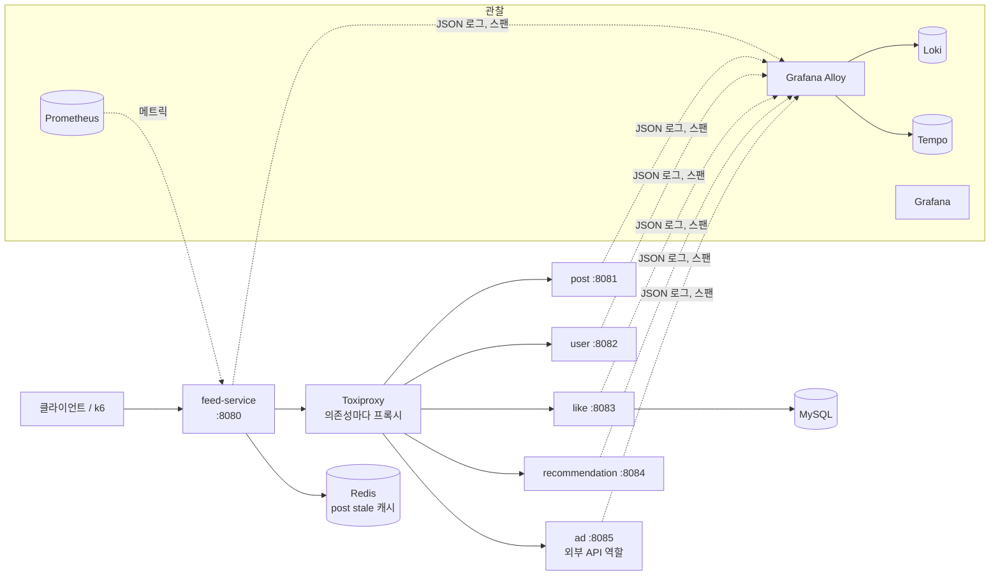
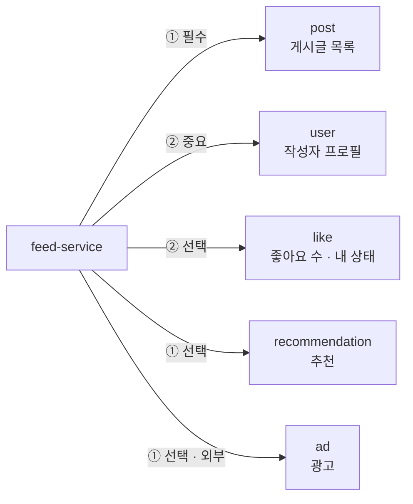
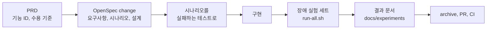

# weave

**하위 서비스 일부가 느려지거나 죽어도, 피드는 SLO 안에서 응답하고 실패한 부분만 빠진다.**

여러 하위 서비스에서 데이터를 모아 피드를 만들 때, 하위 서비스 하나의 장애가 피드 전체 장애로 번지지 않도록 격리하는 프로젝트다. 보호 장치 없는 피드를 먼저 만들고, 장애를 넣어 무너지는 모습을 숫자로 남긴 뒤, 하나씩 고치며 같은 장애로 다시 잰다. 설정값은 모두 측정이나 계산을 근거로 정했다.

### 결과 요약

같은 장애를 같은 부하(400 RPS, 측정 5분)로 넣었을 때 피드의 가용성과 p99다. SLO는 가용성 99.9%, p99 300ms다.

| 장애 | MVP (보호 장치 없음) | 고도화 3 (호출 격리) | 고도화 4 (등급별 대체) |
|---|---|---|---|
| S-02 추천 3초 지연 | 0.01% · 5,002ms | 0% · 201ms | **100% · 200ms** |
| S-03 추천 무응답 | 0% · 5,002ms | 0% · 201ms | **100% · 200ms** |
| S-04 작성자 프로필 다운 | 0% · 86ms | 0% · 119ms | **100% · 119ms** |
| S-05 좋아요 에러율 50% | 50.1% · 95ms | 6.4% · 84ms | **100% · 84ms** |
| S-06 게시글 다운 | 0% · 3ms | 0% · 2ms | **99.99% · 63ms** (stale 캐시) |
| S-08 추천 무응답 뒤 복구 | 51.3% · 5,002ms | 56.2% · 200ms | **100% · 200ms** |

- 추천 하나가 느려지면 MVP에서는 Tomcat 스레드 200개가 모두 묶여 피드 전체가 멈췄다. 호출 격리 뒤에는 최대 45개만 쓴다.
- 장애를 거둔 뒤 SLO를 다시 지키기까지 MVP는 40초 걸렸다. 호출 격리 뒤에는 10초다.
- 평시(S-01) degrade 비율은 고도화 4에서 0.52%, 고도화 5 세트에서 0%로 기준(1% 미만) 안이다.

고도화 5에서는 재시도를 붙이면서 그 재시도가 장애를 키우지 않게 묶었다. 같은 장애에서 가용성과 p99는 고도화 4를 그대로 지켰다.

| 장애 | 고치기 전 | 고도화 5 |
|---|---|---|
| S-09 프로필·좋아요 짧은 5xx: 재시도 수 (user) | 예산 없는 재시도 5,673번 | **재시도 예산으로 614번** |
| S-09 하위 요청 배율 최댓값 (user, 상한 1.2) | 1.224 | **1.02** |
| S-07 광고 요청 한도 초과: ad-service의 429 | 약 59,400건 (Retry-After 무시) | **30건**, 상한을 한도 아래로 두면 **0건** |

## 목차

1. [프로젝트 개요](#1-프로젝트-개요)
   - [1-1. 무엇을 만드나](#1-1-무엇을-만드나)
   - [1-2. 시스템 구성](#1-2-시스템-구성)
   - [1-3. 의존성 등급](#1-3-의존성-등급)
   - [1-4. 기술 스택](#1-4-기술-스택)
   - [1-5. 진행 방식](#1-5-진행-방식)
2. [단계별 기록: 보려던 것, 결정, 결과](#2-단계별-기록-보려던-것-결정-결과)
   - [2-1. MVP: 보호 장치 없는 피드](#2-1-mvp-보호-장치-없는-피드-f-006)
   - [2-2. 고도화 1: traceId 로그](#2-2-고도화-1-traceid-로그-f-004)
   - [2-3. 고도화 2: 장애 실험 세트와 기준선](#2-3-고도화-2-장애-실험-세트와-기준선-f-007)
   - [2-4. 고도화 3: 하위 서비스 호출 격리](#2-4-고도화-3-하위-서비스-호출-격리-f-001)
   - [2-5. 고도화 4: 등급별 Graceful Degradation](#2-5-고도화-4-등급별-graceful-degradation-f-002)
   - [2-6. 고도화 5: 재시도와 외부 API 정책](#2-6-고도화-5-재시도와-외부-api-정책-f-005)
   - [2-7. 고도화 6: 좋아요 상태 기반 API와 멱등성](#2-7-고도화-6-좋아요-상태-기반-api와-멱등성-f-003)
   - [2-8. 남은 것](#2-8-남은-것)
3. [개발 방식](#3-개발-방식)
4. [실행과 테스트](#4-실행과-테스트)

---

## 1. 프로젝트 개요

### 1-1. 무엇을 만드나

피드 하나는 최신 게시글 목록(작성자 프로필, 좋아요 수와 내 좋아요 상태 포함), 추천 섹션, 광고 영역으로 이뤄진다. feed-service가 하위 서비스 5개를 불러 이것을 모은다.

목표는 네 가지다.

| 목표 | 내용 | 상태 |
|---|---|---|
| 장애 격리 | 타임아웃·요청 시간 예산, Resilience4j 서킷 브레이커와 벌크헤드로 느리거나 죽은 하위 서비스를 가둔다 | 완료 (고도화 3) |
| 등급별 Graceful Degradation | 하위 서비스를 필수·중요·선택으로 나누고, 등급마다 실패했을 때의 응답을 다르게 한다 | 완료 (고도화 4) |
| traceId 로그 | traceId 하나로 6개 서비스의 로그와 트레이스를 시간순으로 본다 | 완료 (고도화 1, 3, 4, 5) |
| 좋아요 정합성 | 상태 기반 API와 멱등성으로 재시도·중복·순서 뒤바뀜에도 좋아요가 정확하다 | 완료 (고도화 6) |

### 1-2. 시스템 구성



- feed-service는 하위 서비스를 늘 Toxiproxy를 거쳐 부른다. 장애를 넣을 때 연결 구조가 바뀌지 않아야 결과를 비교할 수 있다.
- 서비스끼리는 HTTP로만 통신한다. 비즈니스 DTO를 공유하는 모듈은 두지 않는다.
- 서비스마다 인스턴스 하나다. 서킷 상태가 인스턴스마다 따로라는 점은 다루지 않는다.

| 모듈 | 포트 | 역할 |
|---|---|---|
| `feed-service` | 8080 | 피드 집계. 하위 서비스 호출, 격리, 대체가 여기에 있다 |
| `post-service` | 8081 | 게시글 |
| `user-service` | 8082 | 작성자 프로필 |
| `like-service` | 8083 | 좋아요 (MySQL) |
| `recommendation-service` | 8084 | 추천 |
| `ad-service` | 8085 | 광고. 통제할 수 없는 외부 API 역할 (429, Retry-After, 요청 한도) |
| `libs/observability` | | 모든 서비스에 자동 적용되는 JSON 로그·트레이싱 설정 |
| `libs/fault-injection` | | 하위 서비스 5개의 앱 수준 장애 주입(지연 분포, 에러율). `experiment` 프로필에서만 켠다 |
| `e2e` | | 서비스 6개를 띄우는 종단 간 테스트와 Compose 테스트 |
| `experiments` | | 장애 실험 세트 (k6 시나리오 S-01~S-09, `run.sh`, `run-all.sh`) |

### 1-3. 의존성 등급



①은 요청을 받자마자 병렬로 부르고, ②는 post 결과(게시글 ID, 작성자 ID)를 받은 뒤 병렬로 부른다.

| 의존성 | 등급 | 실패하면 |
|---|---|---|
| post | 필수 | Redis에 둔 마지막 정상 응답이 10분 안의 것이면 stale로 표시해 응답한다. 없거나 지났으면 503 |
| user | 중요 | 로컬 캐시(Caffeine)의 프로필로 채운다. 캐시에 없는 작성자는 `author.unknown: true` |
| like | 선택 | 좋아요 수를 빼고 내 상태를 `UNKNOWN`으로 내린다. 클라이언트가 버튼을 막아 사용자가 의도와 반대로 누르는 일을 막는다 |
| recommendation, ad | 선택 | 그 영역을 빼고 응답한다 |

응답에는 늘 `degradation`이 붙어, 클라이언트가 무엇이 빠졌고 무엇이 오래된 데이터인지 안다.

```json
"degradation": {
  "missing": ["like", "recommendation"],
  "stale": [{ "section": "post", "cachedAt": "2026-11-08T01:23:45Z" }]
}
```

### 1-4. 기술 스택

| 영역 | 사용 |
|---|---|
| 언어·프레임워크 | Kotlin 2.3, Spring Boot 4.1 (Spring MVC), JDK 25, Gradle 9 Kotlin DSL 멀티 모듈 |
| HTTP 클라이언트 | `RestClient` + Apache HttpClient 5, HTTP Interface(`@HttpExchange`) |
| 장애 대응 | Resilience4j 2.4 (서킷 브레이커, ThreadPool 벌크헤드, TimeLimiter, RateLimiter). 재시도 루프와 재시도 예산은 직접 구현 |
| 저장소·캐시 | MySQL 9 + JPA + Flyway, Redis (post stale 캐시), Caffeine (user 로컬 캐시) |
| 관찰 | logback + logstash-logback-encoder, Micrometer Tracing + OpenTelemetry, Grafana Alloy, Loki, Tempo, Prometheus, Grafana |
| 장애 실험 | Toxiproxy (네트워크 장애), 앱 수준 장애 주입, k6 |
| 테스트 | Kotest, MockK, WireMock, Testcontainers |
| 개발 흐름 | OpenSpec, Claude Code 훅, GitHub Actions |

### 1-5. 진행 방식

**문제 → 측정 → 해결 → 재측정.** 보호 장치 없는 MVP를 먼저 만들고, 장애를 넣어 무너지는 모습을 기준선으로 남긴 뒤, 단계마다 하나씩 고치고 같은 시나리오로 다시 잰다. 단계마다 `develop` → `main`으로 릴리스하고 태그를 붙인다.

| 단계 | 하는 일 | 기능 | 태그 |
|---|---|---|---|
| MVP | 보호 장치 없는 피드 집계, 토글 좋아요 | F-006 | `v0.1.0` |
| 고도화 1 | traceId 로그 수집 | F-004 | `v0.2.0` |
| 고도화 2 | 장애 주입, 장애 실험 세트, MVP 기준선 | F-007 | `v0.3.0` |
| 고도화 3 | 타임아웃·시간 예산, 서킷 브레이커, 벌크헤드 | F-001 | `v0.4.0` |
| 고도화 4 | 등급별 Graceful Degradation | F-002 | `v0.5.0` |
| 고도화 5 | 재시도 예산, 외부 API(ad)의 Retry-After와 쿼터 | F-005 | `v0.6.0` |
| 고도화 6 | 좋아요 상태 기반 API와 멱등성, 인기 글 몰림의 카운터 방식 비교 | F-003 | `v0.7.0` |

판정 기준(SLO)은 처음에 정해 두고 바꾸지 않았다.

| 지표 | 목표 | 정한 이유 |
|---|---|---|
| 피드 가용성 | 99.9% | 부분 응답(degraded)도 성공으로 센다. 선택 등급의 장애가 가용성 예산을 깎으면 등급을 나눈 의미가 약해진다 |
| 피드 p99 | 300ms | 평시 p99(약 100~150ms)에 타임아웃 여유를 더한 값. 타임아웃과 시간 예산의 근거가 된다 |
| 평시 degrade 비율 | 1% 미만 | 장애가 없는데 부분 응답이 나오면 설정 오류로 본다 |

---

## 2. 단계별 기록: 보려던 것, 결정, 결과

자세한 숫자와 근거는 [MVP 기준선](docs/experiments/baseline-mvp.md), [고도화 3 결과](docs/experiments/call-isolation.md), [고도화 4 결과](docs/experiments/graceful-degradation.md), [고도화 5 결과](docs/experiments/retry-policy.md), [아키텍처](docs/architecture.md)에 있다.

### 2-1. MVP: 보호 장치 없는 피드 (F-006)

**보려던 것.** 실무에서 흔히 보이는 "공유 스레드 풀 하나 + 라이브러리 기본 타임아웃" 구성이 장애에 어떻게 무너지는지. 고칠 대상을 먼저 정확히 알아야 고친 효과를 보일 수 있다.

**결정.**

- 하위 서비스 병렬 호출은 Boot 기본 `applicationTaskExecutor` 하나로 하고, 타임아웃·서킷 브레이커·재시도·fallback을 두지 않는다.
- 라이브러리 기본값을 추측하지 않고 테스트 컨텍스트에서 객체를 꺼내 읽어 기록했다. HttpClient 5는 연결·응답·커넥션 대기 타임아웃이 모두 **3분**이고, 공유 풀은 대기열이 사실상 무제한이다.
- HttpClient 5의 자동 재시도는 껐다. 기본값은 429·503에 POST(토글 좋아요)까지 다시 보내, "재시도 없음"이라는 MVP 조건과 맞지 않았다.

**결과.** 서비스 6개를 띄우면 피드 하나를 끝까지 받는다. 이 구성이 고도화 2의 기준선이 됐다.

### 2-2. 고도화 1: traceId 로그 (F-004)

**보려던 것.** 피드 오류 하나를 받았을 때, traceId 하나로 그 요청이 거친 6개 서비스의 로그를 시간순으로 볼 수 있는지. 다음 단계에서 "무엇이 왜 무너졌는지"를 보려면 이것이 먼저 있어야 했다.

**결정.**

- 모든 서비스가 JSON 로그(traceId, spanId, 서비스 이름)를 쓰고, W3C `traceparent`로 전파한다. 공통 설정은 `libs/observability` 하나에 둔다.
- 로그는 Alloy가 컨테이너 stdout을 읽어 Loki로, 스팬은 OTLP로 Tempo로 보낸다. 피드 응답 헤더 `X-Trace-Id`로 클라이언트 오류와 서버 로그를 잇는다.
- **전파를 붙이기 전에 끊기는 곳을 테스트로 먼저 재현했다.** 무엇을 고쳤는지가 테스트로 남게 하려는 것이다.

**결과.**

| 넘어가는 곳 | 전파 없이 | 고친 뒤 |
|---|---|---|
| 공유 스레드 풀 | 하위 호출 다섯 개의 traceId가 모두 `X-Trace-Id`와 달랐다 | 다섯 개 모두 같다. post 뒤 `thenCompose`로 시작한 user·like도 같다 |
| 벌크헤드 스레드 풀 (고도화 3) | 전파기만 붙였을 때 post 뒤 user·like가 여전히 끊겼다. 벌크헤드 스레드가 문맥을 닫은 뒤 future를 끝내서다 | 부른 스레드의 스냅샷을 펼친 채 future를 끝내 이었다 |
| `CompletableFuture` 기본 풀, 직접 만든 풀 | 끊긴다 | `ContextExecutorService.wrap`으로 감싸면 이어진다 |

Loki에서 `{service=~".+"} | traceId="<traceId>"` 한 줄로 6개 서비스의 로그가 나온다. 고도화 3·4에서 타임아웃, 서킷 전이, 벌크헤드 거절, 대체(`fallback_applied`) 로그에도 traceId와 의존성 이름, 원인을 붙였다.

### 2-3. 고도화 2: 장애 실험 세트와 기준선 (F-007)

**보려던 것.** 같은 장애를 몇 번이든 똑같이 재현해 숫자로 비교할 수 있는지, 그리고 MVP가 장애에 **어떻게** 무너지는지(지연 수치만이 아니라 어떤 자원이 묶이는지).

**결정.**

- 네트워크 장애(지연, 끊김, 무응답)는 Toxiproxy로, 앱 수준 장애(에러율, 지연 분포)와 ad의 429·요청 한도는 `libs/fault-injection`으로 넣는다. 하위 서비스 평시 지연은 중앙값 20ms, p99 50ms로 둔다.
- 시나리오 9개(S-01~S-09)를 k6 스크립트와 판정 기준으로 만들고, 명령 하나(`run.sh`)로 돌려 리포트를 남긴다. 단계마다 기대 결과(`expectations.json`)를 적어, `run-all.sh`가 0으로 끝나면 그 단계의 실험 세트가 통과한 것이다.
- 리포트에 Tomcat 스레드, 호출 스레드 풀, 커넥션 풀, CPU를 넣었다. 장애가 번지는 원인(스레드 고갈)은 지연만으로는 보이지 않는다.
- **실험 RPS는 400.** S-01을 100~400 RPS로 돌려 SLO를 지키고, 보내지 못한 요청이 0이고, CPU가 0.7 미만인 가장 높은 값을 골랐다. CPU가 먼저 차면 스레드가 묶이는 원인과 섞인다.
- **잡음 범위를 먼저 쟀다.** 같은 S-01을 네 번 돌린 p99가 90~95ms였다. 이후 비교에서 이 범위 안의 차이는 개선이나 악화로 보지 않는다.

**결과.** 9개 모두 기대대로 MVP는 S-01만 SLO를 지켰다. 무너지는 모습은 두 가지였다.

- **느린 선택 의존성 하나가 피드 전체를 멈춘다 (S-02, S-03).** 추천의 커넥션 풀 20개가 먼저 차고, 공유 풀 스레드 100개가 응답이나 커넥션을 기다리고, 다른 의존성 호출은 공유 풀 대기열에 쌓이고(최대 약 500), Tomcat 스레드 200개가 모두 묶였다. 다른 하위 서비스는 정상이었고 CPU는 0.17로 오히려 낮았다. 자원이 계산이 아니라 기다림에 묶여 있었다.
- **빨리 실패하는 장애는 자원을 묶지 않지만 피드를 실패시킨다 (S-04~S-07, S-09).** 가용성이 넣은 장애의 크기와 같았다. 중요·선택 등급의 실패도 필수인 post의 실패처럼 피드 전체를 실패시켰다.

측정 도구의 결함도 두 가지 찾아 고친 뒤 다시 쟀다.

| 문제 | 고친 것 |
|---|---|
| 시간 초과된 요청 약 11만 개의 k6 `http_req_duration`이 0으로 남아 S-02의 p50이 0ms로 나왔다 | 요청 앞뒤 경과 시간(`feed_latency`)으로 잰다 |
| Tomcat 스레드가 모두 묶이자 같은 커넥터의 `/actuator/prometheus`도 막혀 지표가 비었다 | Actuator를 관리 포트 8090으로 떼고, 리포트에 지표 수집 비율을 적는다 |

### 2-4. 고도화 3: 하위 서비스 호출 격리 (F-001)

**보려던 것.** 느리거나 죽은 의존성이 자기 몫의 자원만 쓰고, 다른 의존성과 Tomcat 스레드를 묶지 않는지. 그리고 장애를 거둔 뒤 얼마나 빨리 돌아오는지.

**결정.** 조회 호출을 `IsolatedCalls` 한 곳에서 의존성마다 서킷 브레이커 → 호출 시간 상한 → ThreadPool 벌크헤드로 감싸고, 피드 요청 하나에 시간 예산을 둔다. 값은 모두 기준선 측정과 계산으로 정했다.

| 값 | 정한 값 | 근거 |
|---|---|---|
| 호출 시간 상한 | post·user·like 100ms, recommendation·ad 200ms | 기준선 평시 호출 p99(51~54ms)의 약 2배. 평시에 100ms를 넘는 비율이 합 0.033%로 가용성 예산(0.1%)의 절반 아래 |
| 요청 시간 예산 | 250ms | p99 300ms에 여유 50ms. post 뒤의 user·like는 남은 예산만큼만 기다린다 |
| 벌크헤드 | 의존성마다 스레드 40, 대기열 0 | 리틀의 법칙: 400 RPS × 51ms ≈ 20.4, 여유 2배. 넘치면 기다리지 않고 바로 거절한다 |
| 커넥션 풀 | 벌크헤드와 같은 40 | 기다림이 벌크헤드 한 곳에서만 생기게 한다 |
| 서킷 실패율 문턱 | 50% | 기준선 S-01의 호출 실패율이 0 |
| 서킷 열림 유지 | 5초, 반열림 시험 10개 | 복구 시간 목표 20초에서 거꾸로 정했다 |
| 서킷 판단 창 | 최근 10초, 최소 100호출 | 처음에는 최근 호출 100개였는데, 1초 GC 멈춤만으로 창이 차서 서킷이 열렸다(아래) |

실패 분류도 정했다. 타임아웃·연결 실패·5xx만 서킷 실패로 세고, 4xx는 세지 않는다. 벌크헤드 거절은 부르지도 않은 호출이라 성공으로도 세지 않는다. 성공으로 세면 절반이 거절되는 장애에서 실패율이 묽어진다.

**결과.**

| 시나리오 | p99 기준선 → 고도화 3 | Tomcat 사용 중 최댓값 |
|---|---|---|
| S-02 추천 3초 지연 | 5,002ms → 201ms | 200 → 45 |
| S-03 추천 무응답 | 5,002ms → 201ms | 200 → 47 |
| S-08 추천 무응답 뒤 복구 | 5,002ms → 200ms | 200 → 45 |

- S-02에서 post·user·like·ad 호출 p99는 50.5~51.9ms로 평시와 같았다. 묶이는 것은 recommendation의 벌크헤드 40개뿐이다.
- 장애를 거둔 뒤 **10초** 만에 SLO를 되찾았다(기준선 40초, 목표 20초).
- 가용성은 아직 0이었다. 실패한 의존성이 여전히 피드를 실패시키고, 그것은 고도화 4의 몫으로 기대 결과에 적어 두었다.

**시간 상한이 생기자 드러난 문제 두 가지.** 짧은 멈춤이 곧 실패가 되면서 MVP에서는 보이지 않던 것들이다.

| 문제 | 증거 | 고친 것 |
|---|---|---|
| **콜드 스타트 고리.** 막 띄운 like-service가 느려 서킷이 열리고, 열린 동안 트래픽이 가지 않아 데워지지 못한 채 약 100초 동안 열림·닫힘을 되풀이했다 | S-01 가용성 0.892 | `run-all.sh`가 첫 시나리오 전에 하위 서비스를 데우는 준비 실행을 한다. 뒤의 S-01 가용성 0.9995 |
| **Serial GC 멈춤을 서킷이 키웠다.** 컨테이너 자원 상한 때문에 JVM이 Serial GC를 골라 1.05초 Full GC가 생겼고, 판단 창(호출 100개 = 0.25초)이 그 1초로 차서 서킷이 5초 열렸다 | S-01 가용성 0.982 | JVM을 G1로 고정하고(최대 멈춤 80ms), 판단 창을 최근 10초로 바꿨다. 1초 멈춤은 이제 창의 약 10%다 |

**가상 스레드와 비교했다.** S-02를 "플랫폼 스레드 + ThreadPool 벌크헤드"와 "가상 스레드 + Semaphore 벌크헤드"로 같은 조건에서 돌렸다.

| 항목 | 플랫폼 + ThreadPool (기본) | 가상 + Semaphore |
|---|---|---|
| 피드 p99 | 201ms | 201ms |
| 다른 의존성 호출 p99 | 50.8~52.3ms | 50.6~52.8ms |
| 플랫폼 스레드 수 | 436 | 32 |
| CPU 평균 | 0.28 | 0.33 |

격리 효과가 같고, 400 RPS에서 기본 구성은 스레드에 묶이지 않아(Tomcat 사용 중 최대 42/200) **기본 구성을 유지했다.** 동시 요청이 Tomcat 최대 스레드에 닿는 부하라면 다시 비교할 만하다.

### 2-5. 고도화 4: 등급별 Graceful Degradation (F-002)

**보려던 것.** 의존성이 실패해도 그 영역만 빠지고 피드는 200으로 응답하는지, 클라이언트가 정상 응답과 부분 응답을 구분할 수 있는지, 그리고 대체가 응답을 늦추지 않는지.

**결정.**

- **대체는 `FeedAssembler` 한 곳에서 한다.** Gateway나 Resilience4j fallback에 흩지 않고, 의존성마다 결과를 값(`Result`)으로 받아 순수 함수 `FeedDegradation.compose`로 응답을 만든다. 응답의 `degradation`, 대체 로그, 지표가 같은 영역 결과에서 나와 서로 어긋나지 않는다.
- **post 캐시는 Redis, user 캐시는 Caffeine.** post는 필수라 재시작에도 남아야 하고, 프로필은 잘 바뀌지 않아 인스턴스 메모리로 충분하다. user 캐시는 실패했을 때만 읽어, 정상일 때는 늘 최신 프로필을 보인다.
- **Redis 장애가 피드를 막지 않게 했다.** 캐시 쓰기는 응답 경로 밖의 스레드 하나로 넘기고 기다리지 않는다. 끊긴 동안의 명령은 쌓지 않고 바로 실패하게 하고(`REJECT_COMMANDS`), Redis 헬스가 feed-service 헬스를 내리지 않게 했다.

| 값 | 정한 값 | 근거 |
|---|---|---|
| post stale 허용 | 10분 | 짧은 장애(배포 실패, 재시작)는 가리고, 오래된 피드가 길게 남지 않게 한다 |
| Redis 읽기 상한 | 30ms | 예산 250ms = post 100 + 읽기 + user·like 100 + 집계 20 → 읽기 30ms 이하. S-06에서 GET의 99.9%가 1.05ms 이하였다 |
| post 캐시 쓰기 간격 | 1초 | 400 RPS로 매번 쓰면 같은 값을 초당 400번 덮어쓴다. 1초는 허용 시간 10분의 0.17%다 |
| user 캐시 | 1시간, 최대 1만 명 | 잰 항목 크기 약 330B × 1만 ≈ 3.2MB, 힙의 1.3% |

**결과.** 9개 시나리오 모두 가용성 99.9%와 p99 300ms를 지켰다.

| 시나리오 | 가용성 고도화 3 → 고도화 4 | 그 의존성의 degrade 비율 |
|---|---|---|
| S-02, S-03 추천 지연·무응답 | 0 → 1 | recommendation 1 |
| S-04 작성자 프로필 다운 | 0 → 1 | user 0 (모두 로컬 캐시로 채움) |
| S-05 좋아요 에러율 50% | 0.064 → 1 | like 0.93 |
| S-06 게시글 다운 | 0 → 0.99986 | post 1 (stale) |
| S-07 광고 요청 한도 초과 | 0.50 → 1 | ad 0.50 |
| S-09 프로필·좋아요 짧은 5xx | 0.81 → 1 | like 0.15 |

- **대체는 응답을 늦추지 않았다.** p99는 고도화 3과 같다. S-06은 오히려 63ms로 평시보다 짧다. 서킷이 열린 post를 부르지 않고 1ms 안쪽의 Redis 읽기로 바꿨기 때문이다.
- **고도화 3에서는 서킷이 피드를 더 나쁘게 만들던 곳이 이제 득이 된다.** S-05에서 like 서킷이 열린 동안 피드가 모두 실패해 가용성이 기준선(0.50)보다 낮은 0.064였는데, 같은 서킷 동작이 이제 사용자에게 `UNKNOWN`으로만 보인다.
- **한계:** 실험 데이터가 고정이라(작성자 50명) user 캐시 적중률이 100%였다. 실제로 캐시에 없는 작성자가 얼마나 될지는 이 실험으로 알 수 없다.

### 2-6. 고도화 5: 재시도와 외부 API 정책 (F-005)

**보려던 것.** 순간 실패는 재시도로 넘기되, 재시도가 장애 중에 하위 서비스 요청을 불리지 않는지. 고칠 수 없고 한도가 있는 외부 API(ad)의 한도를 날리지 않는지.

**결정.**

- **재시도는 멱등한 조회만, 재시도할 실패만, 남은 시간 안에서만 한다.** 5xx·연결 실패·입출력 실패만 다시 부르고 시간 초과·4xx·서킷 거절은 부르지 않는다. 남은 요청 시간이 `시도 상한 + 기다림`보다 짧으면 보내지 않는다. Resilience4j `Retry`로는 시도마다 이것을 볼 수 없어 루프를 직접 썼다(`RetryLoop`). 기다리는 동안 스레드도 벌크헤드 자리도 잡지 않는다.
- **재시도 예산으로 비율을 묶는다.** 의존성마다 최근 창의 원래 호출 수에 비율을 곱한 만큼만 다시 부른다.
- **ad는 다시 부르지 않고, 429의 Retry-After 동안 부르지 않으며, 계약 쿼터 전에 스스로 멈춘다.** 대기는 서킷 바깥에 둔다. 서킷을 강제로 열면 429가 장애처럼 보이고 저절로 돌아오지 않는다.

| 값 | 정한 값 | 근거 |
|---|---|---|
| 최대 시도, 기다림 | 3번, 10ms·20ms(±50%) | Google SRE 책의 "요청 하나에 최대 3번". 빠른 실패 두 번을 겪어도 세 번째 시도의 상한까지 약 190ms로 예산 250ms 안 |
| 재시도 예산 | 최근 1초 원래 호출의 10% (창마다 최소 1번) | 비율은 Google SRE 책. 창은 처음 10초였다가 측정 뒤 줄였다(아래) |
| 요청 배율 상한 (판정) | 20초 구간 최댓값 1.2 | 계산한 S-09 배율이 예산 있으면 약 1.03, 없으면 약 1.33이라 둘을 가른다 |
| ad 요청 수 상한 | 100ms마다 54건 | 계약 쿼터 초당 600건(가정). 상한 주기가 제공자의 1초 창과 맞지 않아 어느 1초에도 11주기가 걸친다. 54 × 11 = 594 |
| Retry-After | 기본 1초, 최대 60초 | 머리글이 없으면 쿼터 창 하나만 쉰다. 60초를 넘으면 일일 한도나 제공자 장애로 보고 1분마다 확인한다 |

**결과.** 9개 시나리오 모두 가용성, p99, 요청 배율 상한을 지켰다.

| 구성 (S-09) | 요청 배율 최댓값 user | 재시도 user | 503 |
|---|---|---|---|
| 예산 없음 | 1.224 (상한 초과) | 5,673 | 44 |
| 예산 10%, 창 10초 (처음 값) | 1.059~1.064 | 1,199~1,229 | 18~313 |
| **예산 10%, 창 1초** | **1.02** | **614** | **2** |

| 구성 (S-07) | ad-service의 429 | ad degrade |
|---|---|---|
| 고도화 4 (Retry-After를 보지 않음) | 약 59,400 | 0.50 |
| **Retry-After 대기 + 상한 54** | **30** | 0.50 |
| 상한을 한도 아래로 (18) | **0** | 0.55 |

**측정이 설정을 바꿨다.** 처음에는 예산 창을 서킷 판단 창과 같은 10초로 뒀는데, S-09 첫 실행에서 가용성 0.9974로 SLO를 지키지 못했다. 장애가 시작되자 재시도가 몰린 직후 feed-service가 약 0.7초 멈춰 모든 의존성의 벌크헤드가 찼다. 평시 10초 동안 쌓인 예산이 한 번에 쓰일 수 있는 구조여서 창을 1초로 줄였고, 503은 2건이 됐다.

**한계도 그대로 적는다.**

- 멈춤 자체는 줄었지만 없어지지 않았다(최종 세트 0.3초). 예산 없는 실행의 첫 장애에서는 503이 없어, 재시도 양 하나로 설명되지 않는다. GC나 BLOCKED 스레드는 아니었고 5초 수집 간격으로는 원인을 가르지 못했다.
- 재시도가 살리는 응답은 이 실험 세트에서 작다(S-09 like degrade 0.148 → 0.145). 몇 초 이상 이어지는 장애는 서킷이 금방 열리기 때문이다. 순간 실패를 넘기는 이득은 통합 테스트로 확인했고, 실험 세트가 보이는 것은 늘어나는 요청을 묶었다는 것이다.
- 실험 세트 중 like-service가 512MB에서 OOMKilled로 죽어 컨테이너 상한을 768MB로 올렸다. 힙(128MB)과 GC는 그대로 뒀고, 네이티브 메모리가 왜 약 460MB까지 오르는지는 못 가렸다.

### 2-7. 고도화 6: 좋아요 상태 기반 API와 멱등성 (F-003)

**보려던 것.** 토글 좋아요가 재전송과 동시 요청에서 어떻게 깨지는지. 멱등성과 순서 판단으로 사용자의 마지막 의도가 남는지. 인기 글에 좋아요가 몰릴 때 카운터를 어떻게 고쳐야 하는지.

**결정.**

- **토글을 없애고 원하는 상태를 보낸다.** `PUT /likes/{postId}`에 `{"liked": 불리언, "version": 양의 정수}`를 보낸다. `version`은 클라이언트가 의도를 만들 때 정하고 재전송에도 그대로 쓴다. 저장 값 이하면 바꾸지 않고 지금 상태를 돌려준다.
- **취소해도 행을 남긴다.** 지우면 취소 뒤 늦게 온 좋아요의 순서를 판단할 근거가 사라진다. 판단 전에 그 행을 잠그고, 잠금 순서는 좋아요 행 → 카운터 행이다.
- **feed-service는 쓰기를 다시 부르지 않는다.** 멱등해져 안전하지만 재시도 층이 둘이면 장애 중 요청이 곱으로 늘어난다. 재전송은 클라이언트 한 층에서 한다.

| 값 | 정한 값 | 근거 |
|---|---|---|
| S-11 부하 | 400 RPS | 기준선(read-modify-write)이 실패 없이 버틴 단계. 600 RPS는 버티지 못했다 |
| 기본 카운터 방식 | `atomic` | 수가 정확하고 막히지 않은 실행의 p99가 분할과 같다 |
| 분할을 켤 때의 칸 수 | 8 | 분할 4 약 300회, 8은 10~37회, 16은 0회. 8에서 16으로 늘려 줄어드는 대기는 2분에 200ms 안팎 |
| `like-write` 상한 | 10 | 400 RPS × 11ms = 동시 4.4개, 여유 2배로 약 9 |

**결과.** 토글에서는 재전송이 의도를 뒤집고 동시 50명의 갱신 44건이 유실됐다. 상태 지정에서는 S-10의 중복, 동시, 순서 뒤바뀜, 타임아웃 뒤 재전송이 모두 한 번 반영한 결과로 끝난다.

| 방식 (S-11, 400 RPS, 2분) | 수 불일치 | 행 잠금 대기 | 막히지 않은 p99 |
|---|---|---|---|
| read-modify-write | **1,898~2,626건** | 2,218~3,025회 | 11~18ms |
| **atomic (기본)** | **0** | 2,473~3,451회 | 11ms |
| sharded 8 | 0 | 10~37회 | 8~9ms |
| sharded 16 | 0 | 0회 | 9ms |

S-01~S-09는 모두 기대와 같았고 p99는 고도화 5와 4ms 안으로 같다.

**측정이 설정을 바꿨다.** 막 뜬 서비스에 처음부터 목표 RPS를 줘 400 RPS를 처리 한계로 잘못 읽었고, 준비 구간을 0에서 올리도록 고친 뒤 다시 재서 400 RPS로 정했다. 방식 비교에서는 `atomic`의 잠금 대기 합이 2분에 약 7초(커넥션 10개 기준 0.6%)라 분할로 줄여도 응답 시간이 움직이지 않았다. 그래서 기본은 쓰기 경로가 단순한 `atomic`으로 뒀다.

**한계도 그대로 적는다.**

- 카운터 방식과 관계없이 like-service가 한 코어를 다 쓰고 HikariCP 대기가 189까지 차는 실행이 나왔다. 원인은 가리지 못했다.
- 처리량 한계는 방식별로 재지 않았다. atomic은 600 RPS까지 실패가 없었고 800 RPS는 버티지 못했다.
- S-03 가용성이 0.999233으로 SLO 안에서 고도화 5의 1보다 낮았다. 장애 시작 1.3~1.8초 뒤 약 0.5초에 503 92건이 몰렸고, 고도화 4·5에 적은 feed-service 순간 멈춤·캐시 읽기 실패와 같은 모습이다.

[고도화 6 결과](docs/experiments/idempotent-like.md)

### 2-8. 남은 것

| 무엇 | 어디서 |
|---|---|
| 장애 시작 순간의 feed-service 멈춤(0.2~0.7초). safepoint 로그와 로그 대기열을 재면 가를 수 있다 | [고도화 5 결과](docs/experiments/retry-policy.md) "남은 것" |
| like-service 네이티브 메모리(힙 128MB에 약 460MB) | 같은 문서 |
| 장애를 넣지 않은 like-service의 순간 막힘. 평시 like degrade 0.5%의 대부분이고, S-11에서도 카운터 방식과 관계없이 나왔다. 메모리 압박, 관찰 파이프라인 포화, 호스트 순간 멈춤 중 무엇인지 아직 가리지 못했다 | [고도화 4 결과](docs/experiments/graceful-degradation.md) "남은 것" |
| post 실패와 캐시 읽기 실패가 같은 순간에 오는 503 (S-06에서 0.014%) | 같은 문서 |

---

## 3. 개발 방식

스펙은 OpenSpec으로, 검증은 하네스로, 구현은 루프로 한다. 자세한 규칙은 [하네스 규칙](conventions/harness.md)에 있다.



- [PRD](docs/prd.md)가 "왜, 무엇을, 어디까지"를, `openspec/`의 change가 동작 스펙(WHEN/THEN 시나리오)과 설계 결정을 맡는다. 끝난 change는 `openspec/changes/archive/`에 결정 근거와 함께 남는다.
- 기능은 시나리오를 테스트로 먼저 만들고 구현한다. 테스트 이름에 기능 ID(F-001 등)를 넣어 기능 단위로 거를 수 있다.
- 장애 대응 동작이나 설정값을 바꾼 change는 실험 세트를 돌려 결과를 기록한다. 설정값은 근거(측정값이나 계산) 없이 정하지 않는다.
- 커밋과 브랜치는 [커밋 컨벤션](conventions/commit.md), [브랜치 컨벤션](conventions/branch.md)을 따르고 git 훅이 검사한다.

---

## 4. 실행과 테스트

### 준비

| 필요한 것 | 어디에 |
|---|---|
| JDK 25 | 빌드, 테스트 |
| Docker | 통합 테스트(Testcontainers), 종단 간 테스트, Compose 환경 |
| bash, `jq`, `gzip` | 장애 실험 스크립트, Claude Code 훅 |

처음 한 번 git 훅을 연결한다.

```bash
git config core.hooksPath scripts/git-hooks
```

### 자동 테스트

| 명령 | 무엇을 | 시간 |
|---|---|---|
| `./gradlew test` | 단위 테스트. 모듈 하나는 `./gradlew :feed-service:test` | 짧음 |
| `./gradlew integrationTest` | 통합 테스트(Spring 컨텍스트, WireMock으로 하위 서비스의 지연·5xx·끊김 흉내, Testcontainers MySQL·Redis) | |
| `./gradlew test -Pkotest.filter.tests='*F-001*'` | 기능 ID로 거르기 | |
| `./gradlew :e2e:integrationTest` | 서비스 6개를 bootJar 프로세스로 띄우는 종단 간 테스트 | |
| `./gradlew ktlintCheck build` | 린트, 빌드, 위 테스트 전체. CI가 돌리는 것과 같다 | |
| `./gradlew :e2e:composeTest` | Compose 환경을 띄워 traceId 조회, 프록시 경로, 대시보드 질의, `run.sh`·`run-all.sh` 짧은 실행을 확인하고 내린다 | 10분 남짓 |
| `openspec validate --all --strict --no-interactive` | 스펙 검사 | |

```bash
./gradlew ktlintCheck build
```

### 로컬 환경 띄우기

서비스 6개, MySQL, Redis, Toxiproxy, 관찰 인프라를 Docker Compose로 함께 띄운다.

```bash
cp .env.example .env
```

`.env`에 MySQL 계정(`LIKE_DB_USERNAME`, `LIKE_DB_PASSWORD`, `MYSQL_ROOT_PASSWORD`)을 채운 뒤 띄운다.

```bash
./gradlew bootJar
```

```bash
docker compose up -d --build --wait
```

피드를 하나 받아 본다. 응답 헤더 `X-Trace-Id`가 그 요청의 traceId다.

```bash
curl -i -H 'X-User-Id: 1' 'http://localhost:8080/feed?size=10'
```

| 주소 | 무엇 |
|---|---|
| `http://localhost:8080/feed?size=10` | 피드 (헤더 `X-User-Id`) |
| `http://localhost:3000` | Grafana. Explore에서 Loki로 `{service=~".+"} \| traceId="<traceId>"`를 조회하고, 로그의 traceId 링크로 Tempo 트레이스를 연다 |
| `http://localhost:3000/d/weave-feed` | 피드 실험 대시보드 (피드 SLO, 의존성별 호출, 자원 사용량, 서킷·벌크헤드, degrade 비율, 재시도·외부 API) |
| `http://localhost:9090` | Prometheus |
| `http://localhost:8474` | Toxiproxy 관리 API |

포트는 모두 `127.0.0.1`에만 열린다. 내릴 때는 볼륨까지 지운다.

```bash
docker compose down -v
```

서비스 하나만 띄울 때는 `./gradlew :feed-service:bootRun`처럼 모듈 이름만 바꾼다. like-service는 MySQL이 필요해 `./gradlew :like-service:bootTestRun`으로 Testcontainers MySQL과 함께 띄운다.

### 장애 실험

위의 Compose 환경을 띄운 뒤 돌린다. `run.sh`는 장애를 되돌리고 feed-service를 다시 띄우고 post 캐시를 비워 같은 상태에서 시작한다. 끝나면(Ctrl-C로 멈춰도) 넣은 장애를 모두 되돌린다.

시나리오 하나를 짧게 (약 40초):

```bash
experiments/run.sh S-02 --rps 5 --warmup 5s --duration 20s
```

시나리오 하나를 기본값(400 RPS, 준비 1분 + 측정 5분)으로 (약 7분). Compose를 막 띄웠다면 S-01을 먼저 한 번 돌려 하위 서비스를 데운다.

```bash
experiments/run.sh S-02
```

S-01~S-09 전체 (약 1시간). 첫 시나리오 전에 하위 서비스를 데우고, 0으로 끝나면 현재 단계의 실험 세트가 통과한 것이다. 이미 데운 환경이면 `--skip-warm-up`을 붙인다.

```bash
experiments/run-all.sh
```

- 리포트는 `experiments/results/<시각>-<ID>/report.md`에 남는다. 판정, p50·p95·p99, 가용성, 의존성별 호출 지연과 degrade 비율, 요청 배율과 재시도 결정 수, ad 429 수, 자원 사용량, 서킷 상태, 10초 구간 표, 측정 구간을 붙인 Grafana 링크가 들어 있다.
- 종료 코드는 0 기대와 같음, 1 기대와 다름, 2 실행하지 못함이다.
- feed-service 설정을 바꿔 돌리려면 `FEED_SPRING_APPLICATION_JSON`으로 덮어 다시 띄운다. 끝나면 변수 없이 다시 띄운다. 예를 들어 가상 스레드 비교는 아래처럼 띄웠다.

```bash
FEED_SPRING_APPLICATION_JSON='{"weave.isolation.bulkhead-type":"semaphore","spring.threads.virtual.enabled":true}' docker compose up -d --force-recreate --no-deps --wait feed-service
```

| ID | 넣는 장애 |
|---|---|
| S-01 | 없음 (평시) |
| S-02 | recommendation 3초 지연 |
| S-03 | recommendation 무응답 |
| S-04 | user-service 다운 |
| S-05 | like 에러율 50% |
| S-06 | post-service 다운 |
| S-07 | ad 요청 한도 초과 (429, Retry-After) |
| S-08 | recommendation 무응답을 120초에 거둔다 (복구 시간) |
| S-09 | user·like 5xx를 10초씩 세 번 |

---

### 문서

| 문서 | 내용 |
|---|---|
| [PRD](docs/prd.md) | 단계, SLO, 의존성 등급, 장애 시나리오, 기능 ID와 수용 기준, 정한 것과 이유 |
| [아키텍처](docs/architecture.md) | 요청 흐름, 시간 예산, Resilience4j 구성과 설정값 근거, 대체 구현, 관찰, 실험 환경 |
| [MVP 기준선](docs/experiments/baseline-mvp.md), [고도화 3 결과](docs/experiments/call-isolation.md), [고도화 4 결과](docs/experiments/graceful-degradation.md), [고도화 5 결과](docs/experiments/retry-policy.md) | 단계별 장애 실험 결과와 비교 |
| `openspec/specs/`, `openspec/changes/archive/` | 동작 스펙과 change별 설계 결정 |
| [conventions/](conventions/) | 하네스, 스펙, 커밋, 브랜치 규칙 |
