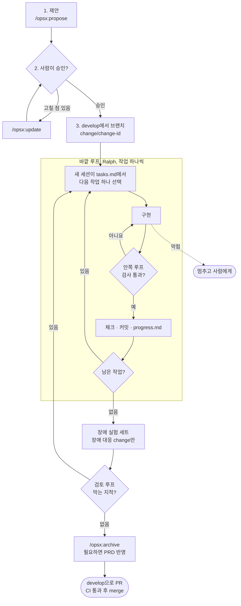

# 하네스 규칙 (OpenSpec 기반 개발 흐름)

weave는 OpenSpec으로 만든 스펙을 AI 에이전트(Claude Code)에게 맡겨 구현한다. 맡기는 방식을 세 층으로 나눈다.

| 층 | 답하는 질문 | weave에서 |
|---|---|---|
| **스펙** | 무엇을 만들고, 언제 끝났다고 보나 | OpenSpec change의 요구사항, 시나리오, tasks.md ([스펙 관리 규칙](spec.md)) |
| **하네스** | 어떤 환경에서, 무엇으로 확인하나 | 2장의 여섯 가지 하네스 |
| **루프** | 어떻게 반복시켜 끝까지 가게 하나 | 3장의 세 겹 루프 |

스펙이 끝나는 조건을 정하고, 하네스가 그 조건을 자동으로 판정하고, 루프가 판정이 날 때까지 에이전트를 돌린다.

> 상태: 하네스 구성(2026-11-04)에서 `CLAUDE.md`, `openspec/`, `scripts/harness/`, `scripts/git-hooks/`, `scripts/ralph/`, CI, PR 템플릿을 만들었다. `experiments/`는 고도화 2에서 만든다.

## 1. 전체 흐름

change 하나를 이렇게 진행한다. 브랜치는 [브랜치 컨벤션](branch.md)을 따르고, 문서만 바꾸는 커밋은 이 흐름 없이 `develop`에 바로 커밋한다.

1. **제안:** `/opsx:propose`로 change를 만든다. tasks.md의 첫 작업 묶음은 시나리오를 실패하는 테스트로 옮기는 일이다(`openspec/config.yaml` 규칙).
2. **승인:** 사람이 proposal, specs, design, tasks를 읽고 승인한다. 고칠 점은 `/opsx:update`로 고친다. 승인 전에는 구현하지 않는다.
3. **브랜치:** `develop`에서 `change/<change-id>` 브랜치를 만든다.
4. **구현:** 바깥 루프(Ralph)가 tasks.md의 작업을 하나씩 구현한다. 대화하며 직접 진행하고 싶으면 `/opsx:apply`를 써도 된다.
5. **실험:** 장애 대응 동작(타임아웃, 벌크헤드, 서킷 브레이커, fallback, 재시도)이나 그 설정값을 바꾼 change는 장애 실험 세트를 돌려 결과를 기록한다.
6. **검토:** 검토 루프에서 막는 지적이 없어질 때까지 고친다.
7. **archive:** 4장의 완료 조건을 채우면 change 브랜치에서 `/opsx:archive`로 스펙을 합친다. 구현하며 요구사항이 바뀌었다면 PRD도 고친다(스펙 관리 규칙 4번). 스펙 갱신이 같은 PR에 들어간다.
8. **PR과 CI:** `develop`으로 PR을 열고, CI 검사가 모두 통과하면 merge한다. `develop`에 모인 change는 릴리스 PR로 `main`에 들어간다.

사람이 판단하는 곳은 루프 앞(change 승인)과 뒤(검토 결과와 PR 승인)다. 루프가 도는 동안에는 개입하지 않고, 루프가 막혔다고 알려 올 때만 판단한다.

## 2. 하네스: 에이전트가 일하는 환경

### 2-1. 컨텍스트 하네스

에이전트가 무엇을 보고 일하는지 정한다.

- **지도:** 루트 `CLAUDE.md`에는 프로젝트 한 줄 설명, 모듈과 포트, 기준 문서와 규칙 문서의 위치, 개발 명령만 짧게 적는다. 모듈별 설명이 필요해지면 그 모듈에 `CLAUDE.md`를 둔다.
- **기준 문서:** 레포 안 문서가 기준이다. 제품과 설계는 `docs/`, 동작 스펙은 `openspec/`, 규칙은 `conventions/`에 있다. 대화에서 정한 결정은 문서에 남긴다.
- **작업 컨텍스트:** 지금 하는 change의 proposal, specs, design, tasks와 진행 메모(`progress.md`)만 읽으면 일을 시작할 수 있어야 한다.
- **인수인계:** 세션이 바뀌어도 tasks.md의 체크 상태, 커밋, `progress.md`로 이어 간다. 대화 기록에 기대지 않는다.

### 2-2. 퍼미션 하네스

에이전트가 할 수 있는 범위를 정한다. 설정은 `.claude/settings.json`에 두고 커밋해 Ralph 루프와 같이 쓴다. 이 파일은 에이전트 자신의 권한과 훅을 정하므로 **사람이 직접 고치고 커밋한다.** 에이전트는 바꿀 내용을 제안만 한다.

| 단계 | 대상 |
|---|---|
| 허용 | Gradle(`./gradlew`), `openspec`, `docker compose`, `k6 run`, `git status`·`diff`·`log`·`show`·`add`·`commit`·`branch`·`switch`·`checkout` |
| 확인 | `git push`, 의존성 추가(`buildSrc`나 모듈의 `build.gradle.kts`에 새 라이브러리), Docker Compose 서비스 추가 |
| 거부 | `.env` 읽기·쓰기, 강제 push |

훅으로 추가로 막는 것:

| 막는 것 | 어디서 |
|---|---|
| `.env.example`을 뺀 `.env` 계열 파일 읽기·쓰기 | Claude Code PreToolUse 훅 (`scripts/harness/pre-file.sh`) |
| 바깥 루프가 도는 동안 이미 커밋된 테스트와 실험 시나리오 수정. 테스트가 틀렸다면 루프를 멈추고 사람이 고친다 | 같은 훅. Ralph가 `WEAVE_RALPH=1`로 실행할 때만 |
| [커밋 컨벤션](commit.md) 형식이 아닌 커밋 메시지 | git `commit-msg` 훅 (`scripts/git-hooks/`) |
| `main` 브랜치에 직접 커밋 ([브랜치 컨벤션](branch.md) 5번) | git `pre-commit` 훅 |

커밋 관련 검사는 사람이 커밋할 때도 똑같이 걸리도록 git 훅으로 둔다. git 훅은 `git config core.hooksPath scripts/git-hooks`로 한 번 켠다.

### 2-3. 검증 하네스

구현한 에이전트의 "다 됐다"를 믿지 않고, 테스트와 자동 검사와 장애 실험과 독립 검토로 확인한다.

- **테스트:** 시나리오(WHEN/THEN)마다 자동 테스트를 하나 이상 둔다. 테스트 이름에 기능 ID를 넣는다.
  - **단위 테스트:** 외부 프로세스 없이 도는 테스트. 서킷 브레이커 상태 전이, fallback 선택, 멱등 처리 로직 등.
  - **통합 테스트:** 하위 서비스는 WireMock으로, MySQL·Redis는 Testcontainers로 띄워 HTTP와 DB까지 확인한다. 동시 요청 정합성(좋아요) 테스트도 여기에 둔다.
- **자동 검사:**

  | 검사 | 훅에서 | CI에서 |
  |---|---|---|
  | Kotlin 린트 | 턴을 끝낼 때 (Stop). Gradle을 거쳐 느려서 파일마다 돌리지 않는다 | 모든 push |
  | 타입 검사 | 턴을 끝낼 때 (Stop) | 모든 push |
  | 테스트 | 턴을 끝낼 때 (Stop). 바뀐 모듈의 단위 테스트만 | 모든 push. 통합 테스트 포함 |
  | `openspec validate --strict` | change 문서를 고친 턴의 끝 (Stop) | 모든 push |

  Stop 훅(`scripts/harness/stop-check.sh`)은 `develop`에서 갈라진 뒤 바뀐 모듈의 검사만 돌린다. 같은 세션에서 세 번 연속 실패하면 더 막지 않고 사람에게 넘긴다.

- **장애 실험 세트:** `experiments/`의 시나리오마다 Toxiproxy로 장애(지연, 끊김, 무응답, 에러율)를 넣고 k6로 부하를 준다. 판정 기준은 PRD의 SLO이고 k6 threshold로 적는다(예: 피드 p99, 피드 에러율, 부분 응답 비율). 전체 서비스와 인프라를 띄워야 해서 오래 걸리니 바깥 루프가 끝난 뒤 한 번, 그리고 장애 대응 change의 PR에서 돌린다. 어느 시나리오든 SLO를 넘거나 직전 기록보다 p99나 에러율이 크게 나빠지면 merge하지 않는다(나빠짐의 기준은 기준선 실험 뒤 정한다).
- **독립 검토:** 3-3의 검토 루프.

### 2-4. 도구 하네스

같은 일을 두 도구가 하지 않게 역할을 나눈다.

| 도구 | 맡는 일 |
|---|---|
| 기본 도구 (파일 읽기·수정, 셸) | 구현 |
| OpenSpec 스킬 (`/opsx:*`) | change 제안, 수정, 대화형 구현, archive |
| Ralph (`scripts/ralph/`) | 바깥 루프 실행. 작업 목록은 OpenSpec tasks.md이고, Ralph의 `prd.json`은 쓰지 않는다 |
| 훅 | 자동 검사와 금지 작업 차단 (2-2, 2-3) |
| 프로젝트 전용 스킬 (하네스 구성 때 만든다) | 로컬 인프라와 서비스 전체 띄우기, 장애 실험 시나리오 하나 실행, traceId로 로그 찾기 |
| MCP (선택) | 개발 MySQL 스키마를 읽기 전용으로 조회 |

### 2-5. 서브에이전트·워크트리 하네스

작업을 격리하고 역할을 나눈다.

- **격리:** change마다 `develop`에서 만든 `change/<change-id>` 브랜치에서 일한다. 여러 change를 동시에 진행할 때는 worktree로 폴더를 나눈다. 장애 실험은 포트를 같이 쓰므로 worktree가 여러 개여도 한 번에 하나만 돌린다.
- **역할 분리:**

  | 역할 | 누가 |
  |---|---|
  | 계획 | `/opsx:propose`를 돌리는 세션 |
  | 구현 | Ralph의 반복 세션 (반복마다 새 세션) |
  | 검토 | 구현과 컨텍스트를 공유하지 않는 리뷰 서브에이전트나 `/code-review` |
  | 탐색 | 코드·문서 찾기용 서브에이전트. 결과만 받는다 |

### 2-6. 디버깅 하네스

에이전트가 스스로 문제를 찾을 수 있게 정보를 정리해 둔다. 장애 대응은 여러 서비스에 걸쳐 일어나고 타이밍에 따라 결과가 달라져, 무엇이 언제 어디서 일어났는지 남기지 않으면 원인을 찾기 어렵다.

- **traceId 로그:** 모든 서비스가 JSON 로그에 traceId·spanId를 남기고(`libs/observability`), Loki에 모은다. traceId 하나로 피드 요청 하나가 거친 서비스의 로그를 시간순으로 볼 수 있어야 한다. 비동기 경계(벌크헤드 스레드 풀 등)에서도 traceId가 끊기지 않아야 한다.
- **장애 대응 이벤트:** 서킷 상태 전이, 벌크헤드 거절, 타임아웃, fallback 적용, 재시도를 로그(traceId 포함)와 메트릭으로 남긴다. 로그에는 요청 본문과 개인정보를 남기지 않는다.
- **실험 리포트:** 시나리오마다 k6 요약(p50·p95·p99, 에러율, 부분 응답 비율)과 같은 구간의 서킷 상태·풀 사용량 그래프를 남긴다. 원본 결과는 `experiments/results/`에 두고 커밋하지 않으며, 요약은 PR 설명과 문서에 적는다.
- **재현 명령:** 시나리오 이름 하나로 같은 장애와 같은 부하를 다시 돌린다.
- **환경 정리:** 필요한 환경 변수는 `.env.example`에 설명과 함께 적고, 무엇을 설정 파일(`application.yml`)에 두고 무엇을 환경 변수로 둘지 표로 정리한다.
- **오류 메시지:** 원인과 확인할 곳을 함께 보여 준다. 예) 어느 하위 서비스가, 어떤 이유(타임아웃, 서킷 열림, 벌크헤드 가득 참)로 실패했는지.

## 3. 루프: 에이전트를 끝까지 돌리는 방식

### 3-1. 안쪽 루프 (한 턴 안)

에이전트가 턴을 끝내려 하면 Stop 훅이 린트, 타입 검사, 바뀐 모듈의 단위 테스트, `openspec validate`를 돌린다. 실패하면 턴을 끝내지 못하고 고친다.

### 3-2. 바깥 루프 (작업 하나씩, Ralph)

`scripts/ralph/ralph.sh <change-id>`로 돌린다. 반복마다 새 세션이 `scripts/ralph/prompt.md`를 받아 작업 하나를 끝낸다.

**한 번의 반복**

1. 규칙 문서와 change 문서(proposal, design, specs, tasks), `progress.md`를 읽는다.
2. tasks.md에서 체크되지 않은 첫 작업 하나를 고른다. 마지막 묶음(검토와 완료 조건 확인)은 하지 않는다. 그건 검토 루프의 몫이다.
3. 그 작업만 구현한다(안쪽 루프).
4. 작업에 적힌 확인 방법과 자동 검사가 통과하면 tasks.md에 체크하고 커밋 컨벤션대로 커밋한다. push는 하지 않는다.
5. `progress.md`에 한 일과 다음 반복이 알아 둘 것을 남기고 끝낸다.

**규칙**

- **작업 크기:** 작업 하나는 새 세션 한 번에 끝낼 크기여야 한다(OpenSpec tasks 규칙).
- **기준 문서는 하나:** 작업 목록은 OpenSpec tasks.md뿐이다. `ralph-skills:ralph`로 PRD를 `prd.json`으로 바꾸지 않는다.
- **진행 메모:** `openspec/changes/<change-id>/progress.md`. 맨 위에 다시 쓸 만한 패턴을 모으고, 아래에 반복 기록을 덧붙인다. change와 함께 archive된다.
- **끝:** 마지막 묶음을 뺀 작업이 모두 체크되고 검사가 통과하면 루프를 멈추고 검토 루프로 넘긴다.
- **멈추고 사람에게 넘기는 경우:** 이미 있는 시나리오 테스트나 실험 시나리오를 고쳐야 통과할 것 같을 때, change 범위 밖 수정이 필요할 때, 스펙이 모호해 판단이 필요할 때, 장애 대응 설정값을 측정 근거 없이 정해야 할 때, 같은 작업이 세 번 실패했을 때, 최대 반복 수(기본은 남은 작업 수의 두 배)에 닿았을 때.
- **권한:** 반복 세션은 `--permission-mode acceptEdits`로 돌린다. 파일 수정은 허용하고, 셸 명령은 퍼미션 하네스의 허용 목록 안에서만 쓴다.

### 3-3. 검토 루프 (구현과 분리)

바깥 루프가 끝나면, 구현에 참여하지 않은 리뷰어가 change 문서와 diff를 함께 보고 아래를 확인한다. 지적은 **막음**(merge 전에 반드시 고친다)과 **제안**으로 나눈다. 막는 지적이 있으면 tasks.md에 고칠 작업을 추가하고 바깥 루프로 돌려보낸다.

1. specs의 시나리오마다 테스트가 있고, 테스트가 그 WHEN/THEN을 실제로 확인한다.
2. change의 범위(proposal, tasks) 밖의 수정이 없다.
3. 하위 서비스 호출이 타임아웃·벌크헤드·서킷 브레이커를 거치지 않는 코드 경로가 없고, 실패 시 동작이 PRD의 의존성 등급 표와 같다.
4. 재시도는 멱등한 호출에만 걸려 있고, 좋아요 상태를 바꾸는 API는 같은 요청을 여러 번 받아도 결과가 같다.
5. 장애 대응 설정값(타임아웃, 문턱, 풀 크기)마다 근거(측정값이나 계산)가 design.md나 커밋에 있다.
6. 스레드가 바뀌는 곳(벌크헤드, 비동기 호출)에서도 traceId가 이어진다.
7. 커밋이 컨벤션을 따르고 기능 ID가 붙어 있다.
8. 비밀 값이 커밋되지 않았다.

## 4. change 완료 조건

아래를 모두 채우면 change 브랜치에서 archive하고 `develop`으로 PR을 연다.

- [ ] tasks.md의 작업이 모두 체크됐다.
- [ ] 시나리오마다 테스트가 있고 모두 통과한다.
- [ ] 자동 검사가 로컬에서 모두 통과한다.
- [ ] 검토에서 막는 지적이 없다.
- [ ] 장애 대응 change라면 장애 실험 세트 결과를 기록했다. PR 설명에도 적는다.
- [ ] 요구사항이 바뀌었다면 PRD도 고쳤다.

PR 템플릿(`.github/pull_request_template.md`)의 "확인한 것"이 이 목록을 담는다. PR은 CI가 통과해야 merge한다.

## 5. 명령

하네스 구성(2026-11-04)에서 정했다. 훅, CI, Ralph 지시문이 모두 이 명령을 쓴다.

| 항목 | 명령 |
|---|---|
| Kotlin 린트 / 자동 고치기 | `./gradlew ktlintCheck` / `./gradlew ktlintFormat` |
| 타입 검사 | `./gradlew compileKotlin compileTestKotlin` |
| 단위 테스트 (Stop 훅용) | `./gradlew test`, 모듈 하나는 `./gradlew :<모듈>:test` (예: `:feed-service:test`, `:libs:observability:test`). `Integration` 태그가 없는 테스트만 돈다 |
| 통합 테스트 | `./gradlew integrationTest`. `@Tags("Integration")`이 붙은 테스트만 돈다 |
| 전체 테스트 (CI용) | `./gradlew ktlintCheck build`. `build`가 `test`와 `integrationTest`를 모두 돌린다 |
| 기능 ID로 테스트 거르기 | `./gradlew test -Pkotest.filter.tests='*F-003*'`. 테스트 이름에 기능 ID를 넣어 둔다 |
| 스펙 검사 | `openspec validate --all --strict --no-interactive` |
| 서비스 하나 실행 | `./gradlew :<모듈>:bootRun` |
| Ralph 루프 | `scripts/ralph/ralph.sh <change-id> [최대 반복 수]` |
| 로컬 인프라 | `docker compose up -d`. 고도화 1(`add-trace-logging`)에서 만든다 |
| 장애 실험 시나리오 하나 | 고도화 2(`add-fault-experiments`)에서 만든다 |

Stop 훅은 ktlint가 위반을 보고하면 증분 결과를 버리고(`--rerun-tasks`) 한 번 더 돌린다. ktlint-gradle이 지운 파일의 예전 위반을 계속 보고할 때가 있어서다.
