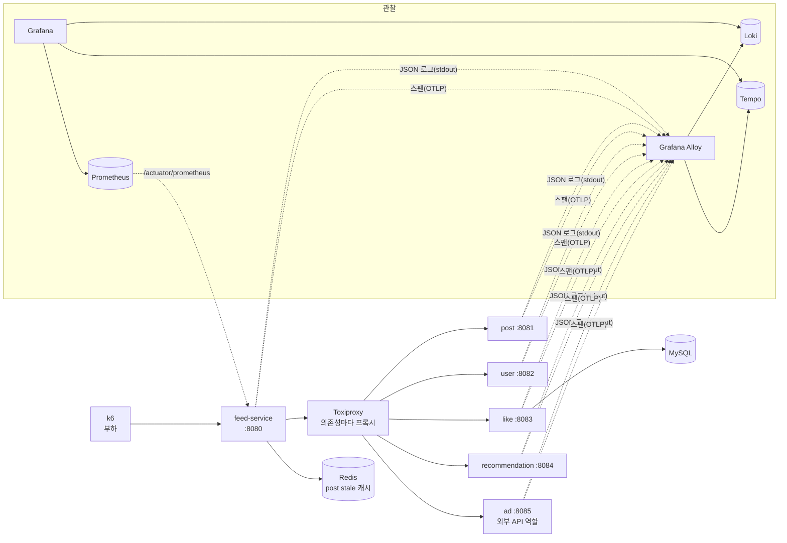
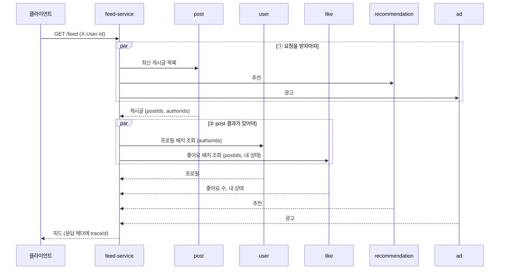
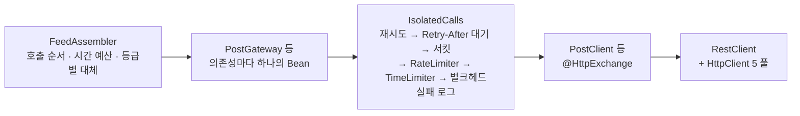
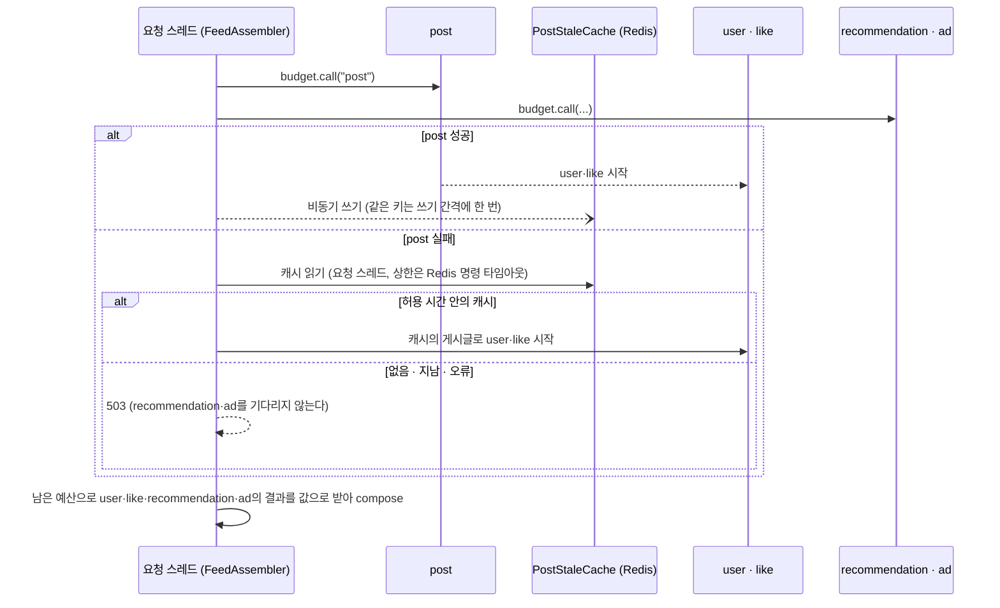

# 아키텍처

- 작성일: 2026-11-04
- 상태: 초안. 고도화 5(`add-retry-policy`, F-005)까지 반영했다. 격리·재시도 설정값과 근거는 4-3과 5-6, 대체 설정값은 6-4, 결과는 [고도화 3 결과](experiments/call-isolation.md), [고도화 4 결과](experiments/graceful-degradation.md), [고도화 5 결과](experiments/retry-policy.md)에 있다.
- 근거: [PRD](prd.md)의 단계, SLO, 의존성 등급. 기능 ID별 세부 설계는 OpenSpec change에서 정한다.

## 1. 결정 요약

| 영역 | 결정 | 버전 |
|---|---|---|
| 언어·프레임워크 | Kotlin, Spring Boot(Spring MVC), JDK 25, Gradle Kotlin DSL 멀티 모듈 | Kotlin 2.3.21, Boot 4.1.2, Gradle 9.8.2 |
| 동시성 | Tomcat은 플랫폼 스레드. 하위 서비스 병렬 호출은 `CompletableFuture`. 가상 스레드는 고도화 3을 마친 뒤 S-02에서 한 번 비교한다(PRD F-001) | — |
| HTTP 클라이언트 | `RestClient` + Apache HttpClient 5, 그 위에 HTTP Interface(`@HttpExchange`) | HttpClient 5.6.5 (Boot BOM) |
| 장애 대응 | Resilience4j Spring Boot 4 스타터. 어노테이션을 쓰지 않고, 스타터가 `resilience4j.*` 설정으로 만든 레지스트리에서 의존성 이름으로 인스턴스를 꺼내 `IsolatedCalls` 한 곳에서 감싼다(5-2). 서킷 브레이커, 벌크헤드(ThreadPool·Semaphore), TimeLimiter는 고도화 3, Retry, RateLimiter는 고도화 5에서 설정으로 연다 | `resilience4j-spring-boot4` 2.4.0 |
| 좋아요 저장 | MySQL + Spring Data JPA + Flyway | MySQL 9, Hibernate 7.4, Flyway 12.4 (Boot BOM) |
| 캐시 | post stale 캐시는 Redis(Spring Data Redis, Lettuce), user 프로필은 Caffeine 로컬 캐시 | Caffeine 3.2.4 (Boot BOM) |
| 로그 | logback + logstash-logback-encoder로 JSON 로그. Grafana Alloy가 모아 Loki로 | encoder 9.0, logback 1.5 |
| 트레이싱 | Micrometer Tracing + OpenTelemetry 브리지. 스팬은 OTLP로 Alloy를 거쳐 Tempo로 | Micrometer Tracing 1.7.2, OTel 1.62 (Boot BOM) |
| 메트릭 | Micrometer → Prometheus → Grafana | Boot BOM |
| 장애 실험 | Toxiproxy(네트워크 장애) + 앱 수준 장애 주입, 부하는 k6 | k6 2.3 |
| 실행 환경 | 실험 때는 서비스 6개와 인프라를 모두 Docker Compose로, CPU·메모리 상한을 건다. 개발 중에는 서비스 하나만 `bootRun`으로 띄워도 된다 | — |
| Compose 이미지 | 루트 `compose.yaml`. 서비스는 `docker/service.Dockerfile`로 bootJar를 담고, 그 밖의 이미지는 태그를 버전으로 고정한다(`latest` 금지) | 서비스 `eclipse-temurin:25-jre`, `mysql:9.7`, `grafana/alloy:v1.11.0`, `grafana/loki:3.6.0`, `grafana/tempo:2.9.0`, `prom/prometheus:v3.7.0`, `grafana/grafana:12.2.0` |
| 테스트 | Kotest + MockK(springmockk), 하위 서비스는 WireMock, MySQL·Redis는 Testcontainers | Kotest 6.2.6, MockK 1.14.11, springmockk 5.0.1, WireMock 3.13, Testcontainers 2.0.5 |
| 린트·CI | ktlint, GitHub Actions | 하네스 구성 때 정한다 |

**호환 확인:** `resilience4j-spring-boot4` 2.4.0은 Spring Boot 4.0.0으로 빌드됐다. 4.1.2에서 레지스트리 자동 설정, Prometheus 지표, Boot 버전 검사가 되는 것을 고도화 3에서 확인했다(`ResilienceAutoConfigurationTest`, `add-call-isolation` design 결정 2). Spring Cloud CircuitBreaker는 Boot 4.1용 릴리스(2026.0)가 아직 RC라 쓰지 않는다.

## 2. 시스템 구성



- **feed-service는 하위 서비스를 항상 Toxiproxy를 거쳐 부른다.** MVP와 기준선에서도 같다. 장애를 넣을 때 연결 구조가 바뀌지 않아야 결과를 비교할 수 있다. 프록시는 의존성마다 하나씩 둔다(예: `post-proxy:18081 → post-service:8081`, 9-1).
- **서비스끼리는 HTTP로만 통신한다.** 비즈니스 DTO를 공유하는 모듈은 없고, feed-service가 하위 서비스 응답 형식을 자기 쪽에 따로 정의한다.
- **관찰 데이터는 Alloy 하나로 모은다.** 로그는 Alloy가 컨테이너 stdout을 읽어 Loki로, 스팬은 서비스가 OTLP로 Alloy에 보내 Tempo로 간다. 메트릭은 Prometheus가 각 서비스의 Actuator에서 긁어 간다.
- **서비스마다 인스턴스 하나다.** 서킷 브레이커 상태는 인스턴스 메모리에 있어서, 인스턴스가 여러 개가 되면 인스턴스마다 따로 열리고 닫힌다. 이 프로젝트에서는 다루지 않는다(PRD 8장).

## 3. 레포 구조

```
weave/
├── buildSrc/               # 컨벤션 플러그인 (kotlin, spring-service, spring-library)
├── libs/observability/     # 모든 서비스에 자동 적용되는 로그·트레이싱 설정 (7장)
├── libs/fault-injection/   # 하위 서비스 5개의 앱 수준 장애 주입. experiment 프로필에서만 켠다 (9-2)
├── feed-service/           # 피드 집계, 장애 대응
├── post-service/  user-service/  like-service/  recommendation-service/  ad-service/
├── e2e/                    # 종단 간 테스트와 Compose 테스트
├── docker/                 # Compose 보조 설정: service.Dockerfile, alloy, loki, tempo, prometheus, grafana(대시보드·데이터 소스), toxiproxy
├── experiments/            # 장애 실험 세트: 시나리오 S-01~S-09, k6 스크립트, run.sh·run-all.sh (9-3). results/는 커밋하지 않는다
├── scripts/                # harness, git-hooks, ralph
├── docs/  openspec/  conventions/
└── compose.yaml
```

`docker/`와 `compose.yaml`은 고도화 1(관찰 인프라)과 고도화 2(Toxiproxy, k6, 대시보드)에서, `libs/fault-injection/`과 `experiments/`는 고도화 2에서, `openspec/`과 `scripts/`는 하네스 구성 때 만들었다. PRD 4장의 S-10·S-11 실험 스크립트는 F-003에서 더한다.

## 4. 피드 요청 흐름

### 4-1. 호출 순서



- ①의 세 호출과 ②의 두 호출은 `CompletableFuture`로 병렬로 부른다.
- recommendation과 ad는 ①에서 시작해 ②가 끝날 때까지 기다릴 수 있다. 피드는 모든 호출이 끝나거나 시간 예산이 다 되면 응답한다.

### 4-2. 단계별로 달라지는 것

| 단계 | 호출을 감싸는 것 |
|---|---|
| MVP | 없음. 타임아웃은 라이브러리 기본값, 병렬 호출은 공유 스레드 풀 하나(Boot의 기본 `applicationTaskExecutor`) |
| 고도화 3 | 조회는 `IsolatedCalls`가 의존성마다 서킷 브레이커 → 호출 시간 상한(TimeLimiter) → ThreadPool 벌크헤드로 감싸고, HttpClient 그룹마다 연결·응답·커넥션 대기 타임아웃과 커넥션 풀 크기를 둔다. `FeedAssembler`가 요청 시간 예산(`RequestBudget`)으로 기다린다. 좋아요 토글은 요청 스레드에서 like 서킷과 Semaphore 벌크헤드 `like-toggle`을 거친다. 공유 풀(`applicationTaskExecutor`)은 비교 실험용 Semaphore 모드(`weave.isolation.bulkhead-type: semaphore`)에서만 조회를 돌린다 |
| 고도화 4 | 고도화 3 그대로 감싸고, `FeedAssembler`가 의존성마다 결과를 값으로 받아(`RequestBudget.awaitResult`) 등급대로 대체한다(6장). post가 실패하면 요청 스레드에서 Redis stale 캐시(`PostStaleCache`)를 읽고, 그것도 안 되면 503이다. user 실패는 Caffeine 로컬 캐시(`UserProfileCache`)로 채운다. 응답에 `degradation`이 붙는다 |
| 고도화 5 | 조회는 `IsolatedCalls`가 재시도 루프(`RetryLoop`) → Retry-After 대기(`RetryAfterHolds`) → 서킷 브레이커 → 요청 수 상한(RateLimiter, ad만) → TimeLimiter → ThreadPool 벌크헤드로 감싼다. 재시도는 멱등한 조회(post, user, like, recommendation)만, 재시도할 실패(5xx, 연결 실패, 커넥션 풀 대기를 뺀 입출력 실패)에만, 요청의 남은 시간 예산(`RequestDeadline`)과 의존성별 재시도 예산(`RetryBudget`) 안에서 한다. ad(외부 API)와 좋아요 토글은 다시 부르지 않는다. 429를 받으면 `Retry-After` 동안 그 의존성을 부르지 않는다(5-4, 5-5) |

MVP의 "공유 스레드 풀 하나 + 기본 타임아웃"은 실무에서 흔한 실수를 일부러 재현한 것이다. 하위 서비스 하나가 느려지면 공유 풀과 Tomcat 스레드가 함께 묶여 피드 전체가 느려지는 모습을 고도화 2에서 기준선으로 남긴다. 기본값(풀 크기, 큐 크기, HttpClient의 응답 타임아웃)은 `add-feed-aggregation` change에서 실제 값을 확인해 기록한다.

**MVP 기본값 (2026-11-04 확인, Spring Boot 4.1.2, HttpClient 5.6.5, Tomcat 11.0.27)**

feed-service에 용량 설정(`weave.http-client.max-connections-per-route`, `spring.task.execution.pool.*`)을 넣기 전의 값이다. 용량 설정 뒤 바뀌는 값은 오른쪽 열에 적었다(근거는 `add-feed-aggregation` design 결정 8).

| 대상 | 항목 | 기본값 | 용량 설정 뒤 |
|---|---|---|---|
| `applicationTaskExecutor` (`ThreadPoolTaskExecutor`) | 코어 스레드 | 8 | 100 |
| | 최대 스레드 | `Integer.MAX_VALUE` | 그대로 |
| | 대기열 | `LinkedBlockingQueue`, 용량 `Integer.MAX_VALUE` (사실상 무제한) | 그대로 |
| | 코어 스레드 시간 초과 허용, keep-alive | 허용(`allowCoreThreadTimeOut` true), 60초 | 그대로 |
| HttpClient 5 (그룹마다) | 자동 재시도 (`DefaultHttpRequestRetryStrategy`) | 응답이 429·503이면 1초 뒤(`Retry-After`가 있으면 그 값) 1회 다시 보낸다. 이 경우는 메서드가 멱등인지 보지 않아 토글 POST도 다시 보낸다. 응답 전에 `IOException`(연결 리셋, 응답 없음 `NoHttpResponseException` 등)이 나면 멱등한 요청(GET)만 1회 다시 보낸다. 타임아웃(`InterruptedIOException`), 호스트 이름 실패, 연결 거부, 경로 없음, SSL 오류, 연결 닫힘(`ConnectionClosedException`)은 다시 보내지 않는다 | 끔(`disableAutomaticRetries`, design 결정 3) |
| | 연결 타임아웃 (`ConnectionConfig.connectTimeout`) | 3분 | 그대로 |
| | 응답 타임아웃 | `RequestConfig.responseTimeout`과 `ConnectionConfig.socketTimeout`이 비어 있어 `SocketConfig.soTimeout` 3분이 쓰인다 | 그대로 |
| | 커넥션 풀에서 연결을 기다리는 시간 (`RequestConfig.connectionRequestTimeout`) | 3분 | 그대로 |
| | 라우트당 최대 커넥션 | 5 | 20 |
| | 전체 최대 커넥션 | 25 | 20 |
| feed-service Tomcat | 최대 스레드 | 200 | 그대로 |
| | 최소 여유 스레드, 최대 연결, accept 대기열 | 10, 8192, 100 | 그대로 |

- 대기열이 무제한이라 스레드는 코어 수를 넘지 않는다. `ThreadPoolExecutor`는 대기열이 가득 찰 때만 코어를 넘겨 스레드를 늘리기 때문이다. 최대 스레드 값은 실제로 쓰이지 않는다.
- 코어 스레드도 60초 동안 일이 없으면 내려간다. 한산한 뒤 첫 요청 몰림에는 스레드를 새로 만드는 비용이 더해진다.
- 기본 재시도가 켜져 있으면 실패한 의존성에 요청이 두 번 가고 피드가 1초 이상 늦어진다. 끊김 장애(Toxiproxy `reset_peer` 등)에서도 GET은 라이브러리가 한 번 더 보냈을 것이다. 고도화 2 이후의 결과를 라이브러리 기본 동작과 비교할 때 이 차이를 감안한다. MVP는 "재시도 없음"이어서 `add-feed-aggregation`에서 껐다(886f98e). 재시도는 고도화 5에서 멱등한 호출에만 다시 건다.
- 하위 서비스가 응답하지 않으면 호출 하나가 풀 스레드를 3분까지 붙잡는다. 커넥션 풀이 가득 차면 다음 호출은 연결을 얻으려고 다시 3분까지 기다린다.
- Spring의 `HttpComponentsClientHttpRequestFactory`에는 따로 타임아웃이 없다(`readTimeout`, `connectionRequestTimeout` 모두 -1). 위 값은 모두 HttpClient 5 자체의 기본값이다. 이 -1은 4.1에서 한 번 확인했고 테스트로 남기지 않았다(private 필드라 이름에 기대야 해서다).
- 확인 방법: feed-service의 `@SpringBootTest(webEnvironment = RANDOM_PORT)` 테스트 컨텍스트(위 속성 없음)에서 객체를 꺼내 읽었다. 스레드 풀은 `applicationTaskExecutor` Bean의 `corePoolSize`·`maxPoolSize`·`queueCapacity`와 `threadPoolExecutor.queue`, 커넥션 풀과 타임아웃은 클라이언트 Bean(`PostClient` 등)에서 객체 그래프를 따라가 찾은 `PoolingHttpClientConnectionManager`(`defaultMaxPerRoute`, `maxTotal`, 연결·소켓 설정)와 `InternalHttpClient`의 기본 `RequestConfig`, Tomcat은 `TomcatWebServer`의 커넥터 프로토콜 핸들러(`maxThreads` 등)다. 커넥션 풀을 찾는 코드는 feed-service 테스트 소스의 `HttpClientPools`에 있다. 타임아웃 3분 값들과 Tomcat 값은 `MvpTimeoutDefaultsTest`가 같은 방법으로 다시 확인했다. 고도화 3(`add-call-isolation`, F-001)에서 MVP 값을 단언하던 `MvpTimeoutDefaultsTest`, `HttpClientPoolCapacityTest`, `TaskExecutorCapacityTest`는 격리 값을 같은 방법으로 보는 `IsolationSettingsTest`로 바뀌었고, MVP 값의 기록은 이 표다. 코어 스레드 시간 초과와 keep-alive는 `TaskExecutorKeepAliveTest`가 `applicationTaskExecutor`의 `keepAliveSeconds`와 `threadPoolExecutor.allowsCoreThreadTimeOut()`로, 기본 재시도는 `HttpClientRetryDefaultsTest`가 `DefaultHttpRequestRetryStrategy.INSTANCE`의 `retryRequest`·`getRetryInterval`에 상태 코드 400~599를 넣어 본다. 재시도를 끈 결과(실패한 의존성에 요청 한 번)는 feed 시나리오 테스트가 본다.
- design 결정 8 표의 예상(라우트당 5, 전체 25, 코어 8, Tomcat 200)과 같아 용량 계산 비교는 그대로다.

### 4-3. 시간 예산

p99 300ms(PRD 2장) 안에 응답하기 위한 나눔이다. 하위 서비스의 평시 p99는 약 50ms로 둔다(PRD F-007). 아래 예산은 출발점이고, F-001에서 "기준선 평시 p99" 열을 근거로 확정한다.

"기준선 평시 p99"는 MVP 기준선 S-01(400 RPS, `20261106-075650-S-01`)에서 feed-service가 잰 의존성별 호출 p99다(`http_client_requests_seconds`, Toxiproxy를 거친 값). 피드 전체의 p99는 92ms였다([MVP 기준선](experiments/baseline-mvp.md)).

| 구간 | 기준선 평시 p99 | 예산 (안) | 이유 |
|---|---|---|---|
| ① post | 51.4ms | 100ms | 평시 p99의 2배. 넘으면 stale 캐시로 넘어간다 |
| ② user, like (병렬) | user 51.2ms, like 53.7ms | 100ms | 같은 기준 |
| recommendation, ad | recommendation 51.0ms, ad 51.2ms | 200ms | ①+② 안에 끝나면 된다. 선택 등급이라 더 기다리지 않는다 |
| 집계·직렬화와 여유 | | 약 50ms | 남은 예산 |
| **전체** | 피드 92ms | **250ms** | p99 300ms에 여유 50ms |

**확정 (F-001, 2026-11-07).** 위 예산을 그대로 의존성별 호출 시간 상한(post·user·like 100ms, recommendation·ad 200ms)과 요청 시간 예산(250ms)으로 쓴다. 값을 넣기 전에 MVP 구성으로 S-01(400 RPS, `20261107-033746-S-01`)을 다시 재 평시 호출이 상한에 걸리는 비율을 봤다. 100ms 상한은 89.48ms 경계를 넘는 비율이 post 0.0119%, user 0.0076%, like 0.0136%, 200ms 상한은 178.96ms 경계를 넘는 호출이 없었다. 셋을 합쳐도 0.033%로, 평시 타임아웃으로 인한 피드 실패가 가용성 예산(0.1%)의 절반 아래다. 측정과 판단의 자세한 내용은 `add-call-isolation` design 결정 3이다.

- ②는 남은 예산 안에서만 기다린다. ①이 80ms 걸렸으면 ②에 줄 수 있는 시간은 전체 예산에서 그만큼 줄어든다.
- 하위 서비스에 남은 예산을 헤더로 넘기는 것(deadline 전파)은 다루지 않는다. 하위 서비스가 다시 다른 서비스를 부르지 않기 때문이다.

## 5. HTTP 클라이언트와 Resilience4j

### 5-1. 클라이언트 구성

- 의존성마다 `RestClient`를 따로 만들고, 각자 Apache HttpClient 5의 커넥션 풀을 가진다. 한 의존성의 커넥션 고갈이 다른 의존성에 번지지 않게 하기 위해서다.
- 의존성마다 정하는 값: 연결 타임아웃, 커넥션 획득 타임아웃(풀이 가득 찼을 때 기다리는 시간), 응답 타임아웃, 라우트당 최대 커넥션 수.
- 커넥션 풀 크기는 MVP에서도 평시 부하를 감당하도록 정한다. 보호 장치가 없다는 것은 장애 대응이 없다는 뜻이지, 평시 용량이 모자라도 된다는 뜻이 아니다. 크기는 리틀의 법칙(동시 요청 수 ≈ 초당 요청 수 × 응답시간)에 여유를 더해 정한다.
- 하위 서비스 API는 HTTP Interface(`@HttpExchange`)로 선언한다.

### 5-2. 격리를 씌우는 곳



- **격리는 `IsolatedCalls`(`com.weave.feed.gateway`) 한 곳에서 씌운다**(`add-call-isolation` design 결정 1). Gateway는 `isolated.call("post") { client.getLatestPosts(size).posts }`처럼 의존성 이름과 호출 함수만 넘기고, 격리를 씌운 `CompletableFuture`를 받는다. 서킷 브레이커, TimeLimiter, 벌크헤드는 스타터가 만든 레지스트리에서 의존성 이름으로 꺼낸다.
- **어노테이션을 쓰지 않는 이유:**
  - 비교 실험(design 결정 11)은 같은 호출을 ThreadPool 벌크헤드와 Semaphore 벌크헤드로 바꿔 돌려야 한다. `@Bulkhead(type = ...)`는 컴파일 때 정해진다. 지금은 `weave.isolation.bulkhead-type`(`thread-pool` 기본 | `semaphore`, `IsolationProperties`) 하나로 바꾼다.
  - 감싸는 순서(5-4)가 aspect 순서 속성에 흩어지지 않고, self-invocation처럼 프록시를 거치지 않는 호출이 조용히 빠지는 일이 없다. "격리를 거치지 않는 호출이 없다"를 Gateway가 `IsolatedCalls`만 쓰는지로 확인한다.
  - AOP 의존성을 더하지 않는다.
- 요청 스레드에서 동기로 부르는 좋아요 토글은 `isolated.callBlocking("like", IsolatedCalls.LIKE_TOGGLE) { ... }`로 부른다. 조회와 같은 `like` 서킷과 Semaphore 벌크헤드 `like-toggle`을 거치고 TimeLimiter는 쓰지 않는다(그룹의 응답 타임아웃이 같은 역할을 한다, design 결정 6).
- 실패 로그(`downstream_call_failed`)도 `IsolatedCalls`가 감싼 future의 결과에서 한 번만 남긴다. 시간 상한이나 요청 시간 예산이 먼저 끝낸 호출의 뒤늦은 실패는 남기지 않는다. 다시 부른 시도의 실패는 실패 로그가 아니라 `downstream_call_retried` 줄의 `cause`로 남고, 실패 로그는 마지막 시도의 실패로 한 번이다(`add-retry-policy` design 결정 8).
- **재시도 루프는 Resilience4j `Retry`가 아니라 `IsolatedCalls`(`RetryLoop`)가 직접 돈다**(`add-retry-policy` design 결정 1). 다시 부를지는 실패 종류만이 아니라 그 요청의 남은 시간, 의존성의 재시도 예산, 요청 시간 예산이 이미 끝냈는지를 시도마다 봐야 해서다. 설정(최대 시도 횟수, 간격 함수)만 스타터가 만든 `RetryRegistry`에서 의존성 이름으로 꺼내고(`RetryRegistry.find`, 인스턴스가 없는 ad는 다시 부르지 않는다), 스타터의 `resilience4j_retry_calls_total`은 늘 0이다. 재시도 결정은 `weave_retry_calls_total`로 센다.
- 마감은 `RequestBudget.call`이 `start()`를 부르는 동안만 ThreadLocal `RequestDeadline`에 둔다. Gateway가 `IsolatedCalls.call`을 그 안에서 동기로 부른다는 구조에 기댄다(마감이 없으면 시간 조건 없이 시도 횟수만 본다).
- 서킷 상태 전이 로그(`circuit_state_changed`)는 `CircuitStateLog`가 레지스트리의 서킷마다 건다(design 결정 9).
- **fallback은 `FeedAssembler` 한 곳에서 한다**(`add-graceful-degradation` design 결정 1). Gateway와 `IsolatedCalls`는 실패를 그대로 넘기고(실패 로그만 남긴다), `FeedAssembler`가 의존성별 결과를 받아 PRD 3장의 등급표대로 응답을 만든다(6장). Resilience4j fallback이나 Gateway에서 대체하지 않는 이유는 둘이다. 응답의 `degradation`은 무엇을 대체했는지 알아야 만들 수 있고, 대체에는 요청 문맥(post 캐시의 `size`, user 대체의 작성자 ID)이 필요하다. 이렇게 두면 F-005의 재시도는 `IsolatedCalls` 안에 들어가 "재시도가 다 실패한 뒤에 대체한다"는 순서가 구조로 정해진다.

### 5-3. 설정 구조

모든 모듈을 설정으로 연다. 공통 기본값은 `configs.default`에, 의존성별 값은 `instances.<의존성>`에 둔다. 인스턴스 이름은 `post`, `user`, `like`, `recommendation`, `ad`이고 HTTP 서비스 그룹 이름과 같다(`IsolatedCalls.DEPENDENCIES`). 설정은 feed-service `application.yml`에 있다.

```yaml
resilience4j:
  circuitbreaker:
    configs:
      default:
        sliding-window-type: COUNT_BASED
        sliding-window-size: ...         # 값은 5-6
        failure-rate-threshold: ...
        slow-call-duration-threshold: ...
        slow-call-rate-threshold: ...
        wait-duration-in-open-state: ...
        permitted-number-of-calls-in-half-open-state: ...
        automatic-transition-from-open-to-half-open-enabled: true
        record-failure-predicate: com.weave.feed.gateway.CircuitFailurePredicate   # 5-5
        ignore-exceptions:                 # 부르지 않은 호출은 성공으로도 세지 않는다 (5-5)
          - io.github.resilience4j.bulkhead.BulkheadFullException
          - io.github.resilience4j.ratelimiter.RequestNotPermitted
    instances:
      post: { base-config: default }     # user, like, recommendation, ad도 같다
  timelimiter:
    configs:
      default:
        cancel-running-future: true
    instances: { ... }                   # 의존성마다 timeout-duration (4-3)
  thread-pool-bulkhead:
    configs:
      default:
        queue-capacity: 0                # 자리가 없으면 바로 거절한다
        context-propagators: com.weave.feed.gateway.TraceContextPropagator   # traceId 전파 (7-3)
    instances: { ... }                   # 의존성마다 core-thread-pool-size, max-thread-pool-size
  bulkhead:                              # Semaphore. 좋아요 토글(like-toggle)과 비교 실험의 Semaphore 모드
    configs:
      default:
        max-wait-duration: 0
    instances: { like-toggle: ..., post: ..., ... }
  retry:                                 # 멱등한 조회의 재시도 (고도화 5). IsolatedCalls가 설정만 꺼내 쓴다 (5-2)
    configs:
      default:
        max-attempts: ...                # wait-duration, exponential-backoff-multiplier, randomized-wait-factor도
    instances:
      post: { base-config: default }     # user, like, recommendation도 같다. ad는 두지 않는다(다시 부르지 않는다)
  ratelimiter:                           # ad 계약 쿼터 (고도화 5). 인스턴스가 있는 의존성만 감싼다
    configs:
      default:
        timeout-duration: 0              # 허용을 기다리지 않는다
    instances:
      ad: { base-config: default }       # limit-refresh-period, limit-for-period

weave:
  isolation:
    bulkhead-type: thread-pool           # thread-pool | semaphore (5-2)
  retry:
    budget:                              # 의존성별 재시도 예산 (RetryProperties, RetryBudget). 셋 중 하나라도 없으면 예산을 보지 않는다
      ratio: ...                         # 창 안 원래 호출 수에 대한 재시도 비율
      min-retries: ...                   # 창마다 최소 재시도 수
      window: ...
  retry-after:                           # 429의 Retry-After 대기 (RetryAfterProperties, RetryAfterHolds)
    default-hold: ...                    # 머리글이 없거나 읽지 못할 때
    max-hold: ...                        # 이보다 긴 Retry-After는 여기서 자른다
```

HTTP 클라이언트의 타임아웃과 풀 크기는 Boot 그룹 설정(`spring.http.serviceclient.<그룹>.connect-timeout`, `read-timeout`)과 `weave.http-client.*`(`HttpClientProperties`: `connection-request-timeout`, `max-connections-per-route`, `groups.<그룹>.max-connections`), 요청 시간 예산은 `weave.feed.time-budget`이다.

### 5-4. 적용 순서

순서는 바깥에서 안쪽으로 `Retry → Retry-After 대기 → CircuitBreaker → RateLimiter → TimeLimiter → Bulkhead → 호출`이다(Retry-After 대기를 뺀 순서는 Resilience4j aspect의 기본 순서와 같다). 순서는 코드 한 곳, `IsolatedCalls.call`에만 있다(5-2). 고도화 3에 CircuitBreaker → TimeLimiter → Bulkhead를 두었고, 고도화 5(`add-retry-policy` design 결정 1, 4, 6)에서 재시도 루프, Retry-After 대기, RateLimiter를 같은 곳에 더했다. 좋아요 토글(`IsolatedCalls.callBlocking`)은 CircuitBreaker → Semaphore 벌크헤드 → 호출이고 다시 부르지 않는다.

| 순서 (바깥 → 안) | 이렇게 둔 이유 |
|---|---|
| Retry (`RetryLoop`, 고도화 5) | 재시도 한 번 한 번이 대기·서킷 브레이커를 거쳐, 실패가 서킷에 그대로 집계되고 서킷이 열리면 다음 시도가 `circuit_open`(재시도하지 않는 실패)으로 끝나 재시도가 바로 멈춘다. 시간 상한과 벌크헤드도 시도마다 다시 적용된다. 기다리는 동안은 스레드도 벌크헤드 자리도 잡지 않고, 다음 시도를 `isolation-retry` 스케줄러에 예약한다 |
| Retry-After 대기 (`RetryAfterHolds`, 고도화 5) | 429의 `Retry-After`가 끝날 때까지 그 의존성을 부르지 않는다. 서킷 바깥이라 막은 호출(`retry_after`)은 서킷에 닿지 않고 쿼터도 쓰지 않는다. 서킷을 강제로 여는 방법은 저절로 돌아오지 않고 429를 장애처럼 보이게 해서 쓰지 않았다(design 결정 4) |
| CircuitBreaker | 열려 있으면 RateLimiter, 벌크헤드 자원을 쓰기 전에 바로 실패한다 |
| RateLimiter (고도화 5, ad만) | 쿼터는 실제로 나가는 호출에만 쓴다. 허용을 기다리지 않고(`timeout-duration: 0`) `RequestNotPermitted`로 바로 끝난다. 요청 스레드에서 ad 호출을 시작하므로 기다리면 요청 스레드가 묶인다 |
| TimeLimiter | 벌크헤드에서 자리를 잡는 시간까지 호출 시간 상한에 포함한다. 시간 예산은 사용자가 기다리는 시간 기준이기 때문이다 |
| Bulkhead | 실제 호출을 의존성별 스레드 풀에서 돌린다. Semaphore 모드면 의존성별 허가 수를 잡고 `applicationTaskExecutor`에서 돌린다 |

### 5-5. 실패 분류

| 분류 | 예외·응답 | 실패 로그 `cause` | 서킷 | 재시도 |
|---|---|---|---|---|
| 하위 서비스 문제 | 연결 실패, 그 밖의 입출력 실패, 5xx | `connect_failure`, `io_failure`, `http_<상태 코드>` | 실패로 센다 | 멱등한 조회만 한다(고도화 5). 입출력 실패 중 커넥션 풀 대기 초과(`ConnectionRequestTimeoutException`)는 feed 쪽 자원 부족이라 안 한다 |
| 하위 서비스 문제 (느림) | 호출 시간 상한·응답 타임아웃 | `timeout` | 실패로 센다 | 안 한다. 느린 의존성에 다시 보내면 부하만 키우고, 남은 예산에 다시 부른 시도의 상한이 들어가지 않는다 |
| 요청 문제 | 4xx(429 제외) | `http_<상태 코드>` | 세지 않는다 | 안 한다 |
| 속도 조절 | 429 + Retry-After (ad) | `http_429` | 세지 않는다(4xx) | 안 한다. `Retry-After` 동안 그 의존성을 부르지 않는다(아래) |
| 우리 쪽 거절 | 벌크헤드 가득 참, 서킷 열림, 요청 시간 예산 초과 | `bulkhead_full`, `circuit_open`, `budget_exhausted` | 세지 않는다 | 안 한다 |
| 우리 쪽 거절 (고도화 5) | 요청 수 상한(`RequestNotPermitted`, ad), Retry-After 대기 중(`RetryAfterHoldException`) | `rate_limited`, `retry_after` | 세지 않는다(`rate_limited`는 `ignore-exceptions`, `retry_after`는 서킷 바깥이라 닿지 않는다) | 안 한다 |

- 실패 로그의 `cause`와 서킷의 판정은 같은 분류를 쓴다(`DownstreamFailure.of`, `DownstreamFailure.countsAsCircuitFailure`). 서킷에는 `record-failure-predicate`로 `CircuitFailurePredicate`를 넘긴다(`add-call-isolation` design 결정 7). 다시 부를지(`RetryPolicy.retryable`)도 같은 분류로 정한다(`add-retry-policy` design 결정 2).
- Resilience4j는 실패 판정이 거짓인 예외를 성공으로 센다. 4xx는 하위 서비스가 응답한 것이라 성공으로 세도 되지만, 벌크헤드 거절(`BulkheadFullException`)과 요청 수 상한 거절(`RequestNotPermitted`)은 부르지도 않은 호출이라 `ignore-exceptions`로 아예 세지 않는다. 성공으로 세면 절반이 거절되는 장애(S-02)에서 실패율이 묽어진다.
- 서킷 열림(`CallNotPermittedException`)은 서킷이 막은 호출이라 서킷에 다시 기록되지 않는다. 예산 초과(`TimeBudgetExhaustedException`)는 `FeedAssembler`가 서킷 밖에서 끝내는 것이라 서킷에 닿지 않는다.

**Retry-After 대기 (`add-retry-policy` design 결정 4).** 시도가 429로 끝나면 `IsolatedCalls`가 응답 머리글 `Retry-After`(초 또는 HTTP 날짜)를 `RetryAfter.parse`로 읽어 그 의존성의 대기 끝 시각을 `RetryAfterHolds`에 둔다. 머리글이 없거나 읽지 못하면 기본 대기(`weave.retry-after.default-hold`), 긴 값은 최대 대기(`weave.retry-after.max-hold`)로 자르고, 이미 대기 중이면 더 늦은 시각으로만 늘린다. 대기 중인 호출은 서킷도 RateLimiter도 거치지 않고 `retry_after`로 바로 끝난다. 429를 주는 것은 ad뿐이지만 의존성 이름으로 가르지 않는다. 대기를 새로 시작할 때만 `retry_after_hold_started` 로그를 남기고, 막은 호출은 실패 로그와 `weave_retry_after_rejected_calls_total`로 센다. 남은 대기 시간은 `weave_retry_after_hold_remaining_seconds`다.

**재시도 판정 순서 (`RetryLoop`, design 결정 2, 3, 5).** 재시도할 실패가 나면 시도 횟수(`max-attempts`) → 남은 시간(`마감 − 지금 ≥ 그 의존성의 TimeLimiter 상한 + 기다릴 시간`) → 재시도 예산(`창 안의 재시도 수 < max(min-retries, floor(ratio × 창 안의 원래 호출 수))`) 순서로 보고, 결정 하나를 `weave_retry_calls_total{outcome=retried|attempts_exhausted|deadline|budget_exhausted}`로 센다. 시간을 예산보다 먼저 봐 보내지 않을 재시도로 예산을 쓰지 않는다. 다시 부르기로 하면 `downstream_call_retried`(`dependency`, `attempt`, `cause`, `waitMs`)를 남긴다. 예약한 재시도가 돌기 전에 요청 시간 예산이 호출을 먼저 끝냈으면 보내지 않는다.

### 5-6. 설정값을 정하는 방법

값은 기준선을 잰 뒤 아래 방법으로 정하고, 근거를 이 문서에 적는다([커밋 컨벤션](../conventions/commit.md)대로 설정값 커밋은 따로 한다).

| 값 | 정하는 방법 |
|---|---|
| 응답 타임아웃 | 4-3의 시간 예산 안에서, 기준선의 평시 p99에 여유를 더한다 |
| 느린 호출 기준 | 응답 타임아웃보다 조금 짧게. 타임아웃 전에 "느려지는 중"을 잡는다 |
| 실패율 문턱 | 평시(S-01) 실패율보다 충분히 높게. 평시에 열리면 안 된다 |
| 열림 유지 시간 | S-08의 복구 시간 목표에 맞춘다 |
| 벌크헤드 크기 | 리틀의 법칙: 실험 RPS × 그 의존성의 평시 p99 × 여유. 넘는 요청은 기다리지 않고 바로 거절한다 |

**정한 값 (F-001, 2026-11-07).** feed-service `application.yml`에 근거 주석과 함께 있다. 측정과 판단의 자세한 내용은 `add-call-isolation` design 결정 3~7이다.

| 값 | post, user, like | recommendation, ad | 근거 |
|---|---|---|---|
| 호출 시간 상한(TimeLimiter), 연결·응답 타임아웃 | 100ms | 200ms | 기준선 평시 호출 p99(51.0~53.7ms)의 약 2배(4-3). 평시에 100ms 경계(89.48ms 버킷)를 넘는 비율은 post 0.0119%, user 0.0076%, like 0.0136%로 합 0.033%(가용성 예산의 절반 0.05% 아래), 200ms 경계(178.96ms 버킷)는 0 |
| 커넥션 대기 상한 | 100ms | 100ms | 벌크헤드 ≤ 커넥션 풀이라 평시에는 기다리지 않는다. 기다린다면 설정 오류라 빨리 실패한다 |
| 요청 시간 예산 | 250ms(피드 하나) | | p99 300ms에 여유 50ms(4-3) |
| ThreadPool 벌크헤드 | 스레드 40, 대기열 0 | 같음 | 400 RPS × 평시 p99 51ms ≈ 20.4, 여유 2배 → 40. 기준선 400 RPS의 의존성별 커넥션 사용 중 최댓값 14~16의 2.5배 이상 |
| 커넥션 풀(라우트당·전체) | 40, like만 50 | 40 | 벌크헤드와 같게 둬 기다림이 벌크헤드 한 곳에서만 생긴다. like는 토글 상한 10을 더한다 |
| 토글 동시 호출 상한(Semaphore) | like 10 | | like 풀에서 읽기 몫 밖의 자리. 토글 부하는 실험 세트에 없어 F-003의 S-11에서 다시 정한다 |
| 서킷: 판단 창, 최소 호출 수 | 최근 10초, 100 | 같음 | 처음에는 최근 호출 100개(400 RPS에서 0.25초)였는데, 1.05초 GC 멈춤만으로 창이 차 서킷이 5초 열렸다. 10초면 1초 멈춤은 창의 약 10%다. 대신 실제 장애도 창 전체의 실패율이 문턱을 넘어야 열려, 평시 뒤의 장애는 약 5~7초 뒤에 연다(S-03 실측 7~12초). 그동안 상한이 p99를 묶는다 |
| 서킷: 실패율 문턱 | 50% | 같음 | 기준선 S-01의 호출 실패율 0 |
| 서킷: 느린 호출 기준, 문턱 | 80ms, 50% | 160ms, 50% | 상한의 80%. 평시에 경계를 넘는 비율 0.17% 이하 |
| 서킷: 열림 유지 시간, 반열림 시험 호출 | 5초, 10개 | 같음 | S-08 복구 시간 목표 20초(PRD 10장)에서 거꾸로 정했다 |

**정한 값 (F-005, 2026-11-08).** feed-service `application.yml`에 근거 주석과 함께 있고, `RetrySettingsTest`가 main 설정만 읽어 확인한다. 자세한 내용은 `add-retry-policy` design 결정 5, 6, 11이다.

| 값 | 설정 | 근거 |
|---|---|---|
| 최대 시도 횟수 | 3 (post, user, like, recommendation). ad와 좋아요 토글은 다시 부르지 않는다 | Google SRE 책 22장의 "요청 하나에 최대 3번". user·like가 post 중앙값(20ms) 뒤 시작해 빠른 실패(중앙값 20ms)를 두 번 겪어도 세 번째 시도의 상한(100ms)까지 약 190ms라 요청 시간 예산 250ms 안이다 |
| 재시도 전 기다림 | 10ms, 20ms(지수 ×2), ±50% | 기다림 합(최대 45ms)이 하위 서비스 평시 중앙값 두 번 남짓이라 남은 예산을 시도 자체에 쓴다. jitter는 장애 시작에 같은 순간 실패한 수백 건이 같은 순간 다시 몰리지 않게 한다 |
| 남은 시간 조건 | 마감 − 지금 ≥ 그 의존성의 호출 시간 상한 + 기다림 | 끝까지 기다리지 못할 시도는 보내지 않는다(design 결정 3) |
| 재시도 예산 | 의존성마다 최근 1초(100ms 칸 10개) 원래 호출의 10%, 창마다 최소 1번 | 비율은 Google SRE 책 22장의 클라이언트별 재시도 예산 10%. 장애가 시작되는 순간 풀리는 재시도는 창에 쌓인 예산 전부라, 창 1초면 400 RPS에서 40번(100ms 칸 하나의 평시 호출 수)이다. 처음에는 서킷 판단 창과 같은 10초였는데, S-09에서 장애 시작에 재시도가 0.5초 안에 약 120~320번 몰린 직후 feed-service가 0.2~0.7초 멈추고 503이 났다. 1초로 줄인 뒤 503은 줄었지만 멈춤의 원인은 가리지 못했다([고도화 5 결과](experiments/retry-policy.md)). 계산한 S-09 장애 초반 요청 배율은 예산이 있으면 약 1.03, 없으면 약 1.33이고, 판정 상한 1.2(PRD 10장)가 둘을 가른다 |
| ad 요청 수 상한 | 100ms마다 54건, 기다리지 않음 | 계약 쿼터 초당 600건(가정, PRD 3장). 상한 주기가 제공자의 1초 창과 맞지 않아 어느 1초 창에도 주기 11개가 걸친다. 54 × 11 = 594 ≤ 600. 평균 초당 540건은 피크 400 RPS의 1.35배 |
| Retry-After 기본 대기, 최대 대기 | 1초, 60초 | 머리글이 없는 429는 계약 쿼터 창 하나만 쉰다. 60초보다 긴 값은 일일 한도 소진이나 제공자 장애로 보고 1분마다 한 번 확인한다(판단, change 승인 때 확인) |

## 6. Graceful Degradation 구현

`add-graceful-degradation`(F-002)에서 만들었다. 대체 코드는 `FeedAssembler`와 `com.weave.feed.degradation` 패키지에 있다(5-2). 자세한 결정과 근거는 그 change의 design 결정 1~11이다. 설정값은 6-4다.

### 6-1. 응답 계약

```json
{
  "posts": [
    {
      "id": 10, "title": "...", "content": "...", "createdAt": "...",
      "author": { "id": 3, "nickname": null, "profileImageUrl": null, "unknown": true },
      "like": { "count": null, "myLike": "UNKNOWN" }
    }
  ],
  "recommendations": [],
  "ads": [],
  "degradation": {
    "missing": ["user", "like", "recommendation", "ad"],
    "stale": [{ "section": "post", "cachedAt": "2026-11-08T01:23:45Z" }]
  }
}
```

| 의존성 (등급) | 실패하면 | 응답 | 영역 결과 (`SectionOutcome`) |
|---|---|---|---|
| post (필수) | 같은 `size`의 stale 캐시가 허용 시간 안이면 그 게시글 | `degradation.stale`에 `{"section": "post", "cachedAt"}` | `stale` |
| | 캐시가 없거나 지났거나 읽지 못하면 | 503 `{"error": "posts_unavailable"}` (`PostsUnavailableException` → `FeedController`) | 세지 않는다 |
| user (중요) | 로컬 캐시에 있는 작성자는 그 프로필, 없으면 `author.unknown: true`(`nickname`·`profileImageUrl` null) | 모두 채웠으면 `missing`에 넣지 않는다. 한 명이라도 `unknown`이면 `missing`에 `user` | `cached` / `missing` |
| like (중요) | 모든 게시글이 `like.count: null`, `myLike: "UNKNOWN"` | `missing`에 `like` | `missing` |
| recommendation, ad (선택) | 빈 목록 | `missing`에 의존성 이름 | `missing` |

- `degradation`은 늘 넣는다. 정상이면 `missing`·`stale`이 빈 목록이고 `author.unknown`은 false다(`FeedResponse`, `Degradation`, `StaleSection`, `FeedAuthor`, `FeedLike`, `MyLike.UNKNOWN`).
- `missing`의 값은 응답 필드 이름이 아니라 의존성 이름이다. 로그의 `dependency`, 지표의 `section`, k6 태그와 같은 이름이라 한 이름으로 찾는다.
- user-service가 프로필을 돌려주지 않은 작성자(정상 응답)는 지금처럼 `author: null`이다. "없는 사용자"(null)와 "모르는 사용자"(`unknown`)를 가른다.
- 실패의 종류(시간 상한, 서킷 열림, 벌크헤드 거절, 예산 초과, HTTP 오류)는 가리지 않고 같은 방식으로 대체한다.
- 응답 구성은 순수 함수 `FeedDegradation.compose`다. 게시글과 그 출처(`PostSource.Fresh`·`Stale`), 의존성별 `Result`, user 캐시에서 찾은 프로필을 받아 `ComposedFeed`(응답과 의존성 5개의 영역 결과)를 돌려준다. 응답의 `degradation`, 대체 로그, 지표가 모두 이 영역 결과에서 나와 서로 어긋나지 않는다.

### 6-2. 요청 흐름



- post 결과를 요청 스레드에서 먼저 받는다(`budget.awaitResult`). post future와 "post 뒤 user·like" future를 따로 들고 있어, post가 성공하면 정상 경로의 지연은 고도화 3과 같다.
- post가 실패하면 캐시 읽기와 그 뒤의 user·like 시작을 요청 스레드에서 한다. post 실패는 `isolation-timeout` 스레드(하나뿐이다)나 벌크헤드 스레드에서 끝나는데, 거기서 Redis를 기다리면 다른 호출의 시간 상한 처리가 밀린다. 요청 스레드는 MDC·trace 문맥도 그대로다.
- 503이면 피드 실패가 정해졌으니 recommendation·ad를 기다리지 않는다. 남은 호출은 각자의 시간 상한에서 끝나고 실패 로그만 남는다.
- user·like·recommendation·ad는 `RequestBudget.awaitResult`로 마감까지 기다려 성공 값이나 실패를 `Result`로 받는다. 마감이 지나면 끝나지 않은 호출은 `budget_exhausted`로 끝나 다른 실패처럼 대체된다.
- 성공한 결과를 캐시에 넣는 것도 `FeedAssembler`가 한다(post → `PostStaleCache.write`, user → `UserProfileCache.putAll`). Gateway는 HTTP 호출만 안다.

### 6-3. 캐시 구조

**post stale 캐시 (`PostStaleCache`, Redis)**

| 항목 | 정한 것 |
|---|---|
| 키 | `weave:feed:posts:latest:v1:size:{size}`. post 응답이 `size`마다 달라 다른 개수의 캐시는 쓰지 않는다. `v1`은 값 형식을 바꿀 때 올린다 |
| 값 | `{"cachedAt": "<ISO-8601 UTC>", "posts": [<post-service 응답 항목>]}`(`PostStaleCache.CachedPosts`). 서비스의 Jackson `ObjectMapper`로 문자열을 만들어 `StringRedisTemplate`에 넣는다 |
| stale 판단 | `now - cachedAt ≤ weave.post-cache.max-staleness`. 시각은 `Clock` Bean으로 잰다. Redis TTL도 같은 값이다 |
| 읽기 | post가 실패했을 때만 요청 스레드에서 동기로. 상한은 Redis 명령 타임아웃 `spring.data.redis.timeout`. 결과는 `PostCacheRead`(`Hit`, `Expired`, `Miss`, `Error`) |
| 쓰기 | post가 성공할 때마다 부르지만 같은 키는 `weave.post-cache.write-interval`에 한 번만, 전용 스레드 하나(`post-cache-writer`, 대기열 `WRITE_QUEUE_CAPACITY` 50)로 넘기고 기다리지 않는다. 대기열이 차면 버린다 |

Redis가 느려지거나 죽어도 피드를 막지 않게 하는 것:

- Lettuce `ClientOptions.disconnectedBehavior(REJECT_COMMANDS)`(`PostStaleCacheConfig`의 `LettuceClientOptionsBuilderCustomizer`). 끊긴 것을 아는 동안의 명령은 재연결까지 쌓지 않고 바로 실패한다.
- `spring.data.redis.connect-timeout`을 명령 타임아웃과 같게 둔다. 연결이 없을 때 다시 맺는 시간이 그대로 지연이 되지 않게 한다.
- `management.health.redis.enabled: false`. Redis는 선택적 대체 수단이라 feed-service 헬스를 내리지 않는다.
- 쓰기는 응답 경로 밖이라 Redis가 멈춰도 쓰기 스레드만 묶인다. 읽기·쓰기 실패는 로그 줄 없이 지표만 센다. post를 대체하지 못한 요청은 대체 로그(`reason` `cache_error`)가 한 줄 남는다.
- Redis 앞에는 서킷 브레이커를 두지 않는다. 읽기는 post가 실패했을 때만 하고 상한이 짧으며, 끊긴 동안은 위 설정으로 바로 실패한다.

**user 로컬 캐시 (`UserProfileCache`, Caffeine)**

- user가 성공할 때마다 받은 프로필을 넣고(`putAll`), 실패했을 때만 그 요청의 작성자를 찾는다(`getAll`, fallback-only). 정상일 때는 늘 user-service의 최신 프로필을 보인다.
- `expireAfterWrite`(`weave.user-cache.expire-after-write`), `maximumSize`(`weave.user-cache.maximum-size`), 유효 기간은 `Clock` Bean을 감싼 `Ticker`로 잰다. `recordStats`와 `CaffeineCacheMetrics`(`cache="user-profiles"`)로 적중·누락을 낸다.
- 인스턴스 메모리라 재시작하면 비어 있다. 실험은 `run.sh`가 feed-service를 다시 띄우므로 준비 구간이 채운다(S-04는 준비 구간 뒤에 장애를 넣는다).

### 6-4. 설정값

feed-service `application.yml`에 근거 주석과 함께 둔다(`add-graceful-degradation` tasks 4장에서 측정·계산 뒤 넣었다). `weave.post-cache.*`나 `weave.user-cache.*` 중 하나라도 없으면(설정으로 지우면) 그 캐시를 쓰지 않는다(`PostStaleCache.DISABLED`, `UserProfileCache.DISABLED`. post가 실패하면 503, user가 실패하면 모두 `unknown`).

| 속성 | 값 | 근거 |
|---|---|---|
| `weave.post-cache.max-staleness` | 10m | PRD 3장, 10장 |
| `weave.post-cache.write-interval` | 1s | 400 RPS에서 매번 쓰면 같은 값을 초당 400번 덮어쓴다. 1초면 `cachedAt`이 최대 1초 이르고, 허용 시간 10분의 0.17%다 |
| `spring.data.redis.timeout`, `connect-timeout` | 30ms (tasks 4.1) | 예산 250ms = post 상한 100 + 읽기 + user·like 상한 100 + 집계 20 → 읽기 ≤ 30ms. S-06(400 RPS, `20261107-130950-S-06`)에서 GET 120,003건의 99.90%가 1.05ms 이하, 모두 9.79ms 이하(기준: p99 ≤ 상한의 1/3). Redis CPU 약 3%(상한 0.5코어) |
| `weave.user-cache.expire-after-write` | 1h (tasks 4.2) | post stale 허용 10분보다 충분히 길게(6배). 측정이 아니라 판단이고 change 승인 때 확인했다 |
| `weave.user-cache.maximum-size` | 10000 (tasks 4.2) | 잰 항목 크기 약 320~336B × 1만 ≈ 3.2MB, 힙 최대 256MB의 1.3% |
| `management.health.redis.enabled` | false | 6-3 |

### 6-5. 대체 로그와 지표

**대체 로그 `fallback_applied` (`FallbackLog`)**: 대체한 의존성마다 한 요청에 한 줄, `FeedAssembler`가 응답 전에 요청 스레드에서 남겨 MDC `traceId`가 붙는다. 실패 원인은 같은 호출의 `downstream_call_failed` 줄에 있어 다시 적지 않는다. 운영자는 traceId 하나로 "왜 실패했나 → 어떻게 대체했나"를 잇는다(PRD F-004의 fallback 부분).

| `dependency` | `fallback` | 더 붙는 필드 |
|---|---|---|
| post | `stale_cache` | |
| post | `unavailable` (503) | `reason`: `cache_miss`, `cache_expired`, `cache_error` |
| user | `local_cache`(모두 채움), `partial_cache`(한 명이라도 `unknown`) | `cacheHits`, `cacheMisses`(중복 없는 작성자 수) |
| like | `unknown` | |
| recommendation, ad | `omitted` | |

**지표 (`DegradationMetrics`)**: 시작할 때 모든 태그 조합을 0으로 등록해, 대체가 한 번도 없었던 동안에도 대시보드와 degrade 비율의 분모가 보인다.

| 지표 | 태그 | 언제 센다 |
|---|---|---|
| `weave.feed.sections` | `section`(의존성 5개), `outcome`(`fresh`, `cached`, `stale`, `missing`) | 200 피드 응답마다 의존성 5개 각각 하나. 503은 세지 않는다 |
| `weave.post.cache.reads` | `outcome`(`hit`, `expired`, `miss`, `error`) | post 실패로 캐시를 읽을 때마다(`FeedAssembler`) |
| `weave.post.cache.writes` | `outcome`(`success`, `error`, `dropped`) | 쓰기를 끝내거나 버릴 때마다(`PostStaleCache`). 쓰기 간격으로 넘기지 않은 것은 세지 않는다 |
| `cache_gets_total`, `cache_puts_total`, `cache_size` | `cache="user-profiles"` | Caffeine 통계. 실패했을 때만 찾으므로 `cache_gets_total`이 곧 대체 조회 수다 |
| 503 수 | `http_server_requests_seconds_count{uri="/feed",status="503"}` | |

- **degrade는 "빠짐 또는 stale"이다.** 의존성별 degrade 비율 = (`stale` + `missing`) ÷ 그 의존성의 전체. user를 캐시로 모두 채운 응답(`cached`)은 degrade가 아니고 대체 횟수로만 센다(PRD F-002).
- 게시글이 없는 응답은 user·like를 부르지 않으니 둘 다 `fresh`로 센다.

## 7. 관찰

### 7-1. `libs/observability`가 하는 일

서비스는 의존성만 추가하면 아래가 모두 적용된다(서비스 컨벤션 플러그인이 이미 넣는다). 서비스는 로그·트레이싱 설정을 따로 두지 않는다.

- **JSON 로그:** `logback-spring.xml` 하나가 정한다. logstash-logback-encoder로 로그 한 건을 stdout에 JSON 한 줄로 쓴다.

  | 필드 | 내용 |
  |---|---|
  | `@timestamp` | ISO-8601, 밀리초까지(`timestampPattern`으로 고정) |
  | `level`, `logger`, `thread`, `message` | 인코더 기본 필드. `logger_name`·`thread_name`을 이름만 바꿨다 |
  | `service` | `spring.application.name` |
  | `traceId`, `spanId` | 요청 처리 중일 때. MDC에서 이 두 키만 내보낸다 |
  | `stack_trace` | 예외가 있을 때. 예외당 30프레임, 원인 먼저, 리플렉션·프록시·필터 체인 프레임 생략 |
  | 이벤트 필드(`event` 등) | SLF4J 2 key-value(`addKeyValue`)로 넣으면 최상위 필드가 된다 |

  비동기 appender(대기열 8192, `discardingThreshold` 0, `neverBlock` false)가 콘솔 appender를 감싼다. 200 RPS에서 서비스 하나의 로그가 초당 400줄 이하라 출력이 멈춰도 약 20초를 버티고, 가득 차도 로그를 버리지 않는다. 하위 서비스가 실패하는 feed 요청은 요청당 6줄까지(스택 트레이스 줄 하나가 최대 약 9 KB)라 장애 경로에서는 약 6.8초다.
- **트레이싱:** Micrometer Tracing의 OTel 브리지와 OTLP 내보내기. 스타터(`spring-boot-starter-opentelemetry`) 대신 모듈을 골라 넣어 메트릭 OTLP 레지스트리를 들이지 않는다. 하위 서비스 호출에는 Boot가 `RestClient.Builder`에 붙인 관찰로 클라이언트 스팬과 `traceparent`(W3C)가 붙는다. OTLP 주소는 기본값에 없어서, 주소를 주지 않으면(테스트, `bootRun`) 스팬을 내보내지 않는다.
- **`X-Trace-Id` 응답 헤더와 요청 완료 로그:** `TraceLoggingFilter` 하나가 맡는다. Boot의 `ServerHttpObservationFilter` 뒤(order `HIGHEST_PRECEDENCE + 2`)에서 현재 스팬의 traceId를 읽는다.
  - 체인을 부르기 전에 `X-Trace-Id`를 넣는다. Tomcat의 `/error` 오류 디스패치에서도 같은 값을 다시 넣어 400·500 응답에도 헤더가 있다.
  - 첫 디스패치가 끝날 때 INFO로 한 줄 남긴다: `event=http_request`, `method`, `path`(쿼리 제외), `status`(체인에서 예외가 올라오면 500), `durationMs`.
  - 체인에서 처리되지 않은 예외가 올라오면 같은 `http_request` 줄을 ERROR로 올려 예외(`stack_trace`)와 함께 남기고 다시 던진다. 서버 스팬 scope 안이라 `traceId`가 있다. Tomcat이 같은 예외로 남기는 `org.apache.catalina.core.ContainerBase.[<엔진>].[<호스트>].[<경로>].[dispatcherServlet]` 줄은 scope가 닫힌 뒤라 `traceId`가 없어, logback 필터(`TomcatServletExceptionLogFilter`)로 막는다. 엔진 이름이 `Tomcat`이든 `Tomcat-N`이든 막는다. 오류 응답(상태, 본문)은 바뀌지 않는다.
  - `/actuator`와 `/actuator/`로 시작하는 경로는 로그만 건너뛴다(헤더는 넣는다). 헬스 체크와 Prometheus 수집이 로그를 덮지 않게 한다. `/actuatorx`처럼 글자만 같은 경로는 남긴다. 이 경로에서 예외가 올라오면 요청 완료 줄 대신 `event=unhandled_exception`, `method`, `path`를 담은 ERROR 줄을 예외와 함께 남기고 다시 던진다. Tomcat 줄을 막았으므로 이 줄이 없으면 `/actuator/prometheus` 수집이 500으로 실패해도 원인이 어디에도 남지 않는다(`TraceLoggingFilterActuatorExceptionTest`).
  - 비동기 디스패치는 다루지 않는다. 컨트롤러가 비동기로 응답하게 바뀌면(F-001 후보) 비동기 디스패치 완료에 맞춰 남기도록 고친다.
- **기본 속성:** 라이브러리는 `application.yml`을 두지 않는다. `EnvironmentPostProcessor`가 `observability-defaults.properties`를 속성 소스 뒤쪽에 붙여, 서비스의 `application.yml`과 환경 변수가 언제나 이긴다.

  | 속성 | 값 | 이유 |
  |---|---|---|
  | `management.tracing.sampling.probability` | `1.0` | 로컬 실험에서 모든 요청을 본다. Boot 기본값은 0.1 |
  | `spring.task.execution.propagate-context` | `true` | 7-3 |
  | `management.endpoints.web.exposure.include` | `health,info,prometheus` | 7-2. 서비스 `application.yml`에 두면 서비스 값이 이겨 `prometheus`가 닫히므로 두지 않는다 |

### 7-2. 수집 경로

| 데이터 | 경로 | 보는 곳 |
|---|---|---|
| 로그 | 컨테이너 stdout(JSON) → Alloy → Loki | Grafana Explore. traceId로 검색 |
| 스팬 | 서비스 → OTLP → Alloy → Tempo | Grafana. 피드 요청 하나의 호출 폭포도 |
| 메트릭 | Prometheus가 `/actuator/prometheus`를 긁는다 | Grafana 대시보드 |

- **로그 수집:** Alloy가 Docker 소켓으로 `weave.logs=true` 라벨이 붙은 컨테이너(서비스 6개)를 찾아 stdout을 읽는다(`docker/alloy/config.alloy`). 탐색 주기는 5초다. 기본값 60초로 두면 서비스보다 먼저 뜬 Alloy가 첫 탐색에서 서비스를 놓쳐 시작 직후 요청의 로그가 1분 가까이 Loki에 없었다.
- **Loki 라벨과 구조화 메타데이터:** 라벨은 `service`(Compose 서비스 이름 = 모듈 이름)와 `level` 둘만 둔다. `traceId`·`spanId`는 요청마다 달라 라벨로 두면 스트림이 폭증하므로, Alloy가 JSON을 풀어 구조화 메타데이터로 붙인다(Loki tsdb + v13 스키마). 로그 시각은 컨테이너 출력 시각이 아니라 줄의 `@timestamp`라, 비동기 appender가 출력을 미뤄도 앱 시각 순서로 남는다. JSON이 아닌 줄(logback보다 먼저 찍힌 JVM 출력 등)은 필드 없이 그대로 들어간다.

  ```logql
  {service=~".+"} | traceId="<traceId>"
  ```

- **스팬:** 서비스는 `MANAGEMENT_OPENTELEMETRY_TRACING_EXPORT_OTLP_ENDPOINT=http://alloy:4318/v1/traces`(Compose에서만 준다, 7-1)로 OTLP HTTP를 보내고, Alloy가 묶어 Tempo(gRPC 4317)로 넘긴다. Tempo에서는 `/api/traces/<traceId>`로 조회한다.
- **메트릭:** Prometheus가 서비스 6개의 `/actuator/prometheus`를 5초마다 긁는다(`docker/prometheus/prometheus.yml`, 9-1). feed-service는 Compose에서 Actuator를 관리 포트 8090으로 열어(`MANAGEMENT_SERVER_PORT`) 업무 요청이 Tomcat 스레드를 모두 묶어도 긁힌다. 관리 포트는 호스트에 열지 않는다.
- **저장:** Loki·Tempo는 단일 프로세스이고 컨테이너 안에만 저장한다. 내리면 지워진다.
- **포트:** 호스트에는 feed-service 8080과 관찰 인프라만 연다. 모두 `127.0.0.1`에만 묶는다(feed-service 8080, Grafana 3000, Loki 3100, Tempo 3200, Prometheus 9090, Alloy UI 12345). Grafana는 로그인 없이 연다.

Grafana에서 로그의 traceId를 누르면 Tempo의 트레이스로(Loki derived field), 트레이스에서 같은 traceId의 로그로(Tempo trace-to-logs) 이동하도록 데이터 소스를 연결한다. 데이터 소스는 `docker/grafana/provisioning/datasources/`에 파일로 두고 자동으로 불러온다. 대시보드(7-4)도 `add-fault-experiments`에서 같은 방식으로 더했다.

Loki·Tempo 조회는 `./gradlew :e2e:composeTest`가 Compose 환경을 띄워 확인한다(하네스 규칙 5장).

### 7-3. 스레드가 바뀔 때의 traceId

traceId는 스레드에 붙은 컨텍스트(MDC, 관찰 컨텍스트)에 있어서, `CompletableFuture`나 벌크헤드 스레드 풀로 일이 넘어가면 그냥은 따라가지 않는다. 고도화 1에서 MVP의 공유 스레드 풀에, 고도화 3에서 ThreadPool 벌크헤드에 각각 전파를 붙이고, 끊기지 않는 것을 테스트로 확인한다.

| 넘어가는 곳 | 방법 |
|---|---|
| Spring `TaskExecutor` (`applicationTaskExecutor`) | `spring.task.execution.propagate-context=true`(라이브러리 기본값, 7-1). Boot가 `ContextPropagatingTaskDecorator`를 붙인다. `TaskDecorator` Bean을 직접 두지 않는다 |
| Resilience4j ThreadPool 벌크헤드 | `resilience4j.thread-pool-bulkhead.configs.default.context-propagators`에 `TraceContextPropagator`(feed-service)를 등록한다. 일을 넣는 스레드에서 Micrometer Context Propagation 스냅샷을 뜨고 벌크헤드 스레드에서 펼친다(관찰과 MDC). 벌크헤드 스레드는 결과 future를 끝내기 전에 문맥을 닫으므로, 결과에 이어 붙인 일(post 뒤의 user·like 호출)은 `IsolatedCalls`가 부른 스레드의 스냅샷을 펼친 채로 future를 끝내 잇는다 |
| 재시도 예약 (`isolation-retry` 스케줄러, 고도화 5) | `IsolatedCalls.call`이 부른 스레드의 스냅샷(`traceContexts.captureAll()`)과 MDC를 받아 두고, 예약한 다음 시도와 `downstream_call_retried` 로그를 그 문맥을 펼친 채 돌린다. 다시 부른 호출의 `traceparent`와 로그에 같은 traceId가 이어진다(`add-retry-policy` design 결정 1). `retry_after_hold_started`도 같은 MDC로 남긴다 |
| 직접 만든 `Executor` | Micrometer Context Propagation의 `ContextExecutorService.wrap(executor, ContextSnapshotFactory)`로 감싼다 |

고치기 전에 끊기는 것을 테스트로 먼저 보였고, 고친 뒤에도 "전파가 없으면 끊긴다"를 기록으로 남겨 두었다.

| 넘어가는 곳 | 전파 없이 | 고친 뒤 | 테스트 |
|---|---|---|---|
| feed-service의 공유 풀(`applicationTaskExecutor`) | 풀 스레드의 RestClient가 새 trace를 시작해, post·recommendation·ad·user·like 다섯 요청의 `traceparent` traceId가 모두 응답의 `X-Trace-Id`와 달랐다. 요청 스레드에서 부르는 좋아요 토글은 처음부터 이어졌다 | 다섯 요청 모두 `X-Trace-Id`와 같다. post가 끝난 뒤 `thenCompose`로 시작한 user·like도 같다 | 끊김: `FeedTracePropagationOffTest`의 "F-004 F-001 전파를 끄면 끊긴다: …"(`propagate-context=false`를 테스트에 명시해, 기본값이 바뀌어도 기록으로 남는다. 고도화 3부터 기본 구성의 조회는 공유 풀이 아니라 벌크헤드에서 돌아, 공유 풀에서 조회를 돌리는 Semaphore 모드(`weave.isolation.bulkhead-type=semaphore`)로 띄운다). 이어짐: `FeedTraceLogScenarioTest`의 "F-004 피드 요청의 다섯 호출: …", "F-004 post가 끝난 뒤 시작한 호출: …" |
| feed-service의 의존성별 ThreadPool 벌크헤드 (F-001) | 벌크헤드 스레드의 RestClient가 새 trace를 시작해 post·recommendation·ad 요청의 `traceparent` traceId가 `X-Trace-Id`와 달랐다. 전파기만 붙였을 때는 이 셋은 이어졌지만, post가 끝난 뒤 시작한 user·like는 여전히 달랐고 like 실패 로그에 traceId가 없었다(벌크헤드 스레드가 문맥을 닫은 뒤 결과 future를 끝낸다) | 다섯 요청 모두 `X-Trace-Id`와 같고, 벌크헤드 스레드에서 남긴 실패 로그의 traceId도 같다 | 끊김: `FeedBulkheadTracePropagationOffTest`의 "전파가 없으면 끊긴다"(`context-propagators`를 비운다). 이어짐: `FeedBulkheadTraceScenarioTest`의 "다섯 호출의 traceId", "벌크헤드 스레드의 실패 로그", `FeedTraceLogScenarioTest`의 두 시나리오, `FeedCallFailureLogScenarioTest`의 "F-004 post 뒤에 부른 호출이 실패한다: …" |
| `Executors.newFixedThreadPool` | 작업 스레드에 현재 스팬이 없어 `traceId`가 없다 | `ContextExecutorService.wrap`으로 감싸면 요청 스레드와 같은 `traceId` | `ExecutorTracePropagationTest`의 "F-004 직접 만든 고정 스레드 풀에서는 traceId가 끊긴다", "F-004 고정 스레드 풀을 ContextExecutorService.wrap으로 감싸면 같은 traceId가 이어진다" |
| `CompletableFuture` 기본 풀(`ForkJoinPool.commonPool()`) | 같음 | 같음 | 같은 파일의 "F-004 CompletableFuture의 기본 풀(ForkJoinPool.commonPool)에서는 traceId가 끊긴다", "F-004 ForkJoinPool.commonPool을 ContextExecutorService.wrap으로 감싸면 같은 traceId가 이어진다" |

`ExecutorTracePropagationTest`는 Spring 없이 돌아, 작업 스레드의 traceId를 MDC가 아니라 OTel 현재 스팬에서 읽는다. MDC까지 보려면 OTel 컨텍스트 저장소에 전역 래퍼(`ContextStorage.addWrapper`)를 더해야 하는데, 이 래퍼는 OTel 컨텍스트를 처음 쓰기 전에만 먹혀 같은 JVM의 다른 테스트 순서에 기대게 된다. 로그의 MDC는 Boot가 같은 OTel 컨텍스트를 따라 채우고, 그 연결은 풀 스레드에서 쓴 실패 로그의 `traceId`를 보는 `FeedCallFailureLogScenarioTest`의 "F-004 하위 서비스가 5xx: …", "F-004 post 뒤에 부른 호출이 실패한다: …"가 실제 로그로 확인한다.

`supplyAsync`에 실행기를 넘기지 않으면 commonPool로 가서 끊긴다. 하위 서비스 호출은 `applicationTaskExecutor`나 감싼 실행기에서 돌린다. F-001의 ThreadPool 벌크헤드도 같은 방식으로 끊김과 이어짐을 테스트로 남겼다(위 표).

### 7-4. 대시보드

피드 SLO(가용성, p50·p95·p99), 의존성별 degrade 비율, 서킷 상태, 벌크헤드 사용량·거절, 커넥션 풀 사용량, Tomcat 스레드 사용량, 재시도 결정과 요청 배율, ad의 Retry-After 대기·요청 수 상한·429를 한 화면에 둔다. 실험 리포트의 그래프도 이 대시보드에서 뜬다.

대시보드는 `add-fault-experiments`(F-007)에서 만들었다. 데이터 소스와 같이 파일로 두고 Grafana가 띄울 때 불러온다. 공급자 설정은 `docker/grafana/provisioning/dashboards/`, 대시보드는 `docker/grafana/dashboards/feed-experiments.json`(uid `weave-feed`, `http://localhost:3000/d/weave-feed`)이다. 화면에서 고친 내용은 저장되지 않으니 JSON을 고친다. 실험 리포트의 Grafana 링크는 이 대시보드에 측정 구간(`from`, `to`)을 붙인 것이다.

지표마다 그 지표를 만드는 단계에서 패널을 더한다. 패널은 대부분 feed-service(`instance="feed-service:8090"`, 관리 포트)의 지표이고, 요청 배율과 ad-service 429만 하위 서비스가 받은 요청(`instance=~"<의존성>-service:…"`, actuator 제외)을 본다.

| 행 | 패널 | 지표 | 더한 단계 |
|---|---|---|---|
| 피드 SLO | 피드 RPS(응답 코드별), 가용성(200 비율, 99.9% 선), p50·p95·p99(300ms 선) | `http_server_requests_seconds`(`uri="/feed"`) | 고도화 2 |
| 의존성 호출 | 의존성별 호출 p99, 실패율(`outcome!="SUCCESS"`), RPS | `http_client_requests_seconds`(`client_name`) | 고도화 2 |
| 자원 사용량 | Tomcat 사용 중·최대 스레드, 의존성별 커넥션 풀 사용 중·대기, CPU(0.7 선) | `tomcat_threads_*`, `httpcomponents_httpclient_pool_total_connections`(`state="leased"`)·`..._total_pending`(`httpclient`), `process_cpu_usage` | 고도화 2. 공유 풀(`applicationTaskExecutor`) 활성 스레드·대기열 패널은 고도화 3에서 지웠다(조회가 의존성별 벌크헤드로 옮겨 갔다) |
| 서킷·벌크헤드 | 의존성별 서킷 상태(상태 타임라인, 0 CLOSED·1 HALF_OPEN·2 OPEN), 벌크헤드 사용 중·최대 스레드, 벌크헤드 거절(초당), 시간 상한 초과(초당) | `resilience4j_circuitbreaker_state`(`state="open"`·`"half_open"`), `resilience4j_bulkhead_active_thread_count`·`..._max_thread_pool_size`, `weave_bulkhead_rejected_calls_total`, `resilience4j_timelimiter_calls_total`(`kind="timeout"`). 모두 `name` 라벨이 의존성이다 | 고도화 3 (`add-call-isolation`, F-001) |
| degrade | 의존성별 degrade 비율(`stale`+`missing` ÷ 전체, 분모가 0이면 0, 1% 선), post 캐시 읽기 결과(초당), user 캐시로 채운 응답(초당), 피드 503(초당) | `weave_feed_sections_total`(`section`, `outcome`), `weave_post_cache_reads_total`(`outcome`), `http_server_requests_seconds_count`(`uri="/feed"`, `status="503"`). 정의는 6-5 | 고도화 4 (`add-graceful-degradation`, F-002) |
| 재시도·외부 API | 의존성별 재시도 결정(초당, `outcome`별), 의존성별 요청 배율(하위 서비스 업무 요청 ÷ 피드 요청, 20초 창, 1.2 선), ad Retry-After 남은 대기, ad Retry-After로 막은 호출(초당), ad 요청 수 상한으로 막은 호출(초당), ad-service가 돌려준 429(초당, 없으면 0) | `weave_retry_calls_total`(`name`, `outcome`), `http_server_requests_seconds_count`(하위 서비스 `instance`, feed-service `uri="/feed"`), `weave_retry_after_hold_remaining_seconds`·`weave_retry_after_rejected_calls_total`·`weave_ratelimiter_rejected_calls_total`(`name="ad"`), ad-service의 `http_server_requests_seconds_count`(`status="429"`). 요청 배율의 창과 상한은 9장 판정과 같다 | 고도화 5 (`add-retry-policy`, F-005) |

패널 질의에는 Grafana 시간 변수(`$__rate_interval` 등) 말고 변수를 두지 않는다. 장애가 없을 때도 모든 질의가 시계열을 돌려줘야 해서, 실패율처럼 분자가 빌 수 있는 질의는 0으로 채운다. `./gradlew :e2e:composeTest`의 `ExperimentDashboardComposeScenarioTest`가 S-01 짧은 실행 뒤 모든 패널 질의를 Prometheus에 보내 확인한다.

## 8. 좋아요 저장

| 테이블 | 열 | 제약 |
|---|---|---|
| `post_like` | `user_id`, `post_id`, `liked`, `version`, `created_at` | `(user_id, post_id)` 유니크, `(post_id, liked)` 인덱스 |
| `post_like_count` | `post_id`, `shard`, `like_count` | `(post_id, shard)` 기본 키 |

- MVP의 토글은 고도화 6에서 없앴다. 재전송과 동시 요청에서 깨지는 것은 [고도화 6 결과](experiments/idempotent-like.md)에 재현해 두었다.
- **API:** `PUT /likes/{postId}`에 `{"liked": 불리언, "version": 양의 정수}`를 보낸다. `version`은 클라이언트가 의도를 만들 때 정하고(epoch 밀리초, 앞서 쓴 값 이하면 앞 값 + 1) 재전송에도 그대로 쓴다.
- **순서:** `version`이 저장된 값보다 클 때만 바꾼다. 아니면 바꾸지 않고 200과 지금 상태를 돌려준다. 취소해도 행을 지우지 않아(`liked = false`) 늦게 온 요청을 가려낸다.
- **동시성:** READ COMMITTED 트랜잭션에서 `INSERT ... ON DUPLICATE KEY UPDATE version = version`으로 행을 만들거나 X 잠금을 잡고, 그 안에서 읽고 판단한다. 잠금 순서는 좋아요 행 → 카운터 행이다.
  - 유니크 위반을 "이미 반영된 요청"으로 처리하지 않는다. 취소 기록이 행으로 남아 위반이 반영을 뜻하지 않는다(`add-idempotent-like` design 결정 4).
  - 네이티브·벌크 갱신은 `@Modifying(clearAutomatically = true, flushAutomatically = true)`로 영속성 컨텍스트의 옛 값을 비운다.
- **불일치 검사:** `GET /actuator/likeconsistency[?postId=]`가 저장된 수와 `liked` 행 수가 다른 게시글을 최대 100건 돌려준다. 값은 고치지 않는다. 노출은 `experiment` 프로필의 Actuator 목록에 있다.
- 스키마는 Flyway로 관리한다.

## 9. 장애 실험 환경

구성은 `add-fault-experiments`(F-007)에서 정했다. 설계 근거는 그 change의 design 결정 1~12에 있다.

### 9-1. Docker Compose

루트 `compose.yaml` 하나가 실험 환경이다. 하위 서비스 5개는 늘 `experiment` 프로필(`SPRING_PROFILES_ACTIVE=experiment`)로 떠서 장애 주입 엔드포인트가 열려 있다. 하위 서비스 포트는 호스트에 열지 않는다.

| 대상 | 자원 상한 (`deploy.resources.limits`) | 메모 |
|---|---|---|
| feed-service | CPU 2, 메모리 1GB | Tomcat 최대 스레드 200을 `application.yml`에 명시한다(Boot 기본값, 4-2). Actuator는 관리 포트 8090(`MANAGEMENT_SERVER_PORT`)이고 헬스 체크와 Prometheus가 이 포트를 본다. 호스트 변수 `FEED_SPRING_APPLICATION_JSON`을 `SPRING_APPLICATION_JSON`으로 넘긴다(없으면 `{}`, 아래) |
| 하위 서비스 5개 | 각 CPU 1, 메모리 512MB. like-service만 메모리 768MB | like-service는 JVM이 보는 메모리를 `-XX:MaxRAM=512m`으로 다른 서비스와 같게 둬 힙(128MB)과 GC를 그대로 두고 컨테이너 상한만 올렸다. 512MB에서 고도화 5 실험 세트 중 OOMKilled로 죽었다(힙 128MB에 네이티브 메모리 약 460MB, 2026-11-08) |
| MySQL, Toxiproxy | 각 CPU 1 | |
| Redis (`redis:8.2.2`) | CPU 0.5, 메모리 256MB | post stale 캐시(6-3). 캐시라 저장하지 않는다(`--save "" --appendonly no`). 값은 키 최대 50개 × 약 6KB이고 S-06의 읽기 400회/초는 한 코어 처리량에 비해 작다. 호스트 포트는 열지 않고 Toxiproxy 뒤에 두지 않는다. feed-service는 `REDIS_HOST=redis`로 부르고 Redis가 healthy가 된 뒤 뜬다(`add-graceful-degradation` design 결정 12) |
| Alloy, Prometheus, Grafana | 각 CPU 0.5, 메모리 512MB | 실험 대상이 아니라 상한만 건다. OOM 재시작이 보이면 근거와 함께 올린다 |
| Loki, Tempo | 각 CPU 0.5, 메모리 1GB | 부하 중 로그·스팬이 쌓인다 |
| k6 (`grafana/k6:2.3.0`) | CPU 2, 메모리 2GB | `profiles: [experiment]`라 `up`으로는 뜨지 않고 `run.sh`가 `docker compose run`으로 부른다. `experiments/`를 마운트한다 |

- **서비스 JVM의 GC:** 서비스 6개는 G1(`JAVA_TOOL_OPTIONS: -XX:+UseG1GC`)로 띈다. 이 자원 상한에서는 JVM이 Serial GC를 골라 like-service에 1초가 넘는 Full GC가 생겼고, 고도화 3의 시간 상한(100ms) 아래에서는 그 멈춤이 곧 실패가 됐다. G1은 S-01에서 최대 멈춤 80ms였고, ZGC는 이 메모리 상한에서 서비스가 응답하지 못했다(`add-call-isolation` design 결정 15).
- **Toxiproxy**(`ghcr.io/shopify/toxiproxy:2.13.0`): 프록시 정의는 `docker/toxiproxy/toxiproxy.json`이다. 관리 API는 `127.0.0.1:8474`에만 연다. feed-service는 Toxiproxy가 healthy가 된 뒤 뜬다.
- **Prometheus 수집 간격 5초:** 측정 5분에 표본 60개, S-09의 10초 장애가 한 번에 두 번 이상 긁힌다(`docker/prometheus/prometheus.yml`).
- **feed-service 설정 덮어쓰기:** 실험 하나만 feed-service 설정을 바꿀 때(격리를 넓힌 Compose 시나리오, 가상 스레드 비교) `FEED_SPRING_APPLICATION_JSON`에 JSON을 주고 컨테이너를 새로 만든다. 예) `FEED_SPRING_APPLICATION_JSON='{"weave.isolation.bulkhead-type":"semaphore","spring.threads.virtual.enabled":true}' docker compose up -d --force-recreate --no-deps --wait feed-service`. `run.sh`는 feed-service를 `restart`로 다시 띄워 컨테이너 환경을 그대로 두므로 값이 이어진다. 끝나면 변수 없이 같은 명령으로 다시 만든다(add-call-isolation design 결정 10, 11).
- 상한은 예약이 아니다. Docker에 준 CPU가 상한의 합보다 작으면 컨테이너끼리 다툴 수 있어, 실험 RPS를 이 환경에서 S-01로 골랐다. **실험 RPS는 400**, 시나리오당 준비 1분 + 측정 5분이다. 고른 근거와 실행 환경은 [MVP 기준선](experiments/baseline-mvp.md)에 있다.

feed-service는 하위 서비스를 의존성마다 하나인 프록시를 거쳐 부른다. 프록시 이름은 의존성 이름이고, Compose 네트워크 별칭으로 부른다.

| 의존성 (프록시 이름) | feed-service가 부르는 주소 | 대상 |
|---|---|---|
| `post` | `http://post-proxy:18081` | `post-service:8081` |
| `user` | `http://user-proxy:18082` | `user-service:8082` |
| `like` | `http://like-proxy:18083` | `like-service:8083` |
| `recommendation` | `http://recommendation-proxy:18084` | `recommendation-service:8084` |
| `ad` | `http://ad-proxy:18085` | `ad-service:8085` |

### 9-2. 장애 주입

| 수준 | 장애 | 방법 | 쓰는 시나리오 |
|---|---|---|---|
| 네트워크 | 응답 지연 | 프록시에 `latency` 톡식(응답 방향) | S-02 |
| 네트워크 | 무응답 | 프록시에 `timeout` 톡식(`timeout: 0`. 연결을 받고 데이터를 흘리지도 닫지도 않는다) | S-03, S-08 |
| 네트워크 | 다운 | 프록시 끄기(`enabled: false`. 리스너가 닫혀 연결 거부) | S-04, S-06 |
| 앱 | 평시 지연 분포, 에러율 | 하위 서비스 5개의 `/actuator/faults`(`libs/fault-injection`). `GET` 지금 값, `POST`(`latencyMedianMs`, `latencyP99Ms`, `errorRate` 중 준 것만), `DELETE` 기본값으로. 지연은 로그 정규분포이고 기본은 중앙값 20ms·p99 50ms·에러율 0이다. 에러는 500 `{"error":"injected fault"}`. `/actuator` 경로에는 걸지 않는다 | S-01(평시 지연), S-05, S-09 |
| 외부 API | 요청 한도 | ad-service의 `/actuator/quota`. `POST {"limit": n, "windowSeconds": w}`로 고정 창 한도를 켜고 `DELETE`로 끈다. 넘으면 429와 `Retry-After`(창 끝까지 남은 초) | S-07 |

- 네트워크 장애는 Toxiproxy `POST /reset` 하나로 모두 되돌린다. 앱 수준 장애와 요청 한도는 메모리에만 있어 서비스를 다시 띄워도 사라진다.
- 장애는 손으로 넣지 않고 시나리오 시간표로 넣는다. 실험 세트가 시작할 때와 끝날 때 위 다섯 곳을 모두 되돌린다(`experiments/k6/reset.js`).

### 9-3. 실험 세트

```
experiments/
├── run.sh  run-all.sh       # 명령 (아래)
├── config.json              # 기본 RPS, 준비·측정 시간, k6 요청 시간 초과 5초, 사용자 ID 범위
├── slo.json                 # PRD 2장 SLO(가용성 99.9%, p99 300ms, 평시 degrade 비율 1% 미만)와 요청 배율 상한 1.2(PRD 10장). k6 threshold는 여기서만 읽는다
├── expectations.json        # 단계별 기대 결과(시나리오마다 meet/miss, 또는 기준마다 {availability, p99[, degradeRatio, requestRatio, retryAfter]})
├── scenarios/S-01.json ...  # 설명, PRD 4장 문장, 장애 시간표(측정 시작부터 잰 초, 동작, 대상)
├── k6/                      # feed.js(부하·장애·판정), faults.js, contract.js, reset.js
├── lib/                     # verdict.sh(판정), windows.sh(10초 구간, 복구 시간), circuits.sh(서킷 상태 이어 적기), degrade.sh(degrade 비율)
└── results/                 # 실행마다 폴더 하나. 커밋하지 않는다
```

| ID | 장애 |
|---|---|
| S-01 | 없음(평시) |
| S-02 | recommendation 프록시 지연 3,000ms, 측정 내내 |
| S-03 | recommendation 프록시 무응답, 측정 내내 |
| S-04 | user 프록시 끄기, 측정 내내 |
| S-05 | like 에러율 0.5, 측정 내내 |
| S-06 | post 프록시 끄기, 측정 내내 |
| S-07 | ad 요청 한도: 창 10초, 한도 = RPS × 10 ÷ 2 |
| S-08 | S-03의 장애를 0초에 넣고 120초에 거둔다(복구 시간을 잰다) |
| S-09 | user·like 에러율 1을 60·150·240초에 10초씩 |

**명령**([하네스 규칙](../conventions/harness.md) 5장). Compose 환경을 먼저 띄운다(`./gradlew bootJar` 뒤 `docker compose up -d --build --wait`).

```bash
experiments/run.sh S-02                                       # 시나리오 하나 (준비 1분 + 측정 5분, 약 7분)
experiments/run.sh S-01 --rps 5 --warmup 5s --duration 20s    # 짧게 (약 40초)
experiments/run-all.sh                                        # S-01~S-09 (약 1시간). 0이면 장애 실험 세트 통과
experiments/run-all.sh --list                                 # 돌릴 목록
```

- `run.sh`는 장애를 되돌리고 feed-service를 다시 띄우고(앞 실행이 묶어 둔 스레드와 user 로컬 캐시를 지운다) post 캐시를 비워(`docker compose exec -T redis redis-cli FLUSHDB`, 준비 구간이 다시 채운다) 같은 상태에서 시작한다. Redis가 떠 있지 않으면 캐시를 쓸 수 없는 상태가 그 실험의 조건일 수 있어 비우지 않고 표준 오류에 한 줄 적은 뒤 계속한다. 캐시는 장애가 아니라 끝날 때는 비우지 않는다. k6가 준비 구간 뒤 측정 구간 동안 같은 RPS로 `GET /feed`를 보내고, 시간표대로 장애를 넣고 거둔다. 끝나면(실패하거나 Ctrl-C로 멈춰도) 장애를 모두 되돌린다.
- 판정: k6 threshold는 늘 `slo.json`이고 측정 구간 요청만 센다. 가용성은 k6가 보내지 못한 요청도 실패로 넣어 `lib/verdict.sh`가 다시 계산한다. 기준(가용성, p99)마다의 충족 여부가 그 단계의 기대(`expectations.json`)와 모두 같으면 0, 하나라도 다르면 1, 실행하지 못하면 2로 끝난다. 기대는 시나리오마다 두 기준을 함께(`meet`, `miss`) 적거나 `{"availability": "miss", "p99": "meet"}`처럼 기준마다 적는다(add-call-isolation design 결정 10). 고도화 2의 기대는 S-01만 `meet`이다. `miss`인 기준을 지키면 장애가 재현되지 않은 것이라 기대와 다르다. 기대 객체에 `degradeRatio`가 있으면 의존성 5개의 degrade 비율(`lib/degrade.sh`)이 모두 `slo.json`의 `degradeRatio`(0.01)보다 작아야 그 기준을 지킨 것이다(200 응답이 없으면 지키지 못함). 장애 시나리오는 실패한 의존성만큼 오르는 것이 정상이라 적지 않는다(add-graceful-degradation design 결정 12). 기대 객체에 `requestRatio`가 있으면 의존성 5개의 요청 배율 최댓값이 모두 `slo.json`의 `requestRatio`(1.2) 이하, `retryAfter`가 있으면 ad-service가 돌려준 429 수가 429를 받아도 되는 수 이하여야 그 기준을 지킨 것이다(값이 없으면 지키지 못함). 두 값은 `run.sh`가 결과 폴더의 `verdict-input.json`에 써서 `lib/verdict.sh`의 넷째 인자로 넘기고, 두 키가 있는데 파일이 없으면 판정하지 못한다(add-retry-policy design 결정 10). 판정 출력의 `criteria`와 기대와 다른 기준 `mismatchedCriteria`가 `report.json`에, 기준별 결과가 `report.md` 판정 줄 아래에 들어간다.
- `run-all.sh`는 시나리오마다 `run.sh`를 부르고, 기대와 다르거나 실행하지 못한 시나리오가 있어도 끝까지 돈 뒤 판정 표(마크다운)를 출력한다. 종료 코드는 가장 나쁜 것이다.
- `run-all.sh`는 첫 시나리오 전에 하위 서비스를 데우는 준비 실행(`run.sh S-01`, 같은 `--rps`·`--warmup`, 측정 1분)을 한 번 하고 판정 표에 넣지 않는다. 고도화 3(F-001)부터 막 띄운 하위 서비스가 느려 서킷이 열리면 트래픽이 가지 않아 데워지지 못하고 열림·닫힘을 되풀이한다(400 RPS에서 약 100초, `add-call-isolation` design 결정 10). `run.sh`는 feed-service만 다시 띄우므로 데운 하위 서비스는 남는다. 이미 데운 환경이면 `--skip-warm-up`. `run.sh`만 돌릴 때는 Compose를 띄운 뒤 S-01을 한 번 먼저 돌려 데운다.
- Compose 프로젝트나 env 파일을 바꿀 때는 `COMPOSE_PROJECT_NAME`, `COMPOSE_ENV_FILE`을 준다(`:e2e:composeTest`는 `weave-compose-test`와 `e2e/build/compose-test.env`를 쓴다).

**리포트.** 실행마다 `experiments/results/<UTC yyyyMMdd-HHmmss>-<S-xx>/`에 `report.md`와 같은 값의 `report.json`, k6 요약 `summary.json`, 요청마다의 원본 `raw.json.gz`, 서킷 상태 질의 결과 `circuit-state.json`, 판정 입력 `verdict-input.json`(요청 배율 최댓값, ad 429 수. 판정 전에 쓴다)을 남긴다.

| 항목 | 출처 |
|---|---|
| 시나리오, 커밋(더러우면 `-dirty`), 실행 시각, RPS, 준비·측정 시간, 기대 결과, 판정과 넘은 기준 | run.sh, `lib/verdict.sh` |
| 측정 요청 수, 보내지 못한 요청 수, p50·p95·p99(실패한 요청 포함). 지연은 k6가 요청 앞뒤로 잰 경과 시간 `feed_latency`다. k6의 `http_req_duration`은 시간 초과된 요청을 0으로 남길 수 있어 쓰지 않는다 | k6 요약 |
| 가용성 = 200 수 ÷ (측정 요청 수 + 보내지 못한 요청 수) | k6 요약 |
| 의존성별 호출 p99, 실패율, 요청 배율(하위 서비스가 받은 요청 ÷ 피드 요청) | Prometheus |
| 의존성별 요청 배율 최댓값(F-005): 측정 구간 안의 20초 구간마다(5초 간격) 계산한 요청 배율 중 가장 큰 값(`max_over_time` 서브쿼리). 재시도 폭주는 서킷이 열리기 전 몇 초에만 생겨 측정 구간 전체 배율로는 묻힌다. 측정이 40초보다 짧으면 측정 구간 전체의 요청 배율 | Prometheus |
| 의존성별 재시도 결정 수(`weave_retry_calls_total`의 `retried`, `budget_exhausted`, `deadline`, `attempts_exhausted` 증가) | Prometheus |
| ad-service가 돌려준 429 수(`http_server_requests_seconds_count{status="429"}` 증가, 시계열이 없으면 0)와 429를 받아도 되는 수 = (ceil(측정 초 ÷ 시나리오 quota의 `windowSeconds`) + 1) × ad 동시 호출 상한(`resilience4j_bulkhead_max_thread_pool_size{name="ad"}`). 받아도 되는 수는 측정 구간 안에 ad 요청 한도 장애가 있을 때만 | Prometheus, 시나리오 JSON |
| 자원 사용량의 측정 구간 최댓값·평균: Tomcat 사용 중 스레드, 의존성별 벌크헤드 사용 중 스레드·대기열(`resilience4j_bulkhead_active_thread_count`, `resilience4j_bulkhead_queue_depth`. ThreadPool 벌크헤드 지표라 Semaphore 모드의 사용량은 담지 않는다), 의존성별 커넥션 풀 사용 중·대기, feed-service CPU | Prometheus |
| feed-service 지표 수집 비율(측정 구간 `up` 표본 중 1인 비율). 1보다 작으면 자원 사용량이 긁힌 구간만의 값이라고 적는다 | Prometheus |
| 의존성별 서킷 상태: 측정 구간에 거친 상태를 바뀔 때만 이어 적는다(`CLOSED → OPEN → HALF_OPEN → CLOSED`). `resilience4j_circuitbreaker_state`를 5초 간격 `query_range`로 읽어 그보다 짧게 머문 상태는 빠질 수 있고, 정확한 전이는 `circuit_state_changed` 로그로 본다. 서킷 지표가 없는 의존성은 "없음" | Prometheus, `lib/circuits.sh` |
| 의존성별 degrade 비율과 "하나라도" 비율 = 그 영역이 `degradation.missing`이나 `degradation.stale`에 있던 200 응답 수 ÷ 측정 구간 200 응답 수. k6(`contract.js`)가 응답마다 세고 `lib/degrade.sh`가 계산한다. 200 응답이 없으면 "없음" | k6 요약, `lib/degrade.sh` |
| 장애를 넣은 시각과 거둔 시각, 10초 구간 표(요청 수, `feed_latency` p99, 가용성), 복구 시간(S-08) | k6 원본, `lib/windows.sh` |
| Grafana 링크(측정 구간을 붙인 `weave-feed` 대시보드, 7-4) | run.sh |

원본 결과는 커밋하지 않는다. 기준선과 비교 요약은 `docs/experiments/`와 PR 설명에 적는다.

## 10. 테스트

| 종류 | 도구 | 무엇을 |
|---|---|---|
| 단위 | Kotest, MockK | 시간 예산 계산, 등급별 응답 구성, 실패 분류 |
| 통합 | Kotest Spring 확장, WireMock, Testcontainers(MySQL, Redis) | 하위 서비스의 지연·5xx·끊김을 WireMock으로 흉내 내 서킷 전이와 fallback 확인, 좋아요 동시성 |
| 속성 기반 | Kotest property(`checkAll`) | 좋아요: 어떤 순서의 중복·재시도 요청이 와도 최종 상태가 마지막 의도와 같다 |
| 실험 | k6, Toxiproxy | PRD 4장 시나리오 |

- 단위와 통합은 Kotest 태그로 나눈다. Stop 훅은 단위만, CI는 둘 다 돌린다.
- 테스트 이름에 기능 ID를 넣고, 기능 ID로 거르는 방법은 하네스 구성 때 정한다(Kotest는 Gradle `--tests`로 중첩 테스트를 거르기 어렵다).
- 시간에 따라 바뀌는 검증(서킷이 결국 닫힌다)은 `eventually`로 쓴다.

## 11. 설정과 비밀

| 무엇 | 어디에 |
|---|---|
| 장애 대응 설정값, 시간 예산, 캐시 TTL | 서비스의 `application.yml`. 실험마다 바꿀 값은 환경 변수로 덮어쓸 수 있게 한다(느슨한 바인딩, 예: `RESILIENCE4J_TIMELIMITER_INSTANCES_RECOMMENDATION_TIMEOUTDURATION`). Compose의 feed-service는 여러 값을 한 번에 `FEED_SPRING_APPLICATION_JSON`(→ `SPRING_APPLICATION_JSON`)으로 덮는다(9-1). 의존성의 호출 시간 상한을 넓힐 때는 그 그룹의 응답·연결 타임아웃(`spring.http.serviceclient.<그룹>.read-timeout`·`connect-timeout`)도 함께 넓힌다. 상한만 넓히면 응답 타임아웃(상한과 같은 값)이 먼저 끊는다 |
| 대체 설정값(F-002) | feed-service `application.yml`의 `weave.post-cache.*`(stale 허용 시간, 쓰기 간격), `weave.user-cache.*`(유효 기간, 최대 크기), `spring.data.redis.timeout`·`connect-timeout`(캐시 읽기 상한). 값과 근거는 6-4. 환경 변수로 덮을 때는 느슨한 바인딩(예: `WEAVE_POSTCACHE_MAXSTALENESS`)을 쓴다 |
| 실행 환경별 차이(로컬 `bootRun`과 Compose의 주소) | Spring 프로필 `local`, `docker`. 실험 전용 엔드포인트는 `experiment` 프로필 |
| 실험 전용 설정 | 하위 서비스 5개의 `src/main/resources/application-experiment.yml`. 장애 주입 스위치(`weave.fault-injection.enabled: true`)와 Actuator 노출 목록(`health,info,prometheus,faults`, ad-service는 `quota`도)을 둔다. ad-service는 요청 한도 스위치(`weave.ad.quota.enabled: true`)도 둔다. `libs/fault-injection`은 프로필 파일을 싣지 않는다(같은 이름의 파일이 서비스에도 있으면 하나만 읽힌다). feed-service에는 두지 않는다 |
| MySQL 계정 | `.env` (커밋하지 않음). 이름과 설명만 `.env.example`에 |

## 12. OpenSpec change로 넘길 것

| change | 이 문서에서 가져갈 것 |
|---|---|
| `add-feed-aggregation` (F-006) | 4-1 호출 순서, 4-2 MVP 구성과 기본값 기록, 5-1 클라이언트 구성, 8장 토글 좋아요 |
| `add-trace-logging` (F-004) | 7-1 ~ 7-3, Compose의 서비스 6개·MySQL·관찰 인프라 |
| `add-fault-experiments` (F-007) | 9장, 7-4 대시보드, 기준선 기록, 4-3과 5-6을 채울 측정 |
| `add-call-isolation` (F-001) | 5-2 ~ 5-6, 7-3의 벌크헤드 전파, Resilience4j 4.1.2 호환 확인, 가상 스레드 + Semaphore 벌크헤드 비교(S-02). 5-2의 어노테이션 방식은 `IsolatedCalls` 한 곳에서 감싸는 방식으로 바꿨다(design 결정 1) |
| `add-graceful-degradation` (F-002) | 6장, 5-2의 fallback 위치. 응답 구성의 출발점이던 "Assembler가 성공·캐시 대체·실패를 받는다"를 의존성별 `Result`와 영역 결과(`SectionOutcome`)로 구체화했고, 6장에 없던 응답 계약·503 본문·대체 로그·Redis 장애 설정을 정했다(design 결정 1~10) |
| `add-retry-policy` (F-005) | 5-5의 429 처리, Retry·RateLimiter 설정. 재시도 루프는 Resilience4j `Retry`가 아니라 `IsolatedCalls`(`RetryLoop`)가 직접 돌고 설정만 레지스트리에서 꺼낸다(design 결정 1). 5-4 순서에 Retry-After 대기를 더했고, 429 처리 방식(서킷 바깥의 의존성별 대기, `RetryAfterHolds`)과 재시도 예산(`RetryBudget`), 새 실패 분류(`rate_limited`, `retry_after`)를 정했다(design 결정 2~7) |
| `add-idempotent-like` (F-003) | 8장의 고도화 6 항목(카운터 방식 비교 포함), 10장의 속성 기반 테스트 |

## 13. 남은 것

- 좋아요 순서 판단 방법: `add-idempotent-like`
- S-11의 몰림 부하 크기와 카운터 분할 수: `add-idempotent-like`
- 장애를 넣지 않은 like-service의 순간 막힘(고도화 3의 S-04·S-08·S-09)과 like-service 컨테이너 메모리(G1에서 512MiB 중 약 500MiB)의 원인: [고도화 3 결과](experiments/call-isolation.md) "남은 것". 고도화 4부터는 피드 실패가 아니라 like degrade로 드러난다(S-01 0.51%, S-04 3.3%, [고도화 4 결과](experiments/graceful-degradation.md))
- 장애 시작 순간의 feed-service 멈춤(0.2~0.7초, 고도화 5의 재시도가 있는 모든 구성의 S-09). GC·BLOCKED 스레드는 아니었고, 5초 수집 간격으로는 가르지 못한다. safepoint 로그와 `AsyncAppender` 대기열을 재면 가를 수 있다: [고도화 5 결과](experiments/retry-policy.md) "남은 것"
- like-service의 네이티브 메모리(힙 128MB에 약 460MB, 9-1): 고도화 5 실험 세트 중 512MB에서 OOMKilled로 죽어 컨테이너 상한만 768MB로 올렸다. 원인은 가리지 못했다
- post 실패와 같은 순간의 캐시 읽기 실패(고도화 4의 S-01 503 6건, S-06 17건)의 원인. S-06의 11건은 Lettuce 지표에 남지 않아, 읽기 오류를 종류별로 세야 가를 수 있다: [고도화 4 결과](experiments/graceful-degradation.md) "남은 것"

정한 것:

- 4-3 시간 예산과 5-6 설정값(F-001): [MVP 기준선](experiments/baseline-mvp.md)과 값을 넣기 전의 평시 꼬리 지연 측정을 근거로 정했다
- 서비스 JVM의 GC(F-001): G1(9-1, `add-call-isolation` design 결정 15)
- 가상 스레드 비교의 구성(F-001): `weave.isolation.bulkhead-type: semaphore`와 `spring.threads.virtual.enabled: true`로 바꾸고, Semaphore 벌크헤드 상한은 ThreadPool 벌크헤드 크기와 같게 둔다. 비교하려는 것이 크기가 아니라 격리 방식이어서다(`add-call-isolation` design 결정 11)
- 가상 스레드 비교 결과(F-001): 격리 효과가 같고 400 RPS에서 기본 구성이 스레드에 묶이지 않아 기본 구성(플랫폼 스레드 + ThreadPool 벌크헤드)을 유지한다([고도화 3 결과](experiments/call-isolation.md))
- fallback을 둘 곳(F-002): Gateway나 Resilience4j fallback이 아니라 `FeedAssembler` 한 곳(5-2, `add-graceful-degradation` design 결정 1)
- post 캐시 키 구조와 응답 계약(F-002): `size`별 키 `weave:feed:posts:latest:v1:size:{size}`, 응답의 `degradation`(6-1·6-3, design 결정 2·4)
- 대체 설정값(F-002, 6-4): Redis 읽기 상한 30ms(S-06의 GET 지연 측정), user 캐시 1시간·10,000명(판단과 잰 항목 크기), post stale 허용 10분(PRD)·쓰기 간격 1초(계산)
- 429와 Retry-After 처리 방식(F-005): 서킷을 강제로 열지 않고, 재시도 루프 바로 안·서킷 바깥에 의존성별 대기(`RetryAfterHolds`)를 둔다. 대기 중인 호출은 서킷에 닿지 않고 `retry_after`로 끝난다(5-4, 5-5, `add-retry-policy` design 결정 4)
- 재시도·외부 API 설정값(F-005, 5-6): 최대 3번·10ms·20ms(±50%)·남은 시간 안, 재시도 예산 10%(1초 창, 최소 1번), ad 상한 100ms마다 54건(계약 쿼터 초당 600건 가정), Retry-After 기본 1초·최대 60초. 결과는 [고도화 5 결과](experiments/retry-policy.md)
