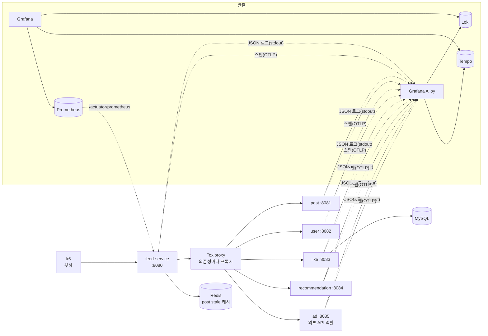
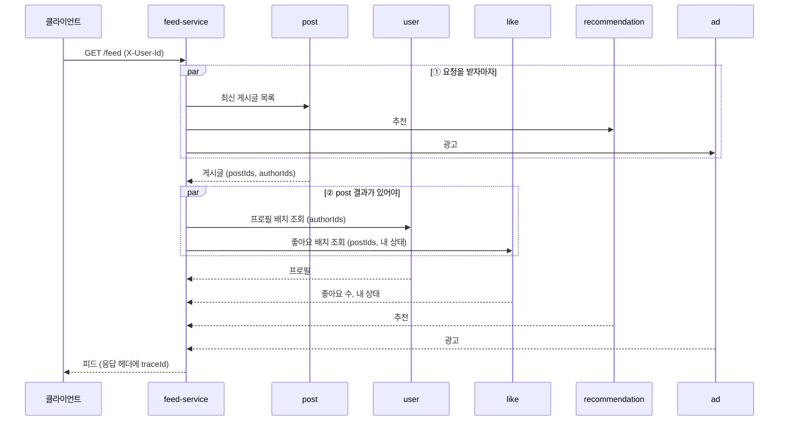
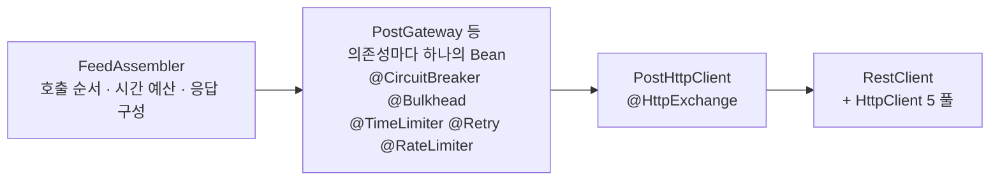

# 아키텍처

- 작성일: 2026-11-04
- 상태: 초안. 장애 대응 설정값(타임아웃, 문턱, 풀 크기)은 고도화 2의 기준선을 잰 뒤 이 문서에 근거와 함께 채운다.
- 근거: [PRD](prd.md)의 단계, SLO, 의존성 등급. 기능 ID별 세부 설계는 OpenSpec change에서 정한다.

## 1. 결정 요약

| 영역 | 결정 | 버전 |
|---|---|---|
| 언어·프레임워크 | Kotlin, Spring Boot(Spring MVC), JDK 25, Gradle Kotlin DSL 멀티 모듈 | Kotlin 2.3.21, Boot 4.1.2, Gradle 9.8.2 |
| 동시성 | Tomcat은 플랫폼 스레드. 하위 서비스 병렬 호출은 `CompletableFuture`. 가상 스레드는 고도화 3을 마친 뒤 S-02에서 한 번 비교한다(PRD F-001) | — |
| HTTP 클라이언트 | `RestClient` + Apache HttpClient 5, 그 위에 HTTP Interface(`@HttpExchange`) | HttpClient 5.6.5 (Boot BOM) |
| 장애 대응 | Resilience4j Spring Boot 4 스타터, **어노테이션 방식**. 서킷 브레이커, 벌크헤드(Semaphore·ThreadPool), TimeLimiter, Retry, RateLimiter를 모두 설정으로 연다 | `resilience4j-spring-boot4` 2.4.0 |
| 좋아요 저장 | MySQL + Spring Data JPA + Flyway | MySQL 9, Hibernate 7.4, Flyway 12.4 (Boot BOM) |
| 캐시 | post stale 캐시는 Redis(Spring Data Redis, Lettuce), user 프로필은 Caffeine 로컬 캐시 | Caffeine 3.2.4 (Boot BOM) |
| 로그 | logback + logstash-logback-encoder로 JSON 로그. Grafana Alloy가 모아 Loki로 | encoder 9.0, logback 1.5 |
| 트레이싱 | Micrometer Tracing + OpenTelemetry 브리지. 스팬은 OTLP로 Alloy를 거쳐 Tempo로 | Micrometer Tracing 1.7.2, OTel 1.62 (Boot BOM) |
| 메트릭 | Micrometer → Prometheus → Grafana | Boot BOM |
| 장애 실험 | Toxiproxy(네트워크 장애) + 앱 수준 장애 주입, 부하는 k6 | k6 2.3 |
| 실행 환경 | 실험 때는 서비스 6개와 인프라를 모두 Docker Compose로, CPU·메모리 상한을 건다. 개발 중에는 서비스 하나만 `bootRun`으로 띄워도 된다 | — |
| 테스트 | Kotest + MockK(springmockk), 하위 서비스는 WireMock, MySQL·Redis는 Testcontainers | Kotest 6.2.6, MockK 1.14.11, springmockk 5.0.1, WireMock 3.13, Testcontainers 2.0.5 |
| 린트·CI | ktlint, GitHub Actions | 하네스 구성 때 정한다 |

**호환 확인이 필요한 것:** `resilience4j-spring-boot4` 2.4.0은 Spring Boot 4.0.0으로 빌드됐다. 4.1.2에서 자동 설정과 Actuator 연동이 되는지 고도화 3의 첫 작업에서 확인한다. Spring Cloud CircuitBreaker는 Boot 4.1용 릴리스(2026.0)가 아직 RC라 쓰지 않는다.

## 2. 시스템 구성



- **feed-service는 하위 서비스를 항상 Toxiproxy를 거쳐 부른다.** MVP와 기준선에서도 같다. 장애를 넣을 때 연결 구조가 바뀌지 않아야 결과를 비교할 수 있다. 프록시는 의존성마다 하나씩 둔다(예: `toxiproxy:18081 → post:8081`).
- **서비스끼리는 HTTP로만 통신한다.** 비즈니스 DTO를 공유하는 모듈은 없고, feed-service가 하위 서비스 응답 형식을 자기 쪽에 따로 정의한다.
- **관찰 데이터는 Alloy 하나로 모은다.** 로그는 Alloy가 컨테이너 stdout을 읽어 Loki로, 스팬은 서비스가 OTLP로 Alloy에 보내 Tempo로 간다. 메트릭은 Prometheus가 각 서비스의 Actuator에서 긁어 간다.
- **서비스마다 인스턴스 하나다.** 서킷 브레이커 상태는 인스턴스 메모리에 있어서, 인스턴스가 여러 개가 되면 인스턴스마다 따로 열리고 닫힌다. 이 프로젝트에서는 다루지 않는다(PRD 8장).

## 3. 레포 구조

```
weave/
├── buildSrc/               # 컨벤션 플러그인 (kotlin, spring-service, spring-library)
├── libs/observability/     # 모든 서비스에 자동 적용되는 로그·트레이싱 설정 (7장)
├── feed-service/           # 피드 집계, 장애 대응
├── post-service/  user-service/  like-service/  recommendation-service/  ad-service/
├── docker/                 # Compose 보조 설정: alloy, grafana(대시보드·데이터 소스), toxiproxy, mysql
├── experiments/            # k6 시나리오(S-01~S-10)와 장애 설정. results/는 커밋하지 않는다
├── scripts/                # harness, git-hooks, ralph (하네스 구성 때)
├── docs/  openspec/  conventions/
└── docker-compose.yml
```

지금 있는 것은 `buildSrc/`, `libs/observability/`, 서비스 6개, `docs/`, `conventions/`이다. `docker/`, `docker-compose.yml`은 고도화 1(관찰 인프라)과 고도화 2(Toxiproxy)에서, `experiments/`는 고도화 2에서, `openspec/`과 `scripts/`는 하네스 구성 때 만든다.

## 4. 피드 요청 흐름

### 4-1. 호출 순서



- ①의 세 호출과 ②의 두 호출은 `CompletableFuture`로 병렬로 부른다.
- recommendation과 ad는 ①에서 시작해 ②가 끝날 때까지 기다릴 수 있다. 피드는 모든 호출이 끝나거나 시간 예산이 다 되면 응답한다.

### 4-2. 단계별로 달라지는 것

| 단계 | 호출을 감싸는 것 |
|---|---|
| MVP | 없음. 타임아웃은 라이브러리 기본값, 병렬 호출은 공유 스레드 풀 하나(Boot의 기본 `applicationTaskExecutor`) |
| 고도화 3 | 의존성별 타임아웃, 요청 시간 예산, ThreadPool 벌크헤드, 서킷 브레이커 |
| 고도화 4 | 등급별 fallback, 부분 응답 계약 |
| 고도화 5 | 재시도(멱등한 호출만), ad의 RateLimiter와 Retry-After |

MVP의 "공유 스레드 풀 하나 + 기본 타임아웃"은 실무에서 흔한 실수를 일부러 재현한 것이다. 하위 서비스 하나가 느려지면 공유 풀과 Tomcat 스레드가 함께 묶여 피드 전체가 느려지는 모습을 고도화 2에서 기준선으로 남긴다. 기본값(풀 크기, 큐 크기, HttpClient의 응답 타임아웃)은 `add-feed-aggregation` change에서 실제 값을 확인해 기록한다.

**MVP 기본값 (2026-11-04 확인, Spring Boot 4.1.2, HttpClient 5.6.5, Tomcat 11.0.27)**

feed-service에 용량 설정(`weave.http-client.max-connections-per-route`, `spring.task.execution.pool.*`)을 넣기 전의 값이다. 용량 설정 뒤 바뀌는 값은 오른쪽 열에 적었다(근거는 `add-feed-aggregation` design 결정 8).

| 대상 | 항목 | 기본값 | 용량 설정 뒤 |
|---|---|---|---|
| `applicationTaskExecutor` (`ThreadPoolTaskExecutor`) | 코어 스레드 | 8 | 100 |
| | 최대 스레드 | `Integer.MAX_VALUE` | 그대로 |
| | 대기열 | `LinkedBlockingQueue`, 용량 `Integer.MAX_VALUE` (사실상 무제한) | 그대로 |
| | 코어 스레드 시간 초과 허용, keep-alive | 허용(`allowCoreThreadTimeOut` true), 60초 | 그대로 |
| HttpClient 5 (그룹마다) | 자동 재시도 (`DefaultHttpRequestRetryStrategy`) | 응답이 429·503이면 1초 뒤(`Retry-After`가 있으면 그 값) 1회 다시 보낸다. 이 경우는 메서드가 멱등인지 보지 않아 토글 POST도 다시 보낸다. 응답 전에 `IOException`(연결 리셋, 응답 없음 `NoHttpResponseException` 등)이 나면 멱등한 요청(GET)만 1회 다시 보낸다. 타임아웃(`InterruptedIOException`), 호스트 이름 실패, 연결 거부, 경로 없음, SSL 오류, 연결 닫힘(`ConnectionClosedException`)은 다시 보내지 않는다 | 끔(`disableAutomaticRetries`, design 결정 3) |
| | 연결 타임아웃 (`ConnectionConfig.connectTimeout`) | 3분 | 그대로 |
| | 응답 타임아웃 | `RequestConfig.responseTimeout`과 `ConnectionConfig.socketTimeout`이 비어 있어 `SocketConfig.soTimeout` 3분이 쓰인다 | 그대로 |
| | 커넥션 풀에서 연결을 기다리는 시간 (`RequestConfig.connectionRequestTimeout`) | 3분 | 그대로 |
| | 라우트당 최대 커넥션 | 5 | 20 |
| | 전체 최대 커넥션 | 25 | 20 |
| feed-service Tomcat | 최대 스레드 | 200 | 그대로 |
| | 최소 여유 스레드, 최대 연결, accept 대기열 | 10, 8192, 100 | 그대로 |

- 대기열이 무제한이라 스레드는 코어 수를 넘지 않는다. `ThreadPoolExecutor`는 대기열이 가득 찰 때만 코어를 넘겨 스레드를 늘리기 때문이다. 최대 스레드 값은 실제로 쓰이지 않는다.
- 코어 스레드도 60초 동안 일이 없으면 내려간다. 한산한 뒤 첫 요청 몰림에는 스레드를 새로 만드는 비용이 더해진다.
- 기본 재시도가 켜져 있으면 실패한 의존성에 요청이 두 번 가고 피드가 1초 이상 늦어진다. 끊김 장애(Toxiproxy `reset_peer` 등)에서도 GET은 라이브러리가 한 번 더 보냈을 것이다. 고도화 2 이후의 결과를 라이브러리 기본 동작과 비교할 때 이 차이를 감안한다. MVP는 "재시도 없음"이어서 `add-feed-aggregation`에서 껐다(886f98e). 재시도는 고도화 5에서 멱등한 호출에만 다시 건다.
- 하위 서비스가 응답하지 않으면 호출 하나가 풀 스레드를 3분까지 붙잡는다. 커넥션 풀이 가득 차면 다음 호출은 연결을 얻으려고 다시 3분까지 기다린다.
- Spring의 `HttpComponentsClientHttpRequestFactory`에는 따로 타임아웃이 없다(`readTimeout`, `connectionRequestTimeout` 모두 -1). 위 값은 모두 HttpClient 5 자체의 기본값이다. 이 -1은 4.1에서 한 번 확인했고 테스트로 남기지 않았다(private 필드라 이름에 기대야 해서다).
- 확인 방법: feed-service의 `@SpringBootTest(webEnvironment = RANDOM_PORT)` 테스트 컨텍스트(위 속성 없음)에서 객체를 꺼내 읽었다. 스레드 풀은 `applicationTaskExecutor` Bean의 `corePoolSize`·`maxPoolSize`·`queueCapacity`와 `threadPoolExecutor.queue`, 커넥션 풀과 타임아웃은 클라이언트 Bean(`PostClient` 등)에서 객체 그래프를 따라가 찾은 `PoolingHttpClientConnectionManager`(`defaultMaxPerRoute`, `maxTotal`, 연결·소켓 설정)와 `InternalHttpClient`의 기본 `RequestConfig`, Tomcat은 `TomcatWebServer`의 커넥터 프로토콜 핸들러(`maxThreads` 등)다. 커넥션 풀을 찾는 코드는 feed-service 테스트 소스의 `HttpClientPools`에 있다. 타임아웃 3분 값들과 Tomcat 값은 `MvpTimeoutDefaultsTest`가 같은 방법으로 다시 확인한다. 코어 스레드 시간 초과와 keep-alive는 `TaskExecutorKeepAliveTest`가 `applicationTaskExecutor`의 `keepAliveSeconds`와 `threadPoolExecutor.allowsCoreThreadTimeOut()`로, 기본 재시도는 `HttpClientRetryDefaultsTest`가 `DefaultHttpRequestRetryStrategy.INSTANCE`의 `retryRequest`·`getRetryInterval`에 상태 코드 400~599를 넣어 본다. 재시도를 끈 결과(실패한 의존성에 요청 한 번)는 feed 시나리오 테스트가 본다.
- design 결정 8 표의 예상(라우트당 5, 전체 25, 코어 8, Tomcat 200)과 같아 용량 계산 비교는 그대로다.

### 4-3. 시간 예산 (초기안)

p99 300ms(PRD 2장) 안에 응답하기 위한 나눔이다. 하위 서비스의 평시 p99는 약 50ms로 둔다(PRD F-007). 아래 값은 출발점이고, 기준선을 잰 뒤 확정해 근거를 적는다.

| 구간 | 예산 (안) | 이유 |
|---|---|---|
| ① post | 100ms | 평시 p99의 2배. 넘으면 stale 캐시로 넘어간다 |
| ② user, like (병렬) | 100ms | 같은 기준 |
| recommendation, ad | 200ms | ①+② 안에 끝나면 된다. 선택 등급이라 더 기다리지 않는다 |
| 집계·직렬화와 여유 | 약 50ms | 남은 예산 |
| **전체** | **250ms** | p99 300ms에 여유 50ms |

- ②는 남은 예산 안에서만 기다린다. ①이 80ms 걸렸으면 ②에 줄 수 있는 시간은 전체 예산에서 그만큼 줄어든다.
- 하위 서비스에 남은 예산을 헤더로 넘기는 것(deadline 전파)은 다루지 않는다. 하위 서비스가 다시 다른 서비스를 부르지 않기 때문이다.

## 5. HTTP 클라이언트와 Resilience4j

### 5-1. 클라이언트 구성

- 의존성마다 `RestClient`를 따로 만들고, 각자 Apache HttpClient 5의 커넥션 풀을 가진다. 한 의존성의 커넥션 고갈이 다른 의존성에 번지지 않게 하기 위해서다.
- 의존성마다 정하는 값: 연결 타임아웃, 커넥션 획득 타임아웃(풀이 가득 찼을 때 기다리는 시간), 응답 타임아웃, 라우트당 최대 커넥션 수.
- 커넥션 풀 크기는 MVP에서도 평시 부하를 감당하도록 정한다. 보호 장치가 없다는 것은 장애 대응이 없다는 뜻이지, 평시 용량이 모자라도 된다는 뜻이 아니다. 크기는 리틀의 법칙(동시 요청 수 ≈ 초당 요청 수 × 응답시간)에 여유를 더해 정한다.
- 하위 서비스 API는 HTTP Interface(`@HttpExchange`)로 선언한다.

### 5-2. 어노테이션을 붙이는 곳



- **Resilience4j 어노테이션은 의존성별 Gateway Bean에 붙인다.** HTTP Interface 프록시에 바로 붙이지 않고, 같은 클래스 안에서 부르지 않는다(self-invocation이면 AOP가 걸리지 않는다).
- ThreadPool 벌크헤드와 TimeLimiter를 쓰는 메서드는 `CompletableFuture`를 돌려준다.
- fallback은 어노테이션의 `fallbackMethod`로 Gateway 안에 두고, 등급별 동작(6장)을 담은 결과 타입을 돌려준다.

### 5-3. 설정 구조

모든 모듈을 설정으로 연다. 공통 기본값은 `configs.default`에, 의존성별 값은 `instances.<의존성>`에 둔다. 인스턴스 이름은 `post`, `user`, `like`, `recommendation`, `ad`이다.

```yaml
resilience4j:
  circuitbreaker:
    circuit-breaker-aspect-order: 3      # 순서는 5-4
    configs:
      default:
        sliding-window-type: COUNT_BASED
        sliding-window-size: ...         # 기준선 뒤 채운다
        failure-rate-threshold: ...
        slow-call-duration-threshold: ...
        slow-call-rate-threshold: ...
        wait-duration-in-open-state: ...
        permitted-number-of-calls-in-half-open-state: ...
        automatic-transition-from-open-to-half-open-enabled: true
        record-exceptions: [ ... ]       # 5-5
        ignore-exceptions: [ ... ]
    instances:
      post: { base-config: default }
      ad: { base-config: default, ... }
  thread-pool-bulkhead:
    configs:
      default:
        context-propagators: [ ... ]     # traceId 전파 (7-3)
  bulkhead: { ... }                      # Semaphore. 비교 실험과 가상 스레드용
  timelimiter: { ... }
  retry: { ... }                         # 고도화 5
  ratelimiter: { ... }                   # ad 쿼터 (고도화 5)
```

### 5-4. 적용 순서

Resilience4j 어노테이션의 기본 순서는 바깥에서 안쪽으로 `Retry → CircuitBreaker → RateLimiter → TimeLimiter → Bulkhead → 호출`이다. 기본 순서를 쓰되 `*-aspect-order` 속성으로 명시해, 순서가 설정과 이 문서에 보이게 한다.

| 순서 (바깥 → 안) | 이렇게 둔 이유 |
|---|---|
| Retry | 재시도 한 번 한 번이 서킷 브레이커를 거쳐, 실패가 서킷에 그대로 집계되고 서킷이 열리면 재시도가 바로 멈춘다 |
| CircuitBreaker | 열려 있으면 RateLimiter, 벌크헤드 자원을 쓰기 전에 바로 실패한다 |
| RateLimiter | 쿼터는 실제로 나가는 호출에만 쓴다 |
| TimeLimiter | 벌크헤드 큐에서 기다린 시간까지 타임아웃에 포함한다. 시간 예산은 사용자가 기다리는 시간 기준이기 때문이다 |
| Bulkhead | 실제 호출을 의존성별 스레드 풀에서 돌린다 |

### 5-5. 실패 분류

| 분류 | 예외·응답 | 서킷 | 재시도 |
|---|---|---|---|
| 하위 서비스 문제 | 연결 실패, 타임아웃, 5xx | 실패로 센다 | 멱등한 호출만 (고도화 5) |
| 요청 문제 | 4xx(429 제외) | 세지 않는다 | 안 한다 |
| 속도 조절 | 429 + Retry-After (ad) | F-005 설계에서 정한다 | 안 한다. Retry-After 동안 호출하지 않는다 |
| 우리 쪽 거절 | 벌크헤드 가득 참, 서킷 열림 | 세지 않는다 | 안 한다 |

Retry-After 동안 호출을 막는 방법(서킷을 그 시간만큼 열어 두기, 별도 대기 상태 등)은 `add-retry-policy`에서 정한다.

### 5-6. 설정값을 정하는 방법

값은 기준선을 잰 뒤 아래 방법으로 정하고, 근거를 이 문서에 적는다([커밋 컨벤션](../conventions/commit.md)대로 설정값 커밋은 따로 한다).

| 값 | 정하는 방법 |
|---|---|
| 응답 타임아웃 | 4-3의 시간 예산 안에서, 기준선의 평시 p99에 여유를 더한다 |
| 느린 호출 기준 | 응답 타임아웃보다 조금 짧게. 타임아웃 전에 "느려지는 중"을 잡는다 |
| 실패율 문턱 | 평시(S-01) 실패율보다 충분히 높게. 평시에 열리면 안 된다 |
| 열림 유지 시간 | S-08의 복구 시간 목표에 맞춘다 |
| 벌크헤드 크기 | 리틀의 법칙: 실험 RPS × 그 의존성의 평시 p99 × 여유. 넘는 요청은 기다리지 않고 바로 거절한다 |

## 6. Graceful Degradation 구현

- **응답 구성:** `FeedAssembler`가 의존성별 결과(성공, 캐시 대체, 실패)를 받아 PRD 3장의 등급 표대로 피드를 만들고, 빠진 영역과 stale 여부를 응답에 담는다. 응답 형식은 `add-graceful-degradation`에서 정한다.
- **post stale 캐시:** post 호출이 성공할 때마다 결과와 저장 시각을 Redis에 쓴다. 쓰기는 응답 경로를 막지 않고, 실패해도 무시하고 메트릭만 남긴다. post가 실패하면 캐시를 읽어 10분 안의 것이면 stale로 응답하고, 아니면 503을 준다. Redis 읽기에도 짧은 타임아웃을 둔다. 대체 수단이 느려져 장애를 키우면 안 된다.
- **user 로컬 캐시:** user 호출이 성공하면 프로필을 Caffeine에 넣는다. TTL과 최대 크기는 change에서 정한다. 캐시는 인스턴스 메모리에 있으므로 재시작하면 비어 있다(S-04는 캐시가 채워진 뒤에 장애를 넣는다).
- **like `UNKNOWN`:** 좋아요 영역을 비우고 내 상태를 `UNKNOWN`으로 둔다.
- **메트릭:** 의존성별 degrade 횟수, 캐시 대체 횟수, stale 응답 수, 503 수를 남긴다.

## 7. 관찰

### 7-1. `libs/observability`가 하는 일

서비스는 의존성만 추가하면 아래가 모두 적용된다(서비스 컨벤션 플러그인이 이미 넣는다).

- `logback-spring.xml`: logstash-logback-encoder로 JSON을 stdout에 쓴다. 필드는 시각, 레벨, 서비스 이름, traceId, spanId, 로거, 메시지, 예외. 비동기 appender를 쓰고, 긴 스택 트레이스는 줄인다.
- 트레이싱: Micrometer Tracing의 OTel 브리지와 OTLP 내보내기 설정. 로컬 실험에서는 모든 요청을 수집한다(샘플링 100%).
- 응답 헤더에 traceId를 넣는 필터.
- 스레드가 바뀔 때 컨텍스트를 넘기는 설정(7-3).

### 7-2. 수집 경로

| 데이터 | 경로 | 보는 곳 |
|---|---|---|
| 로그 | 컨테이너 stdout(JSON) → Alloy → Loki | Grafana Explore. traceId로 검색 |
| 스팬 | 서비스 → OTLP → Alloy → Tempo | Grafana. 피드 요청 하나의 호출 폭포도 |
| 메트릭 | Prometheus가 `/actuator/prometheus`를 긁는다 | Grafana 대시보드 |

Grafana에서 로그의 traceId를 누르면 Tempo의 트레이스로, 트레이스에서 로그로 이동하도록 데이터 소스를 연결한다. 데이터 소스와 대시보드는 `docker/grafana/`에 파일로 두고 자동으로 불러온다.

### 7-3. 스레드가 바뀔 때의 traceId

traceId는 스레드에 붙은 컨텍스트(MDC, 관찰 컨텍스트)에 있어서, `CompletableFuture`나 벌크헤드 스레드 풀로 일이 넘어가면 그냥은 따라가지 않는다. 고도화 1에서 MVP의 공유 스레드 풀에, 고도화 3에서 ThreadPool 벌크헤드에 각각 전파를 붙이고, 끊기지 않는 것을 테스트로 확인한다.

| 넘어가는 곳 | 방법 (후보) |
|---|---|
| Spring `TaskExecutor` | `ContextPropagatingTaskDecorator` |
| Resilience4j ThreadPool 벌크헤드 | `context-propagators` 설정에 MDC·관찰 컨텍스트 전파 클래스 등록 |
| 직접 만든 `Executor` | Micrometer Context Propagation으로 감싼다 |

### 7-4. 대시보드

피드 SLO(가용성, p50·p95·p99), 의존성별 degrade 비율, 서킷 상태, 벌크헤드 사용량·거절, 커넥션 풀 사용량, Tomcat 스레드 사용량을 한 화면에 둔다. 실험 리포트의 그래프도 이 대시보드에서 뜬다.

## 8. 좋아요 저장

| 테이블 (안) | 열 | 제약 |
|---|---|---|
| `post_like` | `user_id`, `post_id`, `created_at` | `(user_id, post_id)` 유니크 |
| `post_like_count` | `post_id`, `like_count` | `post_id` 기본 키 |

- MVP는 토글 API로, 누르면 행이 있는지 보고 넣거나 지우며 좋아요 수를 엔티티로 읽어 고친 뒤 저장한다. 고도화 6에서 이 방식이 동시 요청과 재시도에서 깨지는 것(갱신 유실, 중복)을 재현한다.
- 고도화 6에서 바꿀 때 다룰 것:
  - 좋아요 수는 엔티티를 읽고 고치지 않고 원자적 UPDATE(`@Modifying` 쿼리)로 바꾼다. 원자적 UPDATE 뒤 영속성 컨텍스트에 남은 옛 값을 비운다.
  - 유니크 제약 위반은 "이미 반영된 요청"으로 처리한다.
  - 늦게 도착한 재시도가 최근 결과를 덮어쓰지 않게 하는 방법(`@Version`, 요청 시각 등)을 정한다.
  - 좋아요 수와 실제 행 수가 어긋났는지 검사하는 쿼리를 둔다.
  - 인기 글 몰림(PRD S-11): 읽고 고쳐 저장하기, 원자적 UPDATE, 카운터 분할(`post_like_count`를 게시글당 N개 행으로 나누고 쓸 때 하나를 골라 더하고, 읽을 때 합친다)을 같은 몰림 부하로 비교해 처리량, p99, 잠금 대기, 수 불일치를 잰다. 모아서 반영하기는 PRD 8장의 비동기 집계로 보고 다루지 않는다.
- 스키마는 Flyway로 관리한다.

## 9. 장애 실험 환경

### 9-1. Docker Compose

| 대상 | 자원 상한 (안) | 메모 |
|---|---|---|
| feed-service | CPU 2, 메모리 1GB | Tomcat 최대 스레드 수를 명시한다 |
| 하위 서비스 5개 | 각 CPU 1, 메모리 512MB | |
| MySQL, Redis, Toxiproxy | 각 CPU 1 | |
| Alloy, Loki, Tempo, Prometheus, Grafana | 상한만 걸고 실험 대상에서 뺀다 | |

실험 결과가 노트북 상태에 흔들리지 않도록, S-01을 돌려 호스트 CPU가 여유 있는 부하를 실험 RPS로 정한다. 시작값은 200 RPS, 시나리오당 준비 1분 + 측정 5분으로 두고 기준선에서 조정한다.

### 9-2. 장애 주입

| 수준 | 방법 | 쓰는 시나리오 |
|---|---|---|
| 네트워크 | Toxiproxy의 latency, timeout(무응답), reset_peer(끊김), bandwidth | S-02, S-03, S-04(다운) |
| 앱 | 하위 서비스의 실험 전용 Actuator 엔드포인트로 지연 분포, 에러율을 켜고 끈다. 실험 프로필에서만 열린다 | S-01(평시 지연), S-05, S-09 |
| 외부 API | ad가 429와 Retry-After, 쿼터 초과를 흉내 낸다 | S-07 |

### 9-3. 실험 세트

- `experiments/scenarios/`에 시나리오마다 k6 스크립트와 장애 설정을 둔다. 판정 기준(PRD 2장 SLO)은 k6 threshold로 적는다.
- 명령 하나로 장애를 넣고, 부하를 주고, 장애를 거두고, 리포트를 남긴다. 명령은 `add-fault-experiments`에서 만들고 [하네스 규칙](../conventions/harness.md) 5장에 적는다.
- 원본 결과는 `experiments/results/`에 두고 커밋하지 않는다. 요약은 PR 설명과 문서에 적는다.

## 10. 테스트

| 종류 | 도구 | 무엇을 |
|---|---|---|
| 단위 | Kotest, MockK | 시간 예산 계산, 등급별 응답 구성, 실패 분류 |
| 통합 | Kotest Spring 확장, WireMock, Testcontainers(MySQL, Redis) | 하위 서비스의 지연·5xx·끊김을 WireMock으로 흉내 내 서킷 전이와 fallback 확인, 좋아요 동시성 |
| 속성 기반 | Kotest property(`checkAll`) | 좋아요: 어떤 순서의 중복·재시도 요청이 와도 최종 상태가 마지막 의도와 같다 |
| 실험 | k6, Toxiproxy | PRD 4장 시나리오 |

- 단위와 통합은 Kotest 태그로 나눈다. Stop 훅은 단위만, CI는 둘 다 돌린다.
- 테스트 이름에 기능 ID를 넣고, 기능 ID로 거르는 방법은 하네스 구성 때 정한다(Kotest는 Gradle `--tests`로 중첩 테스트를 거르기 어렵다).
- 시간에 따라 바뀌는 검증(서킷이 결국 닫힌다)은 `eventually`로 쓴다.

## 11. 설정과 비밀

| 무엇 | 어디에 |
|---|---|
| 장애 대응 설정값, 시간 예산, 캐시 TTL | 서비스의 `application.yml`. 실험마다 바꿀 값은 환경 변수로 덮어쓸 수 있게 한다 |
| 실행 환경별 차이(로컬 `bootRun`과 Compose의 주소) | Spring 프로필 `local`, `docker`. 실험 전용 엔드포인트는 `experiment` 프로필 |
| MySQL 계정 | `.env` (커밋하지 않음). 이름과 설명만 `.env.example`에 |

## 12. OpenSpec change로 넘길 것

| change | 이 문서에서 가져갈 것 |
|---|---|
| `add-feed-aggregation` (F-006) | 4-1 호출 순서, 4-2 MVP 구성과 기본값 기록, 5-1 클라이언트 구성, 8장 토글 좋아요 |
| `add-trace-logging` (F-004) | 7장 전체, Compose의 관찰 인프라 |
| `add-fault-experiments` (F-007) | 9장, 기준선 기록, 4-3과 5-6을 채울 측정 |
| `add-call-isolation` (F-001) | 5-2 ~ 5-6, 7-3의 벌크헤드 전파, Resilience4j 4.1.2 호환 확인, 가상 스레드 + Semaphore 벌크헤드 비교(S-02) |
| `add-graceful-degradation` (F-002) | 6장 |
| `add-retry-policy` (F-005) | 5-5의 429 처리, Retry·RateLimiter 설정 |
| `add-idempotent-like` (F-003) | 8장의 고도화 6 항목(카운터 방식 비교 포함), 10장의 속성 기반 테스트 |

## 13. 남은 것

- 4-3 시간 예산과 5-6 설정값: 기준선 뒤
- 실험 RPS와 실행 시간: S-01로 정한다
- user 로컬 캐시 TTL·크기, post 캐시 키 구조: `add-graceful-degradation`
- 429와 Retry-After 처리 방식: `add-retry-policy`
- 좋아요 순서 판단 방법: `add-idempotent-like`
- S-11의 몰림 부하 크기와 카운터 분할 수: `add-idempotent-like`
- 가상 스레드 비교의 구성(풀 크기를 Semaphore 상한으로 어떻게 옮길지): `add-call-isolation`
