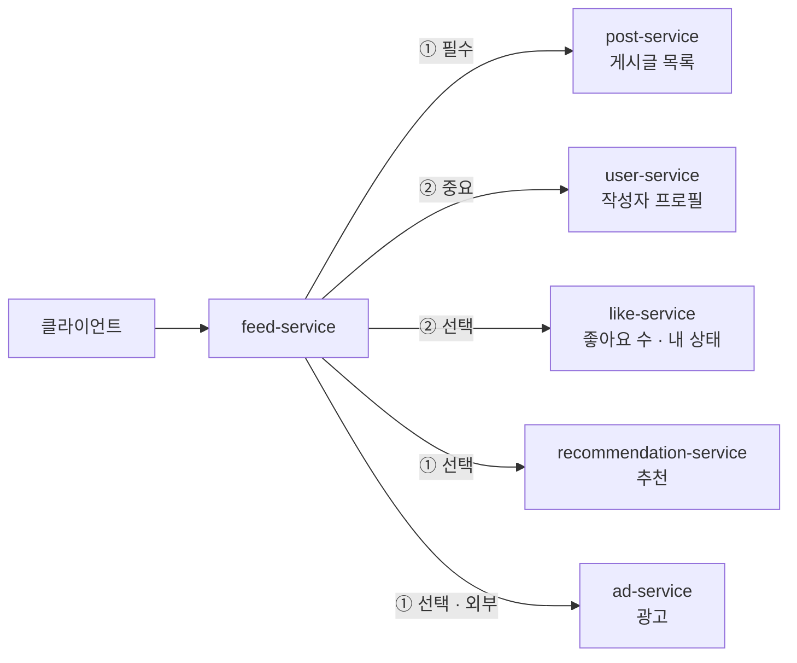

# PRD

- 작성일: 2026-11-04
- 상태: 초안. MVP와 고도화 단계의 기능과 수용 기준은 이 문서가 기준이다.
- 역할: [스펙 관리 규칙](../conventions/spec.md)에 따라 "왜, 무엇을, 어디까지"를 다룬다. 시스템 동작 스펙(요구사항, WHEN/THEN 시나리오, 설계)은 기능 ID별 OpenSpec change에서 쓴다.

## 1. 개요

> 하위 서비스 일부가 느려지거나 죽어도 피드는 SLO 안에서 응답하고, 실패한 부분만 빠진다. 좋아요는 재시도와 중복 요청에도 정확하다.

여러 하위 서비스에서 데이터를 모아 피드를 구성할 때, 하위 서비스 하나의 장애가 피드 전체 장애로 번지지 않도록 격리한다. 실무 수준의 설정과 근거, 측정으로 이를 증명하는 것이 목표다.
위 문장은 고도화를 모두 끝냈을 때의 모습이다. MVP는 보호 장치 없이 동작하는 피드이고, 고도화에서 장애를 재현해 MVP가 무너지는 모습을 기록한 뒤 하나씩 고친다.

| 항목 | 내용 |
|---|---|
| MVP | 보호 장치 없이 하위 서비스를 불러 피드를 만든다 |
| 고도화 목표 | 1. Resilience4j 서킷 브레이커·벌크헤드로 하위 서비스 장애 격리 2. 의존성 등급별 Graceful Degradation 3. 상태 기반 API와 멱등성으로 좋아요 정합성 보장 4. logback 기반 traceId 로그 수집 |
| 피드 | 최신 게시글 목록(작성자 프로필, 좋아요 수와 내 좋아요 상태 포함) + 추천 섹션 + 광고 영역 |
| 구성 | 피드 집계 서비스 1개, 하위 서비스 5개, 공통 관찰 라이브러리 ([README](../README.md)) |
| 검증 | 장애 실험 세트: Toxiproxy로 장애를 넣고 k6로 부하를 줘 SLO로 판정한다 ([하네스 규칙](../conventions/harness.md) 2-3) |
| 빠지는 것 | API Gateway, 인증, 메시지 큐, 개인화 랭킹 등 (8장) |

### 사용하는 사람

| 사람 | 바라는 것 |
|---|---|
| **피드 사용자** (클라이언트 앱) | 하위 서비스가 아파도 피드가 빨리 뜨고, 빠진 부분은 빠졌다고 알 수 있다. 좋아요를 누른 결과가 정확하다 |
| **운영자** (on-call 백엔드 개발자) | 장애가 피드 전체로 번지지 않는다. 무엇이 왜 실패했는지 traceId 하나로 찾고, 서킷 상태와 degrade 비율을 지표로 본다 |

### 단계

"문제 → 측정 → 해결 → 재측정" 순서로 간다. MVP를 먼저 만들고, 고도화 2에서 장애를 넣어 MVP가 무너지는 모습을 기준선으로 남긴 뒤, 고도화 3부터 하나씩 고치며 같은 시나리오로 다시 잰다.

| 단계 | 하는 일 | 기능 |
|---|---|---|
| **MVP** | 하위 서비스 최소 API와, 보호 장치 없는 피드 집계. 좋아요는 토글 API로 둔다 | F-006 |
| 고도화 1 | logback 기반 traceId 로그 수집. 다음 단계에서 무엇이 왜 무너졌는지 보려면 먼저 있어야 한다 | F-004 |
| 고도화 2 | 장애 주입과 장애 실험 세트. MVP가 장애에 무너지는 모습을 기준선으로 기록한다 | F-007 |
| 고도화 3 | 타임아웃·시간 예산, Resilience4j 서킷 브레이커·벌크헤드 | F-001 |
| 고도화 4 | 의존성 등급별 Graceful Degradation | F-002 |
| 고도화 5 | 재시도와 외부 API 정책 | F-005 |
| 고도화 6 | MVP의 토글 좋아요가 재시도·중복에 깨지는 것을 재현하고, 상태 기반 API와 멱등성으로 바꾼다. 인기 글에 좋아요가 몰릴 때의 카운터 갱신 방식을 비교한다 | F-003 |

## 2. SLO와 성공 기준

고도화가 끝났는지는 아래 SLO와 4장의 장애 시나리오로 판정한다. MVP는 SLO를 지키지 않아도 되고, 지키지 못하는 모습을 고도화 2에서 기준선으로 기록한다.

| 지표 | 목표 | 재는 법 |
|---|---|---|
| 피드 가용성 | **99.9%** | 피드 응답 중 200 비율. 부분 응답(degraded)도 성공으로 센다 |
| 피드 응답시간 | **p99 300ms 이하** | 장애 시나리오 중에도 지킨다. 503 응답도 이 안에 나가야 한다 |
| degrade 비율 | **평시 1% 미만** | 응답 중 빠진 영역이 있는 비율. 의존성별로 따로 잰다. 장애 시나리오에서는 그 의존성의 실패만큼 오르는 것이 정상이다 |

- 시나리오마다 같은 부하(RPS는 아키텍처 문서에서 정한다)로 정해진 시간 동안 돌려 위 지표를 잰다.
- 보호 장치가 없는 MVP를 고도화 2에서 기준선으로 재서 기록한다. 이후 고도화 단계마다 같은 시나리오로 다시 재서 기준선과 비교한다.
- 부분 응답을 성공으로 세는 이유: 선택 등급의 장애가 가용성 예산을 깎지 않아야 등급을 나눈 의도와 맞는다. 대신 degrade 비율을 따로 보며, 평시에 부분 응답이 나오면 그 자체를 설정 오류로 본다.

## 3. 의존성 등급

### 등급 정의

| 등급 | 뜻 | 실패하면 |
|---|---|---|
| 필수 | 없으면 피드가 의미 없다 | 대체 데이터로 버티고, 그것도 없으면 피드가 실패한다 |
| 중요 | 없으면 피드의 품질이 떨어진다 | 대체 데이터나 자리 표시로 채우고 피드는 응답한다 |
| 선택 | 없어도 피드의 핵심은 그대로다 | 해당 영역을 빼고 피드는 응답한다 |

### 서비스별 등급

①은 요청을 받자마자 부르고, ②는 post 결과(게시글 ID, 작성자 ID)가 있어야 부른다.

| 서비스 | 등급 | 실패 시 피드 동작 |
|---|---|---|
| post | 필수 | post-service의 마지막 정상 응답을 캐시(Redis)에 두고, **10분** 안의 것이면 stale로 표시해 응답한다. 캐시가 없거나 10분이 넘었으면 503으로 응답한다 |
| user | 중요 | feed-service의 로컬 캐시에 있는 프로필로 채운다. 캐시에 없으면 "알 수 없는 사용자"로 표시한다 |
| like | 선택 | 좋아요 수를 빼고, 내 좋아요 상태를 `UNKNOWN`으로 내려 클라이언트가 버튼을 비활성화하게 한다 |
| recommendation | 선택 | 추천 섹션을 뺀다 |
| ad | 선택 (외부 API) | 광고 영역을 뺀다. 재시도하지 않고, 429의 Retry-After 동안은 호출하지 않는다 |

- **ad만 외부 API다.** 우리가 고칠 수 없고, 요청 한도(쿼터)가 있으며, 429와 Retry-After로 속도를 조절한다. 내부 서비스와 다른 정책을 쓰는 대상이다(F-005).
- **like의 `UNKNOWN`:** 좋아요 수만 숨기면 사용자는 실제와 다른 상태를 보고 다시 누를 수 있다. 상태를 모른다고 알려서 사용자가 의도와 반대로 바꾸는 일을 막는다(F-003과 이어진다).

## 4. 장애 시나리오

장애 실험 세트(F-007)로 만들 시나리오다. 고도화가 끝나면 피드 요청을 재는 시나리오(S-01~S-09)에서 2장의 SLO(가용성 99.9%, p99 300ms)를 지켜야 한다. S-10, S-11은 좋아요 정합성 시나리오라 각자의 기대 동작으로 판정한다. 시나리오마다 따로 기대하는 동작은 아래와 같다.

| ID | 넣는 장애 | 기대하는 동작 | 관련 기능 |
|---|---|---|---|
| S-01 | 없음 (평시) | degrade 비율 1% 미만 | 전체 |
| S-02 | recommendation 응답 3초 지연 | 추천 섹션만 빠진다. post·user·like 호출의 지연은 평시와 비슷하다 | F-001, F-002 |
| S-03 | recommendation 무응답 또는 연결 끊김 | S-02와 같고, 서킷이 열린 뒤에는 recommendation을 호출하지 않고 바로 뺀다 | F-001, F-002 |
| S-04 | user-service 다운 | 캐시에 있는 작성자는 정상 표시, 없는 작성자는 "알 수 없는 사용자". 피드는 200 | F-001, F-002 |
| S-05 | like-service 에러율 50% | 실패한 응답의 좋아요 영역만 `UNKNOWN`. 실패가 이어지면 서킷이 열린다 | F-001, F-002 |
| S-06 | post-service 다운 | 10분 안에는 stale 표시와 함께 200. 10분이 넘었거나 캐시가 없으면 503. 503도 p99 300ms 안 | F-001, F-002 |
| S-07 | ad가 429와 Retry-After 반환 | 광고 영역만 빠진다. Retry-After 동안 ad 호출 0건, 재시도 0건 | F-005 |
| S-08 | S-02~S-06의 장애를 거둔다 (복구) | 서킷이 반열림을 거쳐 닫히고, degrade 비율이 평시로 돌아온다. 돌아오는 데 걸리는 시간 목표는 기준선 뒤 정한다 | F-001 |
| S-09 | user·like 일시 5xx (짧은 순간 장애) | 재시도로 하위 서비스에 가는 요청이 정해진 비율 이상 늘지 않는다 (재시도 폭주 없음) | F-005 |
| S-10 | 같은 좋아요 요청의 중복·동시·순서 뒤바뀜. feed-service는 타임아웃으로 실패를 돌려줬지만 like-service는 이미 반영한 요청을 클라이언트가 다시 보내는 경우를 포함한다 | 최종 좋아요 상태와 좋아요 수가 사용자의 마지막 의도와 같다 | F-003, F-005 |
| S-11 | 인기 게시글 한 개에 여러 사용자의 좋아요가 몰림 | 좋아요 수가 실제 좋아요 행 수와 같다. 카운터 갱신 방식별 처리량, p99, 잠금 대기를 비교해 기록한다 | F-003 |

S-10은 부하 실험이 아니라 동시성 통합 테스트와 실험 스크립트로 확인한다. S-11은 k6로 좋아요 쓰기에 부하를 주는 실험이다. 피드 SLO가 아니라 방식 사이의 비교로 판정하므로 목표 수치는 두지 않는다. 두 시나리오는 좋아요 쓰기를 다루므로 실험 스크립트도 F-003에서 만든다. F-007의 실험 세트는 피드 요청을 재는 S-01~S-09를 다룬다.

## 5. 기능 목록

| ID | 기능 | 단계 | 관련 목표 | 관련 시나리오 |
|---|---|---|---|---|
| F-006 | 피드 집계 기본 흐름 (하위 서비스 최소 API, 보호 장치 없는 집계, 토글 좋아요) | MVP | — | 기준선의 대상 |
| F-004 | traceId 로그 수집 | 고도화 1 | 4 | 전체 (원인 추적) |
| F-007 | 장애 실험 기반 (장애 주입, Toxiproxy, k6 실험 세트, 기준선) | 고도화 2 | 전체의 검증 기반 | S-01, S-01~S-09의 실행 |
| F-001 | 하위 서비스 호출 격리 (타임아웃·요청 시간 예산, 벌크헤드, 서킷 브레이커) | 고도화 3 | 1 | S-02 ~ S-06, S-08 |
| F-002 | 등급별 Graceful Degradation (부분 응답, post stale 캐시, user 로컬 캐시) | 고도화 4 | 2 | S-02 ~ S-06 |
| F-005 | 재시도와 외부 API 정책 | 고도화 5 | 1, 3 | S-07, S-09, S-10 |
| F-003 | 좋아요 상태 기반 API와 멱등성, 인기 글 몰림의 카운터 갱신 | 고도화 6 | 3 | S-10, S-11 |

표는 단계 순서로 적었다. 기능 ID는 정한 순서대로 붙여 단계 순서와 다르다.

## 6. 기능별 수용 기준

수용 기준은 밖에서 확인할 수 있게 쓴다. 시스템이 어떻게 그렇게 하는지는 OpenSpec change에서 정한다.

### F-001. 하위 서비스 호출 격리

**유저 스토리:** 운영자로서, 하위 서비스 하나가 느려지거나 죽어도 피드 서버의 자원이 그 서비스에 묶이지 않기를 원한다. 그래야 장애가 피드 전체로 번지지 않는다.

**수용 기준**

- [ ] 하위 서비스 호출마다 연결 타임아웃과 응답 타임아웃이 있다.
- [ ] 피드 요청 하나에 전체 시간 예산이 있고, 순차 호출(post → user·like)에서 남은 예산을 넘겨 기다리지 않는다.
- [ ] 의존성마다 동시 호출 상한(벌크헤드)이 따로 있다. recommendation이 느려져도 post·user·like 호출에 쓸 자원은 줄지 않는다(S-02).
- [ ] 의존성마다 서킷 브레이커가 있다. 타임아웃, 연결 실패, 5xx는 실패로 세고, 4xx는 세지 않는다.
- [ ] 서킷이 열리면 그 하위 서비스를 호출하지 않고 바로 실패 처리해 F-002의 등급별 동작으로 넘긴다.
- [ ] 하위 서비스가 복구되면 반열림의 시험 호출을 거쳐 서킷이 닫히고, 정상 호출로 돌아온다(S-08).
- [ ] 서킷 상태 전이, 벌크헤드 거절, 타임아웃이 메트릭과 로그(traceId 포함)로 남는다.
- [ ] 벌크헤드 스레드 풀로 넘어갈 때 traceId가 끊기는 것을 먼저 테스트로 재현하고, 전파를 붙인 뒤 이어지는 것을 확인한다.
- [ ] 타임아웃, 실패율 문턱, 열림 유지 시간, 벌크헤드 크기는 설정으로 바꿀 수 있고, 값마다 근거(측정값이나 계산)가 문서에 있다.
- [ ] 격리를 마친 뒤 S-02에서 "플랫폼 스레드 + ThreadPool 벌크헤드"와 "가상 스레드 + Semaphore 벌크헤드"를 같은 부하로 한 번 비교해, 피드 p99, 격리 효과(post·user·like 호출의 지연), 자원 사용량을 기록한다. 비교 결과로 기본 구성을 바꿀지는 그때 정한다.

### F-002. 등급별 Graceful Degradation

**유저 스토리:** 피드 사용자로서, 일부 기능이 아파도 피드를 빨리 받고, 무엇이 빠졌는지 알고 싶다. 그래야 빈 화면이나 틀린 정보를 보지 않는다.

**수용 기준**

- [ ] 하위 서비스가 실패하면 3장의 등급 표대로 응답한다.
- [ ] 중요·선택 등급의 실패로는 피드가 5xx로 실패하지 않는다.
- [ ] 응답에 빠진 영역 목록과 stale 여부가 드러나, 클라이언트가 정상 응답과 구분할 수 있다.
- [ ] post가 실패하면 10분 안의 캐시로 stale 응답을 하고, 캐시가 없거나 10분이 넘었으면 503을 준다. 503도 p99 300ms 안에 나간다.
- [ ] post 캐시(Redis)가 장애여도 post-service가 정상이면 피드는 정상으로 응답한다. 캐시 쓰기 실패가 피드를 실패시키지 않는다.
- [ ] user가 실패하면 로컬 캐시의 프로필로 채우고, 없으면 "알 수 없는 사용자"로 표시한다. 캐시로 채운 경우는 빠진 영역으로 보지 않고, 캐시 대체 횟수를 메트릭으로 센다.
- [ ] like가 실패하면 좋아요 수를 빼고 내 좋아요 상태를 `UNKNOWN`으로 내린다.
- [ ] 의존성별 degrade 비율을 메트릭으로 볼 수 있고, 평시(S-01)에는 1% 미만이다.

### F-003. 좋아요 상태 기반 API와 멱등성

**유저 스토리:** 피드 사용자로서, 네트워크가 불안해 같은 요청이 여러 번 가거나 순서가 바뀌어도 좋아요가 내가 마지막에 원한 상태로 남기를 원한다.

**수용 기준**

- [ ] 좋아요는 "누름/취소" 토글이 아니라 원하는 상태(`liked: true/false`)를 보내는 API로 바꾼다. 같은 요청을 N번 보내도 결과는 한 번 보낸 것과 같다.
- [ ] 응답에는 요청 처리 뒤의 내 좋아요 상태와 좋아요 수가 있다.
- [ ] 같은 사용자의 같은 요청이 동시에 N개 와도 좋아요는 하나만 남고 좋아요 수가 맞다.
- [ ] 서로 다른 사용자가 동시에 누르면 좋아요 수가 실제 좋아요 행 수와 같다.
- [ ] 늦게 도착한 재시도 요청이 더 최근 요청의 결과를 덮어쓰지 않는다. 예) "좋아요 → 취소" 순서로 보냈는데 첫 요청의 재시도가 나중에 와도 최종 상태는 취소다. 순서를 판단하는 방법은 change 설계에서 정한다.
- [ ] MVP의 토글 API가 재시도·중복에서 깨지는 것을 먼저 테스트로 재현해 기록한다. 상태 기반 API로 바꾼 뒤 토글 API는 남기지 않는다.
- [ ] feed-service가 타임아웃으로 실패를 돌려줬지만 like-service는 이미 반영한 요청을 클라이언트가 다시 보내도, 상태와 수가 한 번 반영한 것과 같다(S-10).
- [ ] 좋아요 수와 실제 좋아요 행 수가 어긋났는지 검사하는 방법이 있다.
- [ ] 인기 게시글 한 개에 좋아요가 몰려도(S-11) 좋아요 수가 실제 좋아요 행 수와 같다.
- [ ] 좋아요 수를 고치는 방식 세 가지를 같은 몰림 부하로 비교해 처리량, p99, 잠금 대기, 수 불일치를 기록하고, 고른 방식과 이유를 문서에 적는다.
  - 읽고 고쳐 저장하기(MVP 방식, 깨지는 기준선)
  - 원자적 UPDATE(한 행에 잠금이 몰린다)
  - 카운터 분할(한 게시글의 수를 여러 행에 나눠 쓰고, 읽을 때 합친다)
- [ ] S-10, S-11의 실험 스크립트를 만들고, F-007의 실험 세트처럼 명령 하나로 돌려 결과를 리포트로 남긴다.
- [ ] 사용자는 `X-User-Id` 헤더로 식별한다(8장, 인증 제외).

### F-004. traceId 로그 수집

**유저 스토리:** 운영자로서, 피드 오류 하나를 받으면 traceId 하나로 그 요청이 거친 모든 서비스의 로그를 시간순으로 보고 싶다. 그래야 어느 하위 서비스가 왜 실패했는지 바로 안다.

**수용 기준**

- [x] 모든 서비스의 로그는 JSON이고, traceId, spanId, 서비스 이름이 들어 있다.
- [x] 피드 요청의 traceId가 모든 하위 서비스 호출로 전파된다(W3C `traceparent`).
- [x] 전파를 붙이기 전에, MVP의 공유 스레드 풀과 `CompletableFuture` 경계에서 traceId가 끊기는 것을 먼저 테스트로 재현해 기록한다. 벌크헤드 스레드 풀은 F-001에서 같은 방식으로 다룬다.
- [ ] 스레드가 바뀌는 곳(벌크헤드 스레드 풀, 비동기·병렬 호출)에서도 traceId가 끊기지 않는다. 고도화 1(`add-trace-logging`)에서 공유 스레드 풀과 `CompletableFuture`(`thenCompose` 뒤 호출 포함)를 했다. 벌크헤드 스레드 풀은 F-001에서 한다.
- [x] 피드 응답 헤더에 traceId가 있어, 클라이언트 오류 리포트와 서버 로그를 이을 수 있다.
- [x] Loki에서 traceId 하나로 6개 서비스의 로그를 시간순으로 조회할 수 있다.
- [ ] 장애 대응 이벤트(타임아웃, 서킷 전이, 벌크헤드 거절, fallback, 재시도) 로그에 traceId, 의존성 이름, 원인이 있다. 고도화 1에서 하위 서비스 호출 실패 로그(traceId, `dependency`, `cause`)를 남겼다. 서킷·벌크헤드·fallback·재시도 이벤트는 F-001, F-002, F-005에서 한다.
- [x] 로그에 요청 본문과 개인정보를 남기지 않는다.
- [x] 공통 설정은 `libs/observability` 하나에 있고, 서비스는 설정을 따로 두지 않는다.

### F-005. 재시도와 외부 API 정책

**유저 스토리:** 운영자로서, 순간 장애는 재시도로 넘기되, 재시도가 장애를 키우거나 외부 API 한도를 날리지 않기를 원한다.

**수용 기준**

- [ ] 재시도는 멱등한 호출(조회, F-003의 상태 기반 좋아요)에만 한다.
- [ ] 재시도 간격은 지수 backoff와 jitter를 쓰고, 최대 횟수가 있으며, 요청의 남은 시간 예산 안에서만 한다.
- [ ] 재시도 비율에 상한(재시도 예산)이 있어, 장애 중에 하위 서비스로 가는 요청이 정해진 비율 이상 늘지 않는다(S-09).
- [ ] 서킷이 열려 있으면 재시도하지 않는다.
- [ ] 4xx는 재시도하지 않는다.
- [ ] ad는 재시도하지 않는다. 429에 Retry-After가 있으면 그 시간 동안 ad를 호출하지 않는다(S-07).
- [ ] ad의 요청 한도(쿼터)를 넘기 전에 feed-service가 스스로 호출을 멈춘다.

### F-006. 피드 집계 기본 흐름 (MVP)

**유저 스토리:** 피드 사용자로서, 피드 API 하나로 게시글, 작성자, 좋아요, 추천, 광고가 모인 피드를 받고 싶다.

**수용 기준**

- [x] 하위 서비스마다 피드 구성에 필요한 최소 API가 있다(게시글 목록, 프로필 배치 조회, 좋아요 배치 조회와 누르기, 추천, 광고).
- [x] feed-service가 3장의 호출 흐름대로 하위 서비스를 불러 피드를 만든다. 직접 정한 타임아웃(라이브러리 기본값만 쓴다), 서킷 브레이커, 벌크헤드, 재시도, fallback은 두지 않는다. HTTP 클라이언트 라이브러리의 자동 재시도도 끈다. 고도화 2에서 이 상태를 기준선으로 잰다.
- [x] 좋아요는 누를 때마다 상태가 뒤집히는 토글 API로 두고, MySQL에 저장한다. 고도화 6에서 이 API의 문제를 재현한다.
- [x] post, user, 추천, 광고의 데이터는 서비스가 시작할 때 넣는 고정 데이터로 둔다.
- [x] 서비스 6개를 띄우면 피드 하나를 끝까지 받을 수 있고, 이를 통합 테스트로 확인한다.

### F-007. 장애 실험 기반

**유저 스토리:** 운영자로서, 장애 대응이 실제로 효과가 있는지 같은 장애를 몇 번이든 똑같이 재현해 숫자로 비교하고 싶다.

**수용 기준**

- [x] 하위 서비스의 평상시 지연 분포를 설정으로 정한다(서비스마다 p99 약 50ms를 기본으로 한다).
- [x] 앱 수준 장애(지연, 에러율)를 설정으로 켜고 끌 수 있고, 네트워크 수준 장애(지연, 끊김, 무응답)는 Toxiproxy로 넣는다.
- [x] ad는 429와 Retry-After, 요청 한도를 흉내 낼 수 있다.
- [x] 피드 요청을 재는 4장의 시나리오(S-01~S-09)마다 k6 스크립트가 있고, 판정 기준이 k6 threshold로 적혀 있다. 명령 하나로 시나리오 하나를 돌린다.
- [x] 시나리오 결과(p50·p95·p99, 가용성, degrade 비율)와 같은 구간의 서킷 상태·자원 사용량을 리포트로 남긴다. 자원 사용량에는 아래가 들어간다. 장애가 자원을 묶어 피드 전체로 번지는 모습(스레드 고갈)을 이 값으로 보인다.
  - feed-service Tomcat의 사용 중 스레드 수
  - 하위 서비스 호출 스레드 풀(MVP의 공유 풀, 고도화 3부터 의존성별 벌크헤드)의 활성 스레드 수와 대기열 길이
  - 의존성별 커넥션 풀의 사용 중·대기 수
- [x] MVP(보호 장치 없음)의 결과를 기준선으로 기록해 둔다.

## 7. 비기능 요구사항

| 항목 | 요구사항 |
|---|---|
| 성능 | 2장의 SLO를 따른다 |
| 관찰 | 서비스마다 메트릭(Prometheus)과 트레이스(Tempo)를 내보내고, 피드 SLO, 의존성별 degrade 비율, 서킷 상태, 벌크헤드 사용량을 Grafana 대시보드로 본다 |
| 설정 | 장애 대응 설정값은 코드가 아니라 설정 파일에 두고, 재배포 없이 실험마다 바꿀 수 있다 |
| 보안 | 비밀 값(DB 계정 등)은 `.env`로 두고 커밋하지 않는다. 이름과 설명만 `.env.example`에 적는다 |
| 테스트 | 시나리오(WHEN/THEN)마다 자동 테스트를 둔다. 단위 테스트와 통합 테스트(WireMock, Testcontainers)를 나눈다 ([하네스 규칙](../conventions/harness.md) 2-3) |
| 환경 | 로컬 Docker Compose(서비스 6개, MySQL, Redis, Toxiproxy, Alloy·Loki·Tempo·Prometheus·Grafana)와 JDK 25. 서비스마다 인스턴스 하나 ([아키텍처](architecture.md) 9장) |

## 8. 제외 범위

MVP와 고도화에서는 하지 않는다.

| 항목 | 이유 |
|---|---|
| API Gateway | 목표 4가지에 필요 없고, 거치는 단계가 늘어 측정이 흐려진다 |
| 인증·권한 | 좋아요의 "누가"는 `X-User-Id` 헤더로 충분하다 |
| 메시지 큐, 좋아요 수 비동기 집계(outbox, 모아서 한 번에 반영) | 정합성을 먼저 동기 방식으로 확실히 한다. 인기 글 몰림도 동기 방식(원자적 UPDATE, 카운터 분할)끼리 비교한다(F-003, S-11). 고도화 뒤의 확장 후보다 |
| 팔로우 기반 개인화, 피드 랭킹 | 피드는 최신 게시글 목록으로 둔다. 장애 격리와 관계없다 |
| 화면(프론트엔드) | 피드 API까지만 만든다. 클라이언트 동작은 응답 계약으로 표현한다 |
| 서비스 메시(Istio 등)로 하는 장애 대응 | 애플리케이션 수준(Resilience4j)의 격리를 직접 다루는 것이 목표다 |
| 서비스 여러 인스턴스, 오토스케일링, 클라우드 배포 | 서비스마다 인스턴스 하나로 실험한다. 서킷 상태가 인스턴스마다 따로라는 점은 아키텍처 문서에 적는다 |

## 9. OpenSpec change 계획

기능 ID마다 change를 만든다. 설계에 기술 스택이 들어가므로 아키텍처 문서를 정한 뒤 만든다.
아래 순서는 1장의 단계와 같고, 서로 기대는 순서다. 앞의 change가 있어야 뒤의 change를 확인할 수 있다.

| 순서 | 단계 | change (안) | 기능 | 메모 |
|---|---|---|---|---|
| 1 | MVP | `add-feed-aggregation` | F-006 | 하위 서비스 최소 API, 보호 장치 없는 피드 집계, 토글 좋아요 |
| 2 | 고도화 1 | `add-trace-logging` | F-004 | traceId 전파, JSON 로그, Loki·Grafana |
| 3 | 고도화 2 | `add-fault-experiments` | F-007 | 장애 주입, Toxiproxy, k6 실험 세트, 기준선 기록 |
| 4 | 고도화 3 | `add-call-isolation` | F-001 | 타임아웃·시간 예산, 벌크헤드, 서킷 브레이커. 비동기 경계의 traceId 전파 확인 |
| 5 | 고도화 4 | `add-graceful-degradation` | F-002 | 부분 응답 계약, post stale 캐시, user 로컬 캐시 |
| 6 | 고도화 5 | `add-retry-policy` | F-005 | 재시도 예산, ad의 Retry-After와 쿼터 |
| 7 | 고도화 6 | `add-idempotent-like` | F-003 | 토글 문제 재현, 상태 기반 API, 동시성, 순서 뒤바뀜 처리, 인기 글 몰림의 카운터 방식 비교(S-11) |

단계마다 `develop` → `main` 릴리스를 하고 태그를 붙인다. MVP가 `v0.1.0`이고 고도화 단계마다 MINOR를 올린다([브랜치 컨벤션](../conventions/branch.md)).

API와 데이터 구조는 각 change의 설계에서 정한다.

## 10. 정한 것과 남은 것

**정한 것** (2026-11-04)

| 항목 | 결정 | 이유 |
|---|---|---|
| post 실패 시 | 10분 안의 stale 캐시, 없으면 503 | 짧은 장애(배포 실패, 재시작)는 가리고, 복구 뒤 오래된 피드가 길게 남지 않게 한다 |
| user 실패 시 | 로컬 캐시, 없으면 "알 수 없는 사용자" | 프로필은 잘 바뀌지 않는다. 캐시 적중률이 degrade를 얼마나 줄이는지도 실험으로 보인다 |
| like 실패 시 | 좋아요 수 숨김, 내 상태 `UNKNOWN` | 틀린 상태를 보고 다시 눌러 의도와 반대로 바뀌는 일을 막는다 |
| 가용성 SLI | 부분 응답을 성공으로 세고, degrade 비율은 따로 잰다 | 선택 등급의 장애가 가용성 예산을 깎으면 등급을 나눈 의미가 약해진다 |
| 가용성 목표 | 99.9% | 실무에서 흔한 목표이고, 실험 구간에서 장애 대응 차이가 수치로 잘 드러난다 |
| p99 목표 | 300ms | 평시 p99(약 100~150ms)에 타임아웃 여유를 더한 값. 타임아웃과 시간 예산의 근거가 된다 |
| 평시 degrade 비율 | 1% 미만 | 장애가 없는데 부분 응답이 나오면 설정 오류다 |
| 단계 | MVP는 보호 장치 없는 피드 집계, 고도화 1~6은 목표 4가지와 그 검증 기반 (1장) | "문제 → 측정 → 해결 → 재측정"으로, 고친 것마다 효과를 기준선과 비교해 보여 줄 수 있다 |
| 기능 ID | F-001 ~ F-007 (5장) | 목표 4가지에 재시도·외부 API 정책, MVP 피드 집계, 실험 기반을 더했다 |
| 기술 스택 | [아키텍처 문서](architecture.md) 1장 | Resilience4j 어노테이션, 플랫폼 스레드 + CompletableFuture, RestClient + HttpClient 5, JPA, logstash-logback-encoder, OTel + Tempo, Kotest |
| 인기 글 몰림 | 동기 방식 세 가지(읽고 고쳐 저장하기, 원자적 UPDATE, 카운터 분할)를 비교한다. 모아서 반영하기는 8장의 비동기 집계로 보고 제외한다 (F-003, S-11) | 멱등만으로는 기본기에 그친다. 한 행에 갱신이 몰릴 때의 경합을 방식별 수치로 보인다. 카운터 분할은 큐 없이 핫 로우를 푸는 방법이라 8장 제외와 부딪히지 않는다 |
| 장애 중 좋아요 재전송 | feed-service는 실패를 돌려줬지만 like-service는 반영한 요청의 재전송을 S-10에 넣는다 | 호출 격리(F-001)의 타임아웃과 좋아요 정합성(F-003)이 실제로 만나는 지점이다 |
| 가상 스레드 | 고도화 3을 마친 뒤 S-02로 한 번 비교한다 (F-001) | 기본 구성은 플랫폼 스레드로 두되, 가상 스레드에서 격리 방식(ThreadPool → Semaphore)이 어떻게 달라지는지 수치로 답할 수 있게 한다 |
| traceId 끊김 | 전파를 붙이기 전에 끊기는 지점을 먼저 재현한다. 공유 풀과 `CompletableFuture`는 F-004, 벌크헤드는 F-001에서 한다 | 다른 기능과 같은 "문제 → 측정 → 해결" 순서다. 무엇을 고쳤는지가 테스트로 남는다 |
| 실험 리포트의 자원 사용량 | Tomcat 스레드, 호출 스레드 풀, 커넥션 풀 수치를 넣는다 (F-007) | 장애가 피드 전체로 번지는 원인(스레드 고갈)을 지연 수치만으로는 보일 수 없다 |
| S-08 복구 시간 목표 | 장애를 거둔 뒤 20초 안에 SLO를 다시 지킨다 (F-001, 2026-11-07) | MVP 기준선은 40초였다. 서킷 열림 유지 5초 + 반열림 시험 호출로 거둔 뒤 첫 10초 구간 안에 닫힐 것으로 보고, 10초 구간 하나만큼 여유를 둔다. 실험 세트는 SLO로만 판정하고 복구 시간은 결과 문서에 목표와 함께 적는다 |
| 격리 설정값 | 호출 시간 상한 post·user·like 100ms, recommendation·ad 200ms, 요청 시간 예산 250ms, 의존성별 벌크헤드 40, 서킷 최근 100호출 중 50%·열림 유지 5초 (F-001, 2026-11-07) | 기준선 측정과 계산으로 정했다. 값마다의 근거는 [아키텍처](architecture.md) 5-6 |

**남은 것** (아키텍처 문서나 change 설계에서 정한다)

- 실험 부하(RPS)와 시나리오당 실행 시간
- user 로컬 캐시 TTL, post 캐시 키 구조
- S-09의 재시도 증가 비율 상한
- S-11의 몰림 부하 크기(동시 사용자 수, RPS)와 카운터 분할 수
- F-003에서 요청 순서를 판단하는 방법(버전, 요청 시각 등)
