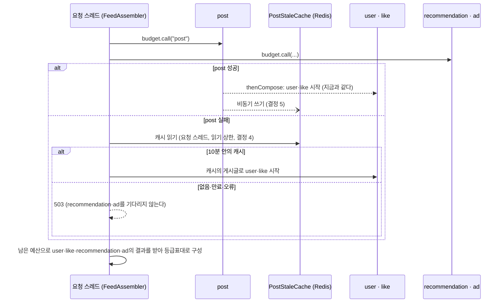

# Design

## Context

- 왜 하는지는 proposal의 Why, 지켜야 할 동작은 specs(`graceful-degradation`, `feed-aggregation`·`call-isolation`·`fault-experiments` 델타)에 있다.
- 지금 feed-service는 `FeedAssembler`가 post·recommendation·ad를 `RequestBudget.call`로 시작하고, post 결과에 `thenCompose`로 user·like를 이어 붙인 뒤 `budget.await`로 차례로 기다린다. 어느 future든 실패하면 `CompletionException`이 `FeedController`까지 올라가 500이 된다. 시간 상한, 서킷, 벌크헤드, 실패 로그(`downstream_call_failed`)는 Gateway 아래의 `IsolatedCalls` 한 곳에 있다(아키텍처 5-2).
- 아키텍처 12장 표대로 6장(Graceful Degradation 구현)을 가져가고, 5-2의 "fallback을 어디에 둘지"와 13장의 "user 로컬 캐시 TTL·크기, post 캐시 키 구조"를 여기서 정한다. 아키텍처 6장과 다르게 정한 것은 결정마다 적는다.
- 근거로 쓰는 측정값은 [고도화 3 결과](../../../docs/experiments/call-isolation.md)다. 실험 RPS 400, S-01 피드 p99 89ms, 의존성별 호출 p99 51.0~53.3ms, 호출 시간 상한 post·user·like 100ms·recommendation·ad 200ms, 요청 시간 예산 250ms.
- 실험 데이터는 고정이다. post-service는 게시글 200개(작성자 50명, `authorId = (id - 1) % 50 + 1`)를 두고 최신 목록이 늘 같다. user-service는 프로필 50개다. 피드 `size`는 1~50이고 실험 부하는 기본값 20만 쓴다.
- Compose에는 아직 Redis가 없다(아키텍처 9-1 "Redis는 post stale 캐시와 함께 F-002에서 더한다").

## Goals / Non-Goals

**Goals**

- 대체 동작이 등급표(PRD 3장) 한 곳에 모여 있고, 응답의 `degradation`이 실제로 대체한 것과 늘 맞는다.
- 대체 수단(Redis, 로컬 캐시)이 느려지거나 죽어도 피드의 시간 예산과 헬스 체크를 해치지 않는다.
- 실험 세트가 고도화 4의 개선(장애 시나리오의 가용성)을 기준으로 지키고, 평시 degrade 비율 1% 미만을 판정한다.

**Non-Goals**

- 재시도, ad의 Retry-After·쿼터(F-005), 좋아요 토글 실패 응답(F-003).
- user 프로필을 캐시에서 먼저 읽기(read-through)와 캐시 적중률 실험.
- 인스턴스 여러 개에서 user 로컬 캐시 공유(PRD 8장).

## Decisions

### 1. 대체는 `FeedAssembler`가 등급표대로 한 곳에서 한다

Gateway와 `IsolatedCalls`는 지금처럼 실패를 그대로 넘기고(실패 로그만 남긴다), `FeedAssembler`가 의존성마다의 결과를 받아 등급표대로 응답을 만든다. 대체 수단(`PostStaleCache`, `UserProfileCache`)과 대체 로그·지표는 새 패키지 `com.weave.feed.degradation`에 둔다.

- **이렇게 둔 이유:**
  - 응답의 `degradation`은 무엇을 대체했는지 알아야 만든다. Gateway나 Resilience4j fallback에서 대체하면 Assembler는 성공한 결과처럼 받아 표시할 수 없고, 대체했다는 사실을 따로 실어 날라야 한다.
  - 대체에는 요청 문맥이 필요하다. post 캐시는 `size`별이고, user 대체는 그 요청의 작성자 ID로 한다. 등급표가 한 곳에 있으면 "등급표대로 응답한다"를 Assembler 단위 테스트 하나로 본다.
  - `IsolatedCalls`의 책임(격리와 실패 로그)이 그대로다. F-005의 재시도도 그 안에 들어가고, 재시도가 다 실패한 뒤에 대체한다는 순서가 구조로 정해진다.
- **다른 안:** Resilience4j 서킷 브레이커의 fallback, Gateway가 `Result`에 대체 표시를 실어 돌려주기. 위 이유로 쓰지 않는다. 아키텍처 5-2의 "fallback을 어디에 둘지"를 이 결정으로 채운다.
- 성공한 결과를 캐시에 넣는 것도 Assembler가 한다(post 결과 → `PostStaleCache.write`, user 결과 → `UserProfileCache.putAll`). Gateway는 HTTP 호출만 안다.

### 2. 응답 계약

```json
{
  "posts": [
    {
      "id": 10, "title": "...", "content": "...", "createdAt": "...",
      "author": { "id": 3, "nickname": null, "profileImageUrl": null, "unknown": true },
      "like": { "count": null, "myLike": "UNKNOWN" }
    }
  ],
  "recommendations": [],
  "ads": [],
  "degradation": {
    "missing": ["user", "like", "recommendation", "ad"],
    "stale": [{ "section": "post", "cachedAt": "2026-11-08T01:23:45Z" }]
  }
}
```

| 정한 것 | 이유 | 다른 안 |
|---|---|---|
| `degradation`을 늘 넣는다(정상이면 빈 목록 둘) | 클라이언트가 필드 유무가 아니라 값으로 판단한다. k6 계약(`contract.js`)도 같은 방식으로 센다 | 대체했을 때만 넣기: 클라이언트가 "없음 = 정상"을 가정해야 한다 |
| `missing`은 의존성 이름 | PRD의 등급표, 로그의 `dependency`, 지표의 `section`, k6 태그가 모두 같은 이름이라 운영자가 한 이름으로 찾는다. 영역 이름(`recommendations`)과 의존성이 1:1이다 | 응답 필드 이름: user가 `posts[].author`라 이름이 맞지 않는다 |
| `stale`은 `section`과 `cachedAt`의 목록 | stale은 post뿐이지만, 클라이언트가 "몇 분 전 피드"를 보일 수 있게 시각을 준다. 목록이라 다른 영역이 stale 대체를 갖게 돼도 형식이 그대로다 | `stale: true` 하나: 시각을 따로 둬야 한다 |
| user 대체 실패는 `author.unknown: true`, `nickname`·`profileImageUrl` null | "알 수 없는 사용자"라는 표시 문구는 클라이언트의 일이다(PRD 8장: 화면은 응답 계약으로 표현한다). 정상 응답의 `unknown`은 false다. user-service가 프로필을 돌려주지 않은 작성자(정상 응답)는 지금처럼 `author: null`로 둬, "없는 사용자"와 "모르는 사용자"를 구분한다 | 서버가 `nickname: "알 수 없는 사용자"`를 넣기: 다국어·표시 정책이 서버에 들어온다 |
| like 실패는 `count: null`, `myLike: "UNKNOWN"` | "수를 뺀다"를 0이 아니라 null로 둔다. 0은 실제 값과 구분되지 않는다. `UNKNOWN`은 PRD 3장 그대로다 | `like: null`: 클라이언트가 게시글마다 null 검사를 한다 |
| recommendation·ad 실패는 빈 목록 | 영역이 빠졌는지는 `missing`이 말한다. 목록 필드를 nullable로 만들지 않는다 | null |

- 시간 표기는 지금 응답의 `createdAt`과 같은 ISO-8601 UTC다.
- 이 변경은 응답 형식을 바꾼다(BREAKING). 클라이언트는 이 프로젝트 안에서 k6와 테스트뿐이라 같은 PR에서 함께 고친다.

### 3. 의존성 결과와 요청 흐름



- **의존성마다 결과를 값으로 받는다.** `RequestBudget`에 future를 마감까지 기다려 성공 값이나 실패를 돌려주는 메서드를 둔다(지금의 `await`는 실패를 던진다). 실패에는 시간 상한, 서킷 열림, 벌크헤드 거절, 예산 초과(`TimeBudgetExhaustedException`), HTTP 오류가 모두 들어가고, 대체는 실패의 종류를 가리지 않는다(`graceful-degradation` "중요·선택 등급의 실패는 피드를 실패시키지 않는다"). 실패 로그는 지금처럼 `IsolatedCalls`나 `RequestBudget`이 한 줄 남긴다.
- **post의 결과는 요청 스레드에서 먼저 받는다.** 지금은 `posts`가 post와 user·like를 합친 future라 어느 쪽이 실패했는지 가를 수 없다. post future와 "post 뒤 user·like" future를 따로 들고, 요청 스레드가 post 결과부터 받는다.
  - 성공이면 이미 `thenCompose`로 시작된 user·like를 기다린다. 정상 경로의 지연은 지금과 같다.
  - 실패면 캐시 읽기와 그 뒤의 user·like 시작을 **요청 스레드에서** 한다. post 실패는 `isolation-timeout` 스레드(하나뿐이다)나 벌크헤드 스레드에서 끝나는데, 거기서 Redis를 기다리면 다른 호출의 시간 상한 처리가 밀린다. 요청 스레드는 어차피 응답을 기다리는 중이라 막아도 되고, MDC·trace 문맥도 그대로다.
- **503이면 recommendation·ad를 기다리지 않는다.** 피드가 실패할 것이 정해졌으니 기다릴 이유가 없다. 남은 future는 각자의 시간 상한에서 끝나고 결과는 버린다(실패 로그는 남는다).
- 응답 구성은 순수 함수로 둔다(입력: 게시글과 그 출처(정상·stale), 의존성별 결과, user 캐시 조회 결과 → 출력: `FeedResponse`와 의존성별 영역 결과). 등급표 단위 테스트는 이 함수를 본다.

### 4. post stale 캐시 (Redis)

| 항목 | 정한 것 | 이유 |
|---|---|---|
| 키 | `weave:feed:posts:latest:v1:size:{size}` | post 응답이 `size`마다 다르다(스펙 "다른 개수의 캐시는 쓰지 않는다"). 크기 20의 캐시를 잘라 5로 쓰는 안은 "마지막 정상 응답"이 아니어서 쓰지 않는다. 키 수는 `size` 범위만큼(최대 50)이다. `v1`은 값 형식을 바꿀 때 올려 옛 값을 읽지 않게 한다 |
| 값 | JSON `{"cachedAt": "<ISO-8601>", "posts": [<post-service 응답 항목>]}` | 받은 시각을 값 안에 둬 stale 판단을 feed-service 시계 하나로 한다. 항목은 feed-service의 하위 서비스 DTO(`PostResponse`) 그대로다 |
| stale 판단 | `now - cachedAt ≤ weave.post-cache.max-staleness`(10분, PRD 3장) | |
| Redis TTL | `max-staleness`와 같다 | 지난 값을 Redis가 지운다. 값 안의 `cachedAt` 검사는 설정을 줄였을 때(스펙 "환경 변수로 stale 허용 시간을 바꾼다")와 테스트 시계를 위해 둔다. 그래서 `reason` `cache_expired`는 설정을 바꾼 직후에만 보인다 |
| 읽기 | 요청 스레드에서 동기로 읽는다(결정 3). 상한은 Redis 명령 타임아웃 `spring.data.redis.timeout` | 결정 6 |
| 쓰기 | 응답 경로 밖의 전용 스레드 하나에서, 같은 키는 `weave.post-cache.write-interval`(1초)에 한 번만 쓴다. 대기열이 차면 버린다 | 결정 5 |
| 직렬화 | 서비스의 Jackson `ObjectMapper`(`tools.jackson`)로 문자열을 만들어 `StringRedisTemplate`에 넣는다 | 응답 DTO와 같은 날짜 형식을 쓴다. Spring Data Redis의 Jackson 직렬화기는 타입 정보를 값에 넣어 형식이 무거워진다 |

- **Redis 장애가 피드를 막지 않게 하는 설정:**
  - Lettuce `ClientOptions.disconnectedBehavior(REJECT_COMMANDS)`(`LettuceClientConfigurationBuilderCustomizer`). 기본값(`DEFAULT`)은 자동 재연결이 켜져 있으면 끊긴 동안의 명령을 대기열에 쌓아, 명령 타임아웃까지 기다린 뒤에야 실패한다. 끊긴 것을 아는 동안은 바로 실패한다.
  - `spring.data.redis.connect-timeout`을 명령 타임아웃과 같게 둔다. 연결이 없으면 다음 명령이 연결을 다시 맺으려 기다리는데, 패킷이 버려지는 장애에서는 이 시간이 그대로 지연이 된다.
  - `management.health.redis.enabled: false`. Redis는 선택적 대체 수단이라 feed-service 헬스(Compose healthcheck, `run.sh`의 대기)를 내리면 안 된다(스펙 "캐시 저장소가 죽었고 post는 정상").
  - 읽기·쓰기 실패는 로그 줄을 남기지 않고 지표만 센다(아키텍처 6장). 400 RPS에서 Redis가 죽으면 쓰기 실패가 초당 수백 줄이 된다. post를 대체하지 못한 요청은 `fallback_applied`(`reason` `cache_error`)가 한 줄씩 남는다.
- Redis 앞에는 서킷 브레이커를 두지 않는다. 읽기는 post가 실패했을 때만 하고 상한이 짧으며, 끊긴 동안은 위 설정으로 바로 실패한다. 서킷을 더하면 "post도 Redis도 아프다"에서 얻는 것이 수 ms뿐인데 상태가 하나 더 생긴다.

### 5. post 캐시 쓰기: 비동기, 같은 키는 1초에 한 번

- **응답 경로 밖에서 쓴다.** post 결과를 받은 스레드에서 전용 실행기(스레드 1개, 대기열 50)로 넘기고 바로 돌아간다. 대기열이 차면 버리고 `outcome` `dropped`로 센다. Redis가 멈춰 있으면(스펙 "캐시 쓰기를 기다리지 않는다") 쓰기 스레드만 명령 타임아웃마다 묶이고 피드는 기다리지 않는다.
- **같은 키는 1초에 한 번만 쓴다**(`write-interval: 1s`). 마지막으로 쓰기를 넘긴 시각을 키마다 메모리에 두고, 1초 안이면 넘기지 않는다(`skipped`는 세지 않는다. 평시에 초당 수백 번이다).
  - 근거: 400 RPS에서 매번 쓰면 초당 400번, 값 하나가 약 6KB(게시글 20개)라 초당 2.4MB를 같은 내용으로 덮어쓴다. 1초 간격이면 키(실험에서는 1개, 최대 50개)마다 초당 한 번이다. 대신 `cachedAt`이 마지막 정상 응답보다 최대 1초 이르다. stale 허용 10분의 0.17%라 판단에 영향이 없다.
  - 대기열 50은 키 수의 최댓값이다. 간격 때문에 키마다 쓰기가 1초에 하나뿐이라 정상이면 대기열에 키 수보다 많이 쌓이지 않는다. 넘친다면 Redis가 1초 넘게 응답하지 않는 것이라 버려도 된다.
- 쓰기 스레드의 실패는 `outcome` `error`로 센다.

### 6. 캐시 읽기 상한: 30ms 이하, Compose에서 재 정한다

- **시간 예산 계산으로 정한 상한:** post가 실패하는 가장 늦은 경우는 호출 시간 상한 100ms다. 그 뒤 캐시를 읽고, user·like(상한 100ms)를 불러야 한다. 예산 250ms = post 100 + 읽기 R + user·like 100 + 집계·직렬화. 고도화 3은 집계·직렬화와 여유로 50ms를 남겼다(아키텍처 4-3). 그 50ms를 읽기와 집계가 나눠, 집계에 20ms를 남기면 **R ≤ 30ms**다.
- R이 30ms보다 길면 stale 경로에서 user·like가 남은 예산에 잘려 `budget_exhausted`로 빠진다(피드는 200이지만 degrade가 늘어난다). 짧을수록 좋지만, 평시 Redis 응답의 꼬리를 자르면 stale로 대체할 수 있었던 요청이 503이 된다.
- **값은 Compose에서 잰 뒤 정한다(tasks 4.1).** S-06(post 다운, 400 RPS, 모든 요청이 캐시를 읽는다)을 명령 타임아웃 30ms로 한 번 돌려, feed-service에서 잰 Redis 읽기 지연 분포(Lettuce 명령 지연 지표, Micrometer `lettuce_command_completion_seconds`)를 본다. p99가 10ms(상한의 1/3) 이하면 30ms를 넣는다. 넘으면 값을 넣지 않고 멈춘다. 그때는 Redis 자원 상한이나 예산 배분을 다시 봐야 한다. 같은 로컬 Docker 네트워크라 p99는 1~2ms로 예상한다.
- 연결 타임아웃도 같은 값이다(결정 4).
- **측정 결과 (tasks 4.1, 2026-11-07, 이 브랜치 `5f3f3c5` 뒤 `e3f4819`, S-06 400 RPS, `20261107-130950-S-06`):** 캐시 값(타임아웃 30ms, stale 10분, 쓰기 간격 1초, user 캐시 1시간·10,000)은 `FEED_SPRING_APPLICATION_JSON`으로 주고, S-01 준비 실행(측정 1분)으로 데운 뒤 돌렸다.
  - 피드: 가용성 1(200 120,002건, 503 0), p99 63ms, post degrade(stale) 1, 나머지 의존성 0. post 캐시 읽기는 모두 `hit`.
  - Redis GET(feed-service에서 잰 `lettuce_seconds`, 측정 구간): 120,003건, p50 0.5ms, p99 1ms 미만(가장 낮은 버킷), 1.05ms 이하 99.90%, 2.10ms 이하 99.95%, 9.79ms 이하 100%. 취소(`CancellationException`)는 0건. `lettuce_seconds_max`의 201ms는 측정 구간 내내 같은 값이라 구간 밖(시작 직후 연결 수립)에서 남은 값으로 보고, 판단은 버킷으로 했다.
  - Redis 컨테이너: 400 RPS 읽기에서 CPU가 한 코어의 약 2.5~3%(상한 0.5코어), 메모리 11MiB(상한 256MiB). 본 측정 때 `docker stats`를 남기지 않아 같은 구성의 짧은 S-06(측정 40초)에서 쟀다.
  - p99가 기준(10ms) 아래라 **30ms를 넣었다.** 1ms 남짓의 평시 꼬리와 상한 사이가 30배라, 상한은 Redis가 실제로 멈췄을 때만 걸린다.
  - Lettuce 지표는 design에 적은 `lettuce_command_completion_seconds`가 아니라 Micrometer 관찰 연동의 `lettuce_seconds`(`db_operation` 태그)였고 히스토그램이 꺼져 있었다. `management.metrics.distribution.percentiles-histogram.lettuce: true`를 main 설정에 더했다(07bd35e).

### 7. user 로컬 캐시 (Caffeine)

| 항목 | 값 (안) | 근거 |
|---|---|---|
| 쓰는 때 | user 호출이 실패했을 때만 읽는다(fallback-only). 성공할 때마다 받은 프로필을 넣는다 | PRD 3장. 정상일 때는 늘 user-service의 최신 프로필을 보인다(스펙 "정상일 때는 캐시를 쓰지 않는다") |
| 유효 기간 (`expireAfterWrite`) | 1시간 | 정상 동안은 피드에 나오는 작성자가 요청마다 다시 쓰여 늘 새것이다. 그래서 유효 기간이 정하는 것은 두 가지다: (1) user-service가 죽은 뒤 몇 분까지 작성자를 채울 수 있나, (2) 장애 중에 보이는 프로필이 최대 얼마나 오래됐나. (1)은 post stale 허용(10분)보다 충분히 길어야 post와 user가 함께 아플 때 user가 먼저 바닥나지 않는다. (2)는 닉네임·사진 변경이 장애 동안만 늦게 보이는 것이라 피드 글보다 너그럽다. 10분의 여섯 배인 1시간으로 둔다. **이 값은 측정이 아니라 판단이라, change를 승인할 때 함께 확인한다** |
| 최대 크기 (`maximumSize`) | 10,000 | 메모리 계산: 항목 하나는 키(`Long`) + 프로필(ID, 닉네임 약 20자, 이미지 URL 약 60자) + Caffeine 노드로 약 0.5KB, 10,000개면 약 5MB다. feed-service 힙 최댓값(1GB 컨테이너, JVM 기본 최대 힙 25% = 256MB)의 2% 남짓이고, 고도화 3에서 잰 힙 사용 최댓값 196MB에 더해도 여유가 있다. 피드 하나에 작성자는 최대 50명(`size` 50)이라 10,000명은 최근 피드 작성자를 넉넉히 덮는다. 실험 데이터는 작성자 50명뿐이다 |
| 통계 | `recordStats()`, Micrometer `CaffeineCacheMetrics`(`cache="user-profiles"`) | 스펙 "대체 지표"의 적중·누락. 캐시는 실패했을 때만 조회하므로 `cache_gets_total`이 곧 대체 조회 수다 |

- 위 1시간과 10,000은 tasks 4.2에서 근거 주석과 함께 따로 커밋한다. 항목 크기 추정(0.5KB)은 tasks 4.2에서 힙 덤프 없이 `Runtime` 사용량 차이로 1만 개를 넣어 한 번 확인한다(단위 테스트가 아니라 한 번 재고 design에 적는다).
- 인스턴스 메모리라 재시작하면 비어 있다(아키텍처 6장). 실험은 `run.sh`가 feed-service를 다시 띄우므로 준비 구간 1분이 채운다(S-04는 준비 구간 뒤에 장애를 넣는다).

### 8. post를 대체할 수 없을 때 503

- `FeedAssembler`가 `PostsUnavailableException`(이유 `cache_miss`, `cache_expired`, `cache_error`)을 던지고, `FeedController`의 `@ExceptionHandler`가 503으로 바꾼다. 본문은 Boot 기본 오류 형식이 아니라 `{"error": "posts_unavailable"}`로 짧게 둔다(이유를 클라이언트에 줄 필요가 없고 로그에 있다). `X-Trace-Id`는 observability 필터가 늘 단다.
- `Retry-After`는 두지 않는다. 언제 복구될지 feed-service가 모른다.
- 처리된 예외라 "처리하지 못한 예외" 로그(`FeedUnhandledExceptionLogScenarioTest`)에 남지 않는다. 대신 `fallback_applied`(`unavailable`)가 한 줄 남는다.
- 시간: post 실패(최대 100ms) + 캐시 읽기(최대 30ms) + 응답. recommendation·ad를 기다리지 않아 약 130ms다(p99 300ms 안, 스펙 "503도 시간 안에 나간다").

### 9. 대체 이벤트 로그 `fallback_applied`

- 필드: `event`, `dependency`, `fallback`, post `unavailable`이면 `reason`, user면 `cacheHits`, `cacheMisses`(작성자 수). MDC의 `traceId`가 함께 간다. 요청 스레드에서 남기므로 MDC가 그대로다.
- 의존성마다 한 요청에 한 줄이다. 실패 원인은 같은 호출의 `downstream_call_failed` 줄에 있어 다시 적지 않는다. 운영자는 traceId 하나로 "왜 실패했나(`downstream_call_failed`) → 어떻게 대체했나(`fallback_applied`)"를 잇는다(PRD F-004 "장애 대응 이벤트 로그"의 fallback 부분).
- 양: 장애 중에는 요청마다 실패 의존성 수만큼 줄이 늘어 `downstream_call_failed`와 같은 규모다. 고도화 3에서 그 규모의 로그로 Loki·Alloy가 버텼다(S-02 400 RPS). 같은 실험으로 다시 본다.

### 10. 지표와 degrade의 정의

| 지표 | 태그 | 언제 센다 |
|---|---|---|
| `weave.feed.sections` | `section`(의존성 5개), `outcome`(`fresh`, `cached`, `stale`, `missing`) | 200 피드 응답마다 의존성 5개 각각 하나. 시작할 때 20개 시계열을 0으로 등록한다 |
| `weave.post.cache.reads` | `outcome`(`hit`, `expired`, `miss`, `error`) | post 실패로 캐시를 읽을 때마다 |
| `weave.post.cache.writes` | `outcome`(`success`, `error`, `dropped`) | 쓰기를 넘기거나 끝낼 때마다 |
| `cache_gets_total`, `cache_puts_total`, `cache_size` | `cache="user-profiles"` | Caffeine 통계(결정 7) |
| 503 수 | 기존 `http_server_requests_seconds_count{uri="/feed",status="503"}` | |

- **degrade는 "빠짐 또는 stale"이다.** 의존성별 degrade 비율 = (`stale` + `missing`) ÷ 그 의존성의 전체. post stale은 영역이 비지 않았지만 PRD 2장의 "빠진 영역이 있는 비율"에 넣는다. 사용자가 보는 피드가 최신이 아니고, 평시(S-01)에 stale이 나오면 설정 오류라는 판단도 같다. user를 캐시로 모두 채운 응답(`cached`)은 PRD F-002대로 degrade가 아니고, 대체 횟수로만 센다.
- user는 작성자 한 명이라도 `unknown`이면 `missing`, 모두 캐시로 채웠으면 `cached`다.
- 게시글이 없는 응답(post가 빈 목록)은 user·like를 부르지 않으니 둘 다 `fresh`로 센다.

### 11. 시계를 Bean으로 둔다

`FeedAssembler`는 지금 `Clock.systemUTC()` 기본 인자를 쓴다. stale 판단(`PostStaleCache`)과 예산이 같은 시계를 쓰도록 `Clock` Bean(`systemUTC`)을 두고 둘에 넣는다. 통합 테스트는 이 Bean을 움직일 수 있는 시계로 바꿔 "5분 전", "11분 전" 캐시를 만든다. Caffeine의 유효 기간은 `Ticker`라 같은 시계를 `Ticker`로 감싸 넣는다(스펙 "캐시 유효 기간이 지났다"는 1초 유효 기간과 실제 시간으로도 볼 수 있지만, 같은 방식으로 둔다).

### 12. 실험 세트의 바뀌는 곳

- **`k6/contract.js`:** `PARTIAL_RESPONSE = true`. 200 응답의 `degradation.missing`과 `degradation.stale[].section`을 합쳐 돌려준다(중복 없이). `feed.js`는 그대로 `degraded_sections{section}`을 세고, 영역이 하나라도 빠진 응답을 `degraded_responses`로 센다. k6 요약에 측정 구간의 `section`별 값이 나오게 지금처럼 `count>=0` 기준을 단다.
- **리포트(`run.sh`):** `degradeRatio`를 `{"post": …, "user": …, "like": …, "recommendation": …, "ad": …, "any": …}`로 바꾼다. 분모는 측정 구간의 200 응답 수(`availability` 비율의 통과 수)다. 200 응답이 없으면 "없음". `report.md`에는 의존성별 한 줄과 "하나라도" 한 줄을 적는다.
- **판정(`lib/verdict.sh`, `slo.json`):** `slo.json`에 `"degradeRatio": 0.01`을 더한다. 기대가 객체이고 `degradeRatio` 키가 있으면, 의존성 5개의 비율이 모두 `< 0.01`일 때 그 기준을 지킨 것으로 본다. 기대가 문자열(`meet`, `miss`)이면 지금처럼 가용성·p99 두 기준만이다. `criteria`·`mismatchedCriteria`에 `degradeRatio`가 들어간다. k6 threshold로는 두지 않는다(시나리오마다 다르고, 판정은 이미 `verdict.sh`가 한다).
- **기대(`expectations.json`):** `"stage": "고도화 4"`, S-01은 `{"availability": "meet", "p99": "meet", "degradeRatio": "meet"}`, S-02~S-09는 `"meet"`. 기대 파일은 구현과 같은 PR에서 바꾼다(앞서 바꾸면 develop의 실험 세트가 실패한다).
  - S-07(ad 429)과 S-09(user·like 짧은 5xx)도 F-002로 가용성을 지킨다. ad는 선택이라 빠지고, user는 캐시로, like는 `UNKNOWN`으로 대체된다. 두 시나리오가 따로 기대하는 동작(Retry-After 동안 호출 0건, 재시도 폭주 없음)은 F-005의 일이고 판정에 넣지 않는다.
- **같은 상태에서 시작한다(`run.sh`):** 장애를 되돌릴 때 `docker compose exec -T redis redis-cli FLUSHDB`로 post 캐시를 비운다. Redis가 떠 있지 않으면 비우지 않고 표준 오류에 한 줄 적은 뒤 계속한다. 캐시를 쓸 수 없는 상태가 그 실험의 조건일 수 있어서다(스펙 "모든 요청이 실패한다"). user 로컬 캐시는 feed-service 재시작이 비운다.
- **"모든 요청이 실패한다":** S-06의 준비 구간이 캐시를 채워 F-002 뒤로는 stale 200이 된다. Compose 테스트가 `docker compose stop redis` 뒤 S-06을 돌리고, 끝나면 `docker compose start redis`로 되돌린다.
- **대시보드:** degrade 행에 의존성별 degrade 비율(분모가 0이면 0으로 채운다), post 캐시 읽기 결과(초당), user 캐시로 채운 응답(초당, `outcome="cached"`), 피드 503(초당)을 둔다. 아키텍처 7-4 표의 degrade 줄을 채운다.
- **Compose(`compose.yaml`):** `redis` 서비스(`redis:8.2.2`, 태그는 tasks에서 레지스트리에 있는지 확인한다)를 `--save "" --appendonly no`(캐시라 저장하지 않는다)로 띄우고, healthcheck는 `redis-cli ping`, 자원 상한은 CPU 0.5·메모리 256MB다. 값은 키 50개 × 약 6KB로 작고, S-06의 읽기 400회/초는 Redis 한 코어 처리량(초당 수만 회)에 비해 작다. S-06에서 Redis CPU를 `docker stats`로 한 번 보고 결과 문서에 적는다. feed-service는 Redis가 healthy가 된 뒤 뜬다(`depends_on`). feed-service가 Redis 없이도 뜨지만, 실험이 처음부터 같은 조건(캐시 쓰기 가능)이게 한다. 호스트 포트는 열지 않는다. Toxiproxy 뒤에 두지 않는다(proposal "하지 않는 것").

### 13. 바뀌는 스펙 구조

- `fault-experiments`의 "기대 결과로 판정한다 (F-007)"를 지우고 "단계별 기대 결과로 판정한다 (F-007)"로 다시 넣는다. 시나리오 이름 "고도화 3의 기대"를 바꿔야 하는데 MODIFIED는 시나리오를 뺄 수 없어서다(`openspec validate`). 새 시나리오 이름은 "지금 단계의 기대"라 다음 단계부터는 MODIFIED로 내용만 고친다. degrade 기준은 설명이 500자를 넘지 않게 "degrade 비율 기준 (F-002)"으로 따로 뒀다.
- `trace-logging`의 세 시나리오는 피드 500을 오류의 예로 썼다. F-002 뒤에는 피드 조회의 하위 서비스 실패가 처리되지 않은 예외가 되지 않으므로, 처리되지 않은 예외는 좋아요 토글 실패(500)로, 오류 응답과 실패한 요청은 게시글을 대체할 수 없는 503으로 바꾼다. 요구사항의 설명은 그대로다(tasks 1.2에서 찾아 더했다).
- `feed-aggregation`의 "하위 서비스 실패는 시간 안에 피드 실패로 끝난다 (F-001)"를 지운다. 그 안의 "한 번만 요청한다" 단언은 `graceful-degradation`으로 옮겼다(재시도가 없다는 것은 F-005가 바꿀 때까지 그쪽 시나리오가 지킨다).

### 14. 설정값 위치와 덮어쓰기

feed-service `application.yml`에 근거 주석과 함께 둔다. 환경 변수나 `FEED_SPRING_APPLICATION_JSON`으로 덮어쓴다(아키텍처 11장).

| 속성 | 값 | 근거 |
|---|---|---|
| `weave.post-cache.max-staleness` | 10m | PRD 3장, 10장 |
| `weave.post-cache.write-interval` | 1s | 결정 5 |
| `spring.data.redis.timeout`, `spring.data.redis.connect-timeout` | 30ms (측정 뒤) | 결정 6 |
| `spring.data.redis.host`, `port` | Compose `redis:6379`, 로컬 `localhost:6379` | `REDIS_HOST` 환경 변수 |
| `weave.user-cache.expire-after-write` | 1h | 결정 7 |
| `weave.user-cache.maximum-size` | 10000 | 결정 7 |
| `management.health.redis.enabled` | false | 결정 4 |

값을 넣는 커밋은 종류별로 나눈다: stale 허용·쓰기 간격, Redis 타임아웃, user 캐시(커밋 컨벤션).

### 15. 테스트를 두는 곳

| 무엇 | 어디 | 방식 |
|---|---|---|
| 등급표대로 응답 구성(의존성별 결과 → 응답·영역 결과) | `FeedDegradationTest`(응답 구성 함수) | 단위 |
| post 결과 흐름(실패면 캐시, 캐시 없으면 예외, 503이면 recommendation·ad를 기다리지 않음, stale 경로의 예산) | 새 `FeedAssemblerPostFlowTest`. 기존 `FeedAssemblerBudgetTest`의 예산 초과·먼저 실패한 의존성 단언은 tasks 2.2 전에 대화형으로 "빠진다"로 바꿨다 | 단위. 가짜 Gateway와 가짜 캐시, 움직이는 시계 |
| stale 판단, 쓰기 간격·대기열 | `PostStaleCacheTest` | 단위. Redis 템플릿은 MockK |
| user 캐시 채움(전부·일부·유효 기간) | `UserProfileCacheTest` | 단위. `Ticker` |
| `graceful-degradation`의 중요·선택 등급 시나리오, 로그, 지표, 설정 덮어쓰기 | `FeedDegradationScenarioTest`, `FeedFallbackLogScenarioTest`, `FeedDegradationMetricsScenarioTest`, `FeedDegradationOverrideScenarioTest` | `Integration`. WireMock |
| post stale 캐시와 Redis 장애 | `FeedPostStaleCacheScenarioTest`, `FeedPostCacheOutageScenarioTest` | `Integration`. Testcontainers `GenericContainer("redis:8.2.2")`. 응답하지 않는 Redis는 `CLIENT PAUSE 1000 ALL`, 죽은 Redis는 듣지 않는 포트 |
| `feed-aggregation`·`call-isolation` 델타 | 기존 시나리오 테스트를 고친다 | `Integration` |
| 판정·degrade 비율 계산 | e2e `ExperimentVerdictScenarioTest`, 새 `ExperimentDegradeRatioScenarioTest` | `Integration`, 픽스처(k6 요약) |
| 같은 상태에서 시작(post 캐시), 모든 요청이 실패, 리포트 항목, S-02 degrade 비율, 대시보드 | e2e `Compose` 태그 테스트 | `./gradlew :e2e:composeTest` |

- **테스트 기본 설정:** `feed-service/src/test/resources/config/application.yml`의 Redis 주소를 듣지 않는 포트(`localhost:1`)로 둔다. Redis를 쓰지 않는 기존 테스트는 캐시 쓰기가 조용히 실패하는 상태로 돌고(그 자체가 "캐시 저장소가 죽었고 post는 정상"의 확인이다), post 실패를 다루는 테스트만 컨테이너를 띄운다. e2e `ServiceProcesses`의 feed-service 프로세스에도 같은 값을 준다.
- **`FeedAssembler` 생성자:** `FeedAssemblerTest`, `FeedAssemblerBudgetTest`(커밋됨)가 Gateway 다섯, `timeBudget`, `clock`만으로 직접 만든다. 2.3·2.4에서 더하는 매개변수(user 캐시, post 캐시, 로그·지표)는 기본값(아무것도 하지 않는 캐시, 버리는 지표 등)을 둬 이 테스트가 그대로 컴파일되게 한다.
- **기존 테스트를 고치는 작업:** 피드 500을 단언하는 커밋된 테스트(`FeedAggregationScenarioTest`, `FeedCallFailureLogScenarioTest`, `FeedCallIsolationScenarioTest`, `FeedSlowDependencyScenarioTest`, `FeedUnreachableScenarioTest` 등과 e2e 판정·Compose 테스트)는 하네스 훅이 Ralph 루프 중에 막으므로 대화형(`/opsx:apply`)으로 고친다.
- 테스트 이름에 `F-002`를 넣고, 대체 로그 테스트는 `F-004`도 넣는다. 고친 기존 테스트는 바뀐 동작의 기능 ID(`F-002`)로 이름을 바꾼다.
- Testcontainers는 feed-service에 처음 들어온다. like-service가 이미 Testcontainers(MySQL)를 쓰므로 CI에 Docker가 있다.

### 16. 영향을 받는 시나리오와 확인 방법

| 시나리오 | 고도화 3 | 고도화 4에서 기대하는 것 | 확인 |
|---|---|---|---|
| S-01 | 가용성 0.9999, p99 89ms | 그대로. 의존성별 degrade 비율 < 1%(평시 타임아웃 0.05% 수준이 degrade로 옮겨 온다) | 실험 세트(degrade 기준) |
| S-02, S-03 | 가용성 0 | 가용성 ≥ 99.9%, recommendation degrade ≈ 1, 나머지 ≈ 0. p99는 recommendation 상한 200ms 근처 | 실험 세트, 리포트의 degrade 비율 |
| S-04 | 가용성 0 | 가용성 ≥ 99.9%, user `cached` ≈ 1, user degrade ≈ 0(고정 데이터라 캐시가 다 덮는다) | 실험 세트, `weave_feed_sections_total` |
| S-05 | 가용성 0.064 | 가용성 ≥ 99.9%, like degrade ≈ 0.5~1(서킷이 열린 동안 1) | 실험 세트 |
| S-06 | 가용성 0 | 가용성 ≥ 99.9%, post degrade(stale) = 1, p99 300ms 안(post 연결 거부 + 캐시 읽기 + user·like) | 실험 세트, Redis 읽기 지연(결정 6) |
| S-07 | 가용성 0.50 | 가용성 ≥ 99.9%, ad degrade ≈ 0.5 | 실험 세트 |
| S-08 | 가용성 0.56, 복구 10초 | 가용성 ≥ 99.9%. 복구 시간은 degrade 비율이 평시로 돌아오는 시간으로 함께 본다 | 실험 세트, 10초 구간 표 |
| S-09 | 가용성 0.81 | 가용성 ≥ 99.9%. 재시도 비율은 F-005 | 실험 세트 |

결과는 `docs/experiments/graceful-degradation.md`에 고도화 3과 나란히 적는다.

## Risks / Trade-offs

- [S-01에서 평시 타임아웃(약 0.05%)이 degrade로 옮겨 와 의존성 하나에 몰리면 1%에 가까워진다] → 고도화 3의 평시 실패는 0.051%를 다섯 의존성이 나눠 가졌다. 1%와는 20배 거리다. 넘으면 실험 세트가 실패하므로 원인을 찾는다(기대를 고치지 않는다).
- [like-service의 순간 막힘(고도화 3 "남은 것")이 이제 실패 대신 degrade로 숨는다] → 가용성은 좋아지지만 S-01의 like degrade 비율로 드러난다. 결과 문서에 like degrade를 따로 적는다.
- [stale 경로에서 post 상한 100ms + 읽기 + user·like 100ms가 예산에 닿는다] → 결정 6의 상한 30ms로 예산 안에 둔다. 닿으면 user·like가 `budget_exhausted`로 빠져 200은 유지된다. S-06의 user·like degrade로 본다. S-06은 연결 거부라 post가 바로 실패해 이 경우가 드물다.
- [Redis가 죽으면 S-06 같은 post 장애에서 바로 503이 된다] → 의도한 동작이다(대체 수단도 없으면 필수 등급이 실패). Redis 장애 실험은 이 change에서 하지 않는다.
- [user 캐시 1시간·10,000은 판단과 계산이다] → 승인 때 확인하고, 실험 데이터가 고정이라 적중률로 검증하지 못한다는 것을 결과 문서에 적는다.
- [응답 형식 변경(BREAKING)] → 클라이언트는 이 레포의 k6와 테스트뿐이라 같은 PR에서 고친다.
- [Testcontainers Redis가 통합 테스트 시간을 늘린다] → Redis가 필요한 테스트 두 클래스에서만 컨테이너를 띄우고 클래스 안에서 공유한다.

## Migration Plan

- 배포 대상은 로컬 Compose뿐이다. `./gradlew bootJar` 뒤 `docker compose up -d --build --wait`가 Redis를 함께 띄운다.
- 되돌리기: change 브랜치의 커밋을 되돌린다. Redis에는 캐시뿐이라 지워도 된다(`docker compose down -v`). 하위 서비스와 좋아요 데이터는 바뀌지 않는다.
- 실험 세트의 기대(`expectations.json`)는 구현과 같은 PR에서 고도화 4로 바꾼다.

## Open Questions

- (승인 때 확인) user 캐시 유효 기간 1시간과 최대 크기 10,000(결정 7).
- (승인 때 확인) 응답 계약의 필드 이름과 형식(결정 2). 특히 `author.unknown`과 `degradation.stale`의 모양.
- (tasks 4.1에서 정한다) Redis 읽기 상한 30ms가 측정으로 맞는지(결정 6).
